# HLD — All-in-One AI Content Generator SaaS

Nov 23, 2026 · @Zin Maung Nyunt

## 0. Document control

This is version 0.7 of the High-Level Design for the All-in-One AI Content Generator SaaS, a training and portfolio project. It describes the product first, then how to build it on Laravel + Vue + Inertia + MySQL on a small DigitalOcean droplet. No code has been written and nothing in an existing repository is changed.

| Item | Value |
| --- | --- |
| Version | 0.7 (review draft, revised 23 Nov 2026) |
| Project type | Training / portfolio project, not a commercial production deployment **\[Confirmed\]** |
| Status | For owner review; remaining decisions are grouped by urgency in Part G |
| Source requirements | Main brief, Page Inventory & Dashboards addendum, Landing Page addendum, v0.2 decisions and follow-up, v0.3 decisions (G-30, G-31, G-32, production deployment), v0.4 decisions (G-9, G-21, G-22, G-11, G-3, G-13a, G-33.1–3), v0.5 decisions (G-35, G-23, G-12, G-2, G-14, G-15, G-20, G-27, G-28, G-8, G-34), v0.6 decisions (no refunds in MVP: G-12, G-15, G-36; duplicate-payment prevention), v0.7 decisions (F-Q1, F-Q2, F-Q3) and the Final Pre-Build Audit findings (F-01 to F-16) |
| Audience | Product owner, developers, AI coding assistants |

### Changes in v0.7

v0.7 applies the owner's answers to the three audit questions and resolves all 16 audit findings. Owner decisions are tagged **\[Confirmed v0.7\]**; engineering choices made to satisfy confirmed rules are tagged **\[Technical decision v0.7\]** and can be revised without changing product behaviour.

| # | Change | Effect on the design | Sections updated |
| --- | --- | --- | --- |
| F-Q1 (F-08) | **A verified email receives the signup bonus only once, recorded when the bonus is granted** \[Confirmed v0.7\] | A keyed hash of the email is written in the same transaction that grants the bonus, guarded by a unique key. This replaces the deletion-time hash, so changing email before deleting no longer re-opens the bonus. It does not stop someone registering with a different email | B1.1, B1.2, B1.4, C2, C9, D, E, F, G |
| F-Q2 (F-05) | **Users may delete their account with an open Stripe Checkout** \[Confirmed v0.7\] | Deletion commits the tombstone first, then asks Stripe to expire open sessions. Expiry is never treated as proof of non-payment. A payment that completes for a deleted account is recorded as Paid, grants no credits and raises a Critical alert for manual handling in Stripe | B1.4, B3.2, B3.5 (new), C3, C9, F |
| F-Q3 (F-11) | **All remaining credits are forfeited on deletion** \[Confirmed v0.7\] | The deletion screen shows the balance and says all credits are permanently lost with no refund. One forfeiture ledger row brings the balance to zero; earlier ledger rows are never changed | A6 U6, B1.4, C2, C3, C9 |
| F-01 (High) | **Waiting in the queue no longer counts as a generation attempt** \[Technical decision v0.7\] | Queue deliveries may repeat until the queue-wait deadline; provider execution is limited to one by persistent state, not by queue tries | B2.1, C5, C5.1 (new), E |
| F-02 (High) | **A duplicate delivery, timeout, restart or crash can never cause a second Gemini call** \[Technical decision v0.7\] | Consistent `retry_after` / timeouts, an atomic claim, and a call marker written before the HTTP request; an uncertain state fails safe without calling again | B2.1, C2, C5.1 (new), C9, E, F |
| F-03 (High) | **Queued users hold no SSE connection** \[Technical decision v0.7\] | The page polls a small status endpoint while queued and opens SSE only when processing starts; reconnects never create a new generation | A6 U2, B2.1, C6, C9, E |
| F-04 | Account deletion while a generation is streaming | Cooperative cancellation: the worker stops at the next chunk flush and the finalise step commits nothing for a cancelled generation | B1.4, B2.1, C5.1 |
| F-06 | Delayed or missing webhooks | Checkout sessions expire after 30 minutes; a scheduled reconciliation checks old Pending payments with Stripe through the same idempotent grant path | B3.2, B3.3, C1, E, C9 |
| F-07 | "Remember me" and admin 2FA | Remember me is not offered or honoured for admin accounts | A5, C7.1, C9 |
| F-09 | Ambiguous stream-replay rule | Replay only on an SSE reconnect with `Last-Event-ID` inside the 10-minute chunk window | C6 |
| F-10 | Account flows during maintenance | Verification, password reset, set-password, email-change confirmation and logout stay available | B5.7 |
| F-12 | Lock order | One order everywhere: user → wallet → payment / generation → reservation | B3.3, C3 |
| F-13 | Password reset and unverified accounts | A successful reset marks the email verified | B1.3 |
| F-14 | "Reserve 1 credit" wording | Reads "the current generation cost (default 1)" | B2.1 |
| F-15 | Indexes not listed | Key indexes added | C2 |
| F-16 | Stack versions not pinned | Laravel ^13.17, PHP ^8.3, Inertia v3, Vue 3.5 recorded | C1 |

### Changes in v0.6

| # | Decision | Effect on the design | Sections updated |
| --- | --- | --- | --- |
| G-12 | **No refund workflow in the MVP** (option C), replacing the v0.5 refund rule | No refund requests, admin refund controls, in-app refunds, credit reversals, refund ledger rows, partial-refund maths or refund status sync. The app does not process refund webhooks. A refund issued manually in the Stripe Dashboard happens outside the app and is **not synchronised** | A6, A7, A8, B3.2, B3.4 (new), C2, C3, C7.3, C7.7, C9, E, F, G |
| G-15 | **Revenue = successful payments recorded by the app**, without refund adjustments, replacing "net of refunds" | Dashboard Total Revenue sums Paid payments only; Pending and Failed never count | A7, C3, E, G |
| G-36 | **Partial refunds removed from MVP scope**; deferred with all refund handling to a future version | Moved from open decisions to future decisions (P-10) | B3, E, G |
| G-38 | **Credits purchased = credits granted from successful purchases**; nothing subtracted for refunds | Credit & Billing "Total Credits Purchased" and Dashboard "Total Credits Sold" use the same definition | A6, A7, G |
| Payments | **Duplicate-payment prevention made an explicit MVP requirement** | Purchase-request idempotency for checkout creation, Stripe idempotency keys, verified and idempotent webhooks, unique constraints and row locks so one purchase grants credits exactly once; intentional repeat purchases still work | B3.2, B3.3 (new), C2, C3, C9, G |
| Statuses | **Supported payment statuses: Pending, Paid, Failed** | Refunded / Partially Refunded removed from the app's statuses and UI | A6, C2 |
| G-37 | **Confirmed: generations already accepted into the queue before maintenance continue; new requests are blocked once maintenance is active** | Previously a recommendation; reservations are not cancelled or released because of maintenance | B5.7, E, G |
| Refund note | **Manual Stripe refunds stated as an accepted MVP limitation; Admin Adjustment no longer mentioned as a workaround** | Admin Adjustment stays a separate, unchanged feature | B3.4 |

### Changes in v0.5

| # | Decision | Effect on the design | Sections updated |
| --- | --- | --- | --- |
| G-35 | **Admins keep their own user features during maintenance**: generate, edit and save their own content; **no credit purchases** | The maintenance middleware exempts admin accounts except for checkout; admins keep full admin access. Users' maintenance rules are unchanged | A2, B5.7, C9, E |
| G-23 | **No admin-to-admin suspension or deletion in the UI**; done only with server-side Artisan commands | Admin rows show no Suspend/Delete actions; the commands keep the last-active-admin safeguard so the system can't lose all admin access | A2, A7, B5.4, C7.4, C9 |
| G-12 | **Refunds deduct the refunded credits from the available balance, never below zero** | Each refund writes one immutable ledger row recording the refund amount, credits due and credits actually deducted; idempotent per Stripe refund id | A8, B3.3 (new), C2, C3, C9, E, F |
| G-2 | **System Errors tab under Admin Activity Logs**, kept separate from admin action records | Grouped error records with privacy redaction; no content, prompts, passwords, keys or secrets | A3, A7, C7.5 |
| G-14 | **Active Users = accounts that are not suspended**; not based on login activity | Dashboard: Active and Suspended counted separately from the same status field | A7, E |
| G-15 | **Revenue is net of refunds** | Paid amounts minus refunded amounts; pending and failed payments never counted; each refund counted once | A7, B3.3, E |
| G-20 | **Maintenance blocks new registrations**; generations already running finish | Register mode, `POST /register` and new Google sign-ups refused during maintenance | A5, B1.1, B5.7, C9 |
| G-27 | **Critical errors email the admins; nothing else does** | Alert sender separate from logging, one email per incident fingerprint per 60-minute cooldown | C7.5, C9, E |
| G-28 | **Edits after generation are saved only with an explicit Save** | Auto-save happens once, at completion; later edits update the same history record in place when Save is clicked; leaving discards unsaved edits; no credits | A6, B4.2, C9 |
| G-8 | **Not intended for EU, Swiss or UK users** in the portfolio/MVP scope; stated in the Terms of Service | Not treated as a legal exemption; legal compliance and final document review are launch tasks | A4, D, G.6 |
| G-34 | **Placeholders during development; owner supplies launch content** (About, Terms, Privacy Policy, support email, social links, logo) | A launch checklist separates development placeholders from launch-ready content | A4, G.6 |

*Version history note:* the G-12 (refund deduction) and G-15 (net of refunds) rows above record what v0.5 said; both were **superseded in v0.6** and are not current requirements.

### Changes in v0.4

| # | Decision | Effect on the design | Sections updated |
| --- | --- | --- | --- |
| G-9 | **Admins have no access to users' generated content** (option C) | Admins never see generated text or prompts anywhere. They see operational metadata only: generation id, user id, template, status, timestamps, token usage, error class | A2, A3, A7, B4, B5, C2, C7.4, C7.5, C9, D, G |
| G-21 | **Admins can use all ordinary user features** (option C) with their own account and credits | Generate, history, tones, purchases and profile work for admins too. The last active admin account is protected from deletion, suspension and demotion | A2, A6, B1.4, B5.3, B5.4, C7.1, C9, G |
| G-22 | **2FA is mandatory for every admin account** (option A) | An admin account gets no session until a second factor is verified: enrolment on first login, a TOTP challenge on every login (including Google sign-in), recovery codes, and Artisan recovery if all are lost. Users don't need 2FA | A2, A3, A5, A6, B1, C2, C7.1, C9, E, F, G |
| G-11 | **System tone fields** (option A): Name (req.), Description, Style Instructions (req.), Sample Content (opt.), Active, Sort Order | System tones and custom tones are kept as separate tables and separate workflows; custom tones keep Name, Sample Content (req.), Description (opt.) | A6, A7, B5.2, C2, C4.3, G |
| G-3 | **Support email and social links in Admin Settings → General** (option A) | Edited without code changes or rebuilds; empty social links are never shown on the public site | A4, A7, C2, E, G |
| G-13a | **A deleted email never gets the signup bonus again** (option A) | A keyed one-way hash of the deleted email is kept, with no link to the account; registration and bonus-granting check it. Must be stated in the Privacy Policy | B1, C2, D, C9, G |
| G-33.1 | **Incomplete output can be copied** | No Save, no TXT export, no history, no charge | A6, B2, C6, C9 |
| G-33.2 | **Incomplete output is not restored** after leaving the Generate page | Temporary UI state only; nothing is kept for 7 days; cleared when leaving the page or starting a new generation | A6, B2, C2, C6, E |
| G-33.3 | **Failed partial output is cleared** | The streamed text disappears and a clear failure message is shown; nothing is kept; credit released | A6, B2, C6, C9 |

### Changes in v0.3

| # | Change | Sections updated |
| --- | --- | --- |
| G-30 | **Exactly one Gemini API call per generation request** in MVP/v1. No backup call to another model on failure; a failed request releases the reserved credit. The driver and scheduler stay able to support several models, backup calls or fallback strategies in a later version | A1, A4, A6, A7, A8, B2, B3, C1, C2, C4, C5, C9, C10, E, F, G |
| G-31 | **Stripe Test Mode** for the portfolio project. Test and Live Mode are selected only through environment configuration (keys, webhook secret, mode flag), with separated data and the same signature checks and idempotency in both. Credits are added only after a verified payment webhook, never from the success redirect | A8, B3.2, C2, C3, C7.3, C7.7 (new), C9, C10, E, G |
| G-32 | **Incomplete output.** The developer sets the technical `maxOutputTokens` per Gemini model (no admin or user length setting). If Gemini stops because that limit was reached (finish reason `MAX_TOKENS`), the generation is **Incomplete**: the partial text streamed so far stays on screen with a clear notice, it is not saved to Content History, the credit is released, and nothing retries automatically | A6, A7, A8, B2, B3.1, B4, C2, C4, C6, C9, E, G |
| Prod | **Production deployment responsibility is undecided and deferred.** The owner may deploy production personally or ask Claude to help; that choice is made later. Production work is not part of the current build | C7.6, C10 (new), D, G |
| Review | Removed v0.2 leftovers that conflicted: model fallback, a second model call, a server-side character cap, admin-editable max output tokens. Part G regrouped into must-decide-now, decide-during-build, Claude's technical decisions, and future production decisions | Whole document |

### Changes in v0.2

| # | Change | Effect on the design |
| --- | --- | --- |
| 1 | Contact Messages become a sub-page reached from the Admin Dashboard, with a Recent Contact Messages widget and a View All link | No new sidebar item |
| 2 | AI Providers and Provider Monitoring merged into one section | Admin sidebar goes from 10 to **9** sections; main page areas go from 18 to **17** |
| 3 | Quality validation, quality warnings and automatic quality retry removed completely | One AI attempt per request; only technical success/failure checks remain |
| 4 | Google-only accounts: set a password through the reset email; delete account by re-authenticating with Google | Password users still confirm deletion with their current password |
| 5 | AI provider: Google Gemini API only, through the owner's existing Google account | Groq and Cloudflare are not used, because each needs its own account; the driver architecture stays open for later providers. Gemini-only means no independent cross-provider fallback |
| 6 | PDF export removed; the Share feature was proposed and then removed | Export is TXT only, plus copy; content stays private to its owner |
| 7 | Hosting: DigitalOcean $6/month Basic droplet (1 vCPU, 1 GB RAM, 25 GB SSD) | Conservative PHP-FPM, one generation worker, tuned MySQL, swap, assets built off-server |
| 8 | Initial portfolio pricing: Starter 50 credits / $4.99, Standard 150 / $9.99, Business 400 / $19.99 | Seeded as editable packages; not validated commercial pricing |

### How to read the labels

Every rule carries one of these labels, so a confirmed requirement is never confused with a suggestion.

| Label | Meaning |
| --- | --- |
| **\[Confirmed\]** | Stated in your requirements or v0.2 decisions. Treat as the source of truth. |
| **\[Recommended\]** | My proposed implementation or value. You can accept or change it. |
| **\[Assumption\]** | Something I had to assume to continue. Please check it. |
| **\[Open\]** | Needs your decision. Listed with a recommendation in Part G. |
| **\[Starting value\]** | A number to begin with, configurable, to be tuned later. Not a business rule. |

### Explicitly not in the MVP (v0.2)

These were removed on purpose and must not reappear anywhere in this design: **PDF export**, **content sharing or public share links**, **content-quality validation**, **quality warnings**, **automatic quality retry**, any **extra AI call for evaluation or retry**, and (for MVP/v1) **a second or backup Gemini call per request**. **\[Confirmed\]** Production deployment and production infrastructure are also outside the current build scope (C10). **\[Confirmed v0.3\]**

## Part A — Product and Business Overview

## A1. Project overview, goals and target users

The product is a template-based AI writing platform: a user picks an admin-written template, types a topic, picks a tone and an output language, and receives exactly one piece of content, streamed as it is written. It is not a chatbot. Users never write AI instructions themselves; the template carries them. **\[Confirmed\]**

Example: template *Blog Article Writer*, prompt *What is a React component?*, tone *Friendly Expert*, language *English* produces one blog article that follows the template's instructions.

### Product goals

1. **Fast, guided content creation.** Template, prompt, tone, language, generate: no prompt engineering needed.
2. **Consistent brand voice.** System tones plus up to 20 personal custom tones learned from sample text.
3. **English and Burmese output** from an English-only interface.
4. **Fair, transparent pay-per-use.** 20 free credits after verification, 1 credit per completed generation (none for incomplete or failed ones), one-time Stripe credit packs, a full ledger of every credit movement.
5. **Reliable generation on free-tier AI APIs.** The Gemini free API behind a provider interface that can take more providers later, with fair queueing, exactly one Gemini call per request, and health tracking from real traffic.
6. **Low operating cost.** One $6/month DigitalOcean droplet, no Redis, no WebSocket server, manual deployment.

### Target users

| Segment | Typical use | What matters to them |
| --- | --- | --- |
| Individual users and content creators | Social posts, captions, blog drafts | Speed, low price per piece, simple UI |
| Businesses | Product descriptions, emails, ads, business copy | Consistent tone, Burmese output, copy and TXT export |
| Marketing teams | Campaign copy across channels | Templates per channel, history search, reusable custom tones |

&#91;Assumption\] A marketing team uses one shared account or individual accounts. Team workspaces and shared billing are out of scope for the MVP.

## A2. User roles and permissions

There are exactly two roles, User and Admin, and every admin has the same permissions. **\[Confirmed\]** Account *states* (unverified, suspended, maintenance) restrict a User further; they are not extra roles.

| Capability | Guest | User (unverified) | User (verified) | User (suspended) | User during maintenance | Admin |
| --- | --- | --- | --- | --- | --- | --- |
| View Landing Page, templates, pricing | Yes | Yes | Yes | Yes | Yes | Yes |
| Send Contact Form | Yes | Yes | Yes | Yes | Yes | Yes |
| Log in | — | Yes | Yes | **No** | Yes | Yes, **only after 2FA** **\[Confirmed v0.4: G-22\]** |
| View Dashboard, own history, own billing | — | Yes | Yes | No (cannot log in) | Yes (read-only) | Yes, own account **\[G-21\]** |
| Generate content | — | **No** | Yes | No | **No** | Yes, own credits **\[G-21\]** |
| Buy credits | — | **No** | Yes | No | **No** | Yes, own account **\[G-21\]** |
| Create / edit custom tones | — | Yes \[Assumption\] | Yes | No | No | Yes, own tones **\[G-21\]** |
| Edit, save, delete own content | — | Yes (if any) | Yes | No | **No** | Yes, own content **\[G-21\]** |
| Copy and export own content | — | Yes | Yes | No | Yes | Yes |
| Change profile, email, password | — | Yes | Yes | No | **No** | Yes |
| Delete own account | — | Yes | Yes | No | No \[Assumption\] | Yes, unless it is the **last active admin** **\[G-21\]** |
| **Read other users' generated content or prompts** | — | — | — | — | — | **Never** **\[Confirmed v0.4: G-9\]** |
| See other users' generation metadata (id, template, status, timestamps, tokens, error class) | — | — | — | — | — | Yes |
| All Admin sections | — | — | — | — | — | Yes |

**Admins during maintenance mode** **\[Confirmed v0.5: G-35\]:** admins keep full admin access and may keep using their own user features (generate, edit and save their own content, manage their own tones), but **cannot buy credits**. Ordinary users stay read-only as before. The admin privacy boundary (G-9) is unchanged: an admin's maintenance exemption applies only to their own account.

**Enforcement \[Recommended\].** Every rule above is checked on the server by middleware and Laravel Policies. The frontend only hides buttons; it is never the security boundary.

- `role` column on `users` with values `user` / `admin`. No permission tables. An admin is also a normal user of the product (own wallet, content, tones, purchases). **\[Confirmed v0.4: G-21\]**
- `EnsureVerified` middleware on generate and checkout routes. Unverified users see a persistent banner with a Resend Verification button.
- `EnsureNotSuspended` middleware on every authenticated request, so a suspension takes effect at once.
- `EnsureTwoFactorComplete` middleware on every authenticated request of an admin account: until the second factor is verified in the current session, the only reachable routes are the 2FA setup/challenge modes of `/auth` and logout. **\[Confirmed v0.4: G-22\]**
- `MaintenanceReadOnly` middleware blocks write routes for ordinary users; for admin accounts it blocks only credit checkout (G-35; see Maintenance workflow).
- **Content privacy:** `ContentPolicy` and `GenerationPolicy` allow reading prompts and generated text only to the owner. Being an admin grants nothing here, and no admin controller, resource or query selects those columns. **\[Confirmed v0.4: G-9\]**
- **Admin role management:** admins are created, promoted, demoted, suspended or deleted only with server-side Artisan commands (G-23) (`app:create-admin`, `app:demote-admin`), never in the UI. Every path that could remove the last active admin (self-deletion, deletion, suspension, demotion) is refused. **\[Confirmed v0.4: G-21 safeguard; Recommended mechanism\]**
- Admins log in through the same `/auth` page, complete 2FA, and land on `/admin`; the user area is one click away.

## A3. Main website structure and page inventory

The product has **17 main page areas**: 2 public pages, 6 User pages and 9 Admin sections. **\[Confirmed in v0.2\]** AI Providers and Provider Monitoring are now one section, and Contact Messages is a sub-page reached from the Admin Dashboard. Detail views, editors, tabs and modals sit inside those areas. Terms of Service, Privacy Policy, password reset and the Stripe success return are modals or modes of existing pages, so the public site stays at exactly two pages. There are no public share links or shared-content routes. **\[Confirmed\]**

&#91;embedded content: website sitemap · 17 main page areas\]

Public pages are open to everyone; the User area needs login; the Admin area needs the Admin role. Detail pages, tabs and modals are listed in the inventory below.

### Page and route inventory

Routes are suggestions **\[Recommended\]**. Type: **Page** = main page area, **Sub** = separate URL inside an area, **Tab**, **Modal**, **Mode** (same page, different state), **Endpoint** (no UI).

| # | Page | Route | Access | Type | Purpose | Main UI sections | Actions | Business logic |
| --- | --- | --- | --- | --- | --- | --- | --- | --- |
| P1 | Landing Page | `/` | Guest+ | Page | Explain product, convert visitors | Navbar, Hero, Features, How It Works, Templates, Pricing, About, Contact, Footer | Scroll nav, browse templates, view pricing, send contact form | Active templates/packages only; guest clicks go to `/auth` |
| P1a | Terms of Service | `/#terms` | Guest+ | Modal | Legal text | Scrollable dialog | Close | Static content |
| P1b | Privacy Policy | `/#privacy` | Guest+ | Modal | Legal text | Scrollable dialog | Close | Static content |
| P2 | Authentication | `/auth` | Guest | Page | Log in or register | Login form, Register form, Google button, switch link | Log in, register, Google login, forgot password | Fortify + Socialite; registration toggle; suspension check |
| P2a | Forgot password | `/auth?mode=forgot` | Guest | Mode | Request reset email (also how Google-only users set a first password) | Email field | Send link | Rate limited; same response whether email exists or not |
| P2b | Reset / set password | `/auth?mode=reset&token=…` | Guest | Mode | Set new password | New password, confirm | Save | Token validation; revoke all sessions |
| U1 | User Dashboard | `/dashboard` | User | Page | Overview + quick start | Stat cards, Quick Generate, Recent Content, Quick Actions, verification banner | Generate, open content, go to buy/tones | Same generation service as U2 |
| U2 | Generate Content | `/generate` (`?template=slug`) | User | Page | Full generation workspace | Template browser, prompt, tone, language, output panel | Generate, edit output, save, copy, export TXT, open in history | Verification, credit reservation, queue, SSE |
| U3 | Content History | `/content` | User | Page | Find and manage past content | Search, filters, paginated list | Search, filter, open, copy, export TXT, delete | Owner-scoped queries |
| U3a | Content Detail / Editor | `/content/{id}` | Owner | Sub | View and edit one item | Metadata, TipTap editor, toolbar | Save, copy, export TXT, delete | In-place update, sanitised HTML; owner only |
| U3b | Delete content | — | Owner | Modal | Confirm permanent delete | Prompt/title, Cancel, Delete | Delete | No refund; ledger kept |
| U4 | My Tones | `/tones` | User | Page | Manage custom tones | System tone list (read-only), My Tones list, counter (n/20) | Create, edit, delete | 20-tone limit; future generations only |
| U4a | Tone form | — | Owner | Modal | Create/edit tone | Name, Sample Content, Description | Save | Validation |
| U5 | Credit & Billing | `/billing` | User | Page | Balance and purchases | Balance cards, packages, unified transaction history | Buy package, filter history | Stripe Checkout, ledger |
| U5a | Payment return | `/billing?checkout=success\|cancel` | User | Mode | Show payment outcome | Status banner | — | Credits only from webhook |
| U6 | Profile / Settings | `/settings` | User | Page | Account management | Tabs: Profile, Email, Password, Appearance, Two-Factor (admins only), Delete Account | Update name, change email, change or set password, theme, delete | Re-verification, session revocation, Google re-auth for Google-only deletion |
| A1 | Admin Dashboard | `/admin` | Admin | Page | System overview | Stat cards, provider health strip, ops counters, chart, recent payments, recent activity, **Recent Contact Messages** | Date filter, refresh, View All Messages | Reads stored data only |
| A1a | Contact Messages | `/admin/messages` | Admin | Sub | Read contact form messages | Status filter (All / New / Read), search, list, detail drawer | Open (marks Read), mark New/Read, Reply (mailto) | No Replied status **\[Confirmed\]** |
| A2 | User Management | `/admin/users` | Admin | Page | Find users | Search, status filter, table | View, suspend, unsuspend, delete, adjust credits | Audited actions |
| A2a | User Detail | `/admin/users/{id}` | Admin | Sub | One user | Tabs: Overview, Content History (metadata only: no prompts or text), Credit Transactions, Account Activity, Admin Actions | All user actions | Mandatory reasons |
| A3 | Template Management | `/admin/templates` | Admin | Page | Templates + categories | Tabs: Templates, Categories | CRUD, activate, reorder | Cache invalidation |
| A3a | Template form | `/admin/templates/create`, `/{id}/edit` | Admin | Sub | Edit one template | Name, description, category, icon, system prompt, status, order | Save | Audit before/after |
| A4 | Tone Management | `/admin/tones` | Admin | Page | System tones | Table, form modal | CRUD, activate, reorder | Audit |
| A5 | Credit Package Management | `/admin/packages` | Admin | Page | Sell credits | Table, form modal | CRUD, activate, reorder | Price snapshot on purchase |
| A6 | Transactions | `/admin/transactions` | Admin | Page | Financial records | Tabs: Credit Ledger, Payments | Search, filter, view | Read-only |
| A7 | AI Providers (configuration + monitoring) | `/admin/providers` | Admin | Page | Configure and watch AI providers | Tabs: **Overview** (health), **Configuration** (providers, credentials, models), **Monitoring** (metrics, errors, cooldowns, usage) | Add/edit, enable/disable, prioritise, Test Connection, filter metrics, refresh | Encrypted secrets; passive health data |
| A7a | Provider detail | `/admin/providers/{id}` | Admin | Sub | One provider and its models | Credentials (masked), models, limits, recent attempts | Save, Test Connection | Audit without secrets |
| A8 | Admin Activity Logs | `/admin/activity-logs` | Admin | Page | Audit trail | Filters, log table, detail drawer | Filter, view diff | Immutable |
| A9 | System Settings | `/admin/settings` | Admin | Page | Site configuration | Tabs: General, Registration, Credits, Email, Maintenance | Save, Test Email, toggle maintenance | Future-only effect |
| — | Error Log | /admin/activity-logs?tab=errors (G-2) | Admin | Tab | Review application errors | Filters, list, grouped counts | Filter, view | No secrets logged |

**Admin two-factor modes of `/auth`** (still the same public page, so the public site stays at two pages) **\[Confirmed v0.4: G-22\]**:

| # | Mode | Route | Access | Purpose |
| --- | --- | --- | --- | --- |
| P2c | 2FA setup | `/auth?mode=two-factor-setup` | Admin after password or Google sign-in, not yet enrolled | Scan QR code, confirm a TOTP code, save recovery codes; no admin or user page is reachable before it completes |
| P2d | 2FA challenge | `/auth?mode=two-factor` | Admin after password or Google sign-in, enrolled | Enter the 6-digit code or one recovery code |

### Non-page endpoints

These have no UI. They are the only places the app steps outside normal Inertia page visits, each for a technical reason. **\[Recommended\]**

| Endpoint | Method | Why it is not an Inertia page |
| --- | --- | --- |
| `/generations` | POST (JSON) | Starts a generation and returns its id at once, so the page can open the stream without a full Inertia visit |
| `/generations/{id}/stream` | GET (SSE) | Server-Sent Events stream. **\[Confirmed\]** |
| `/generations/{id}/cancel` | POST | Lets the user cancel a queued job and get the reservation back |
| `/content/{id}/export/txt` | GET | TXT file download (owner only) |
| `/stripe/webhook` | POST | Stripe Webhooks. **\[Confirmed\]** |
| `/billing/checkout` | POST | Creates the Stripe Checkout Session, then redirects to Stripe |
| `/auth/google/redirect`, `/auth/google/callback` | GET | Socialite OAuth round trip (also used for Google re-authentication before account deletion) |
| `/email/verify/{id}/{hash}`, `/settings/email/verify/{token}` | GET | Signed verification links from emails; redirect to the dashboard with a toast |
| `/contact` | POST | Contact form submission (Inertia form post) |
| `/sitemap.xml`, `/robots.txt` | GET | SEO files (public pages only) |

Admin dashboard polling uses Inertia partial reloads (`only: ['ops']`), not a separate REST API.

## A4. Landing Page (`/`)

The Landing Page is one responsive, vertically scrolling page with nine sections. It shows real templates and real credit packages from the database, and every call to action leads to `/auth` or, for logged-in users, straight into the product. **\[Confirmed\]** No separate Features, Pricing, About, Templates or Contact pages exist.

### A4.1 Page structure

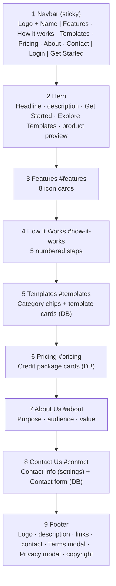

### A4.2 Section-by-section specification

**1. Navbar / Header**

- *Shows:* website logo and name from General settings; links Features, How It Works, Templates, Pricing, About, Contact; **Login** (text link); **Get Started** (primary button); theme toggle (light/dark). \[Recommended: theme toggle\]
- *Behaviour:* sticky at the top; transparent over the hero, solid background with a bottom border once scrolled. Links smooth-scroll to section anchors (`#templates` etc.) and update the URL hash; the active section is highlighted while scrolling (IntersectionObserver).
- *Logged-in visitor:* Login and Get Started are replaced by **Go to Dashboard** (or **Admin Panel** for admins). \[Recommended\]
- *CTA targets:* Login → `/auth?mode=login`; Get Started → `/auth?mode=register`. **\[Confirmed\]** If registration is disabled in settings, Get Started goes to login mode and the Register tab shows a "Registration is currently closed" note.

**2. Hero / Introduction**

- *Layout:* two columns on desktop: copy on the left, product preview on the right.
- *Shows:* headline, supporting description, **Get Started** (primary) and **Explore Templates** (secondary) buttons, and a product preview: a stylised mock of the Generate screen (template chip, prompt, tone and language pickers, an output card with text appearing line by line). The preview is built from HTML/CSS, not a screenshot, so it follows light and dark mode. \[Recommended\]
- *Draft copy \[Recommended, replace freely\]:* headline "Create on-brand content in seconds, not hours". Description: "Pick a template, describe your topic, choose a tone and language (English or Burmese), and watch your content write itself. Built for creators, businesses and marketing teams."
- *Behaviour:* Get Started → `/auth?mode=register` (logged in: `/generate`). Explore Templates → smooth scroll to `#templates`.

**3. Features** (static content)

Eight cards, each with an icon (Lucide), a title and one sentence. Grid: 4 columns desktop, 2 tablet, 1 mobile. No admin management. **\[Confirmed\]**

| Icon | Title | Description (draft) |
| --- | --- | --- |
| LayoutTemplate | Multiple Content Templates | Ready-made templates for social media, blogs, e-commerce, email, ads and business writing. |
| Palette | Custom Writing Tones | Use our tones or teach your own with a sample of your writing. |
| Languages | English and Burmese Output | Generate content in English or Burmese from the same simple screen. |
| Sparkles | AI-Powered Generation | Each template carries expert instructions, so you only describe the topic. |
| Zap | Streaming Generation | Watch your content appear as it is written, with no long waits on a blank screen. |
| History | Content Editing and History | Every result is saved. Search, edit with a rich text editor, copy or export. |
| Coins | Credit-Based Usage | Pay only for content you receive. One credit per generation, no subscription. |
| ShieldCheck | Reliable Generation | Requests are queued fairly, and you only pay for complete content: if a generation fails or is cut off, the credit comes back automatically. (Renamed from "Multiple AI Provider Reliability": the MVP uses one provider and one AI call per request, with no fallback.) |

**4. How It Works** (static content)

Five numbered steps joined by a connector line: horizontal on desktop, vertical on mobile. Each step has a number badge, icon, title and one line. **\[Confirmed\]** steps:

1. **Choose a Template.** Pick what you want to write.
2. **Enter a Prompt or Topic.** One sentence is enough.
3. **Select Tone and Language.** System tone or your own, English or Burmese.
4. **Generate and Receive Content.** It streams in as it is written.
5. **Edit, Copy, or Export.** Polish it in the editor, copy it, or export it as a TXT file.

**5. Available Templates and Categories** (database)

- *Data:* only active categories and active templates in active categories, both ordered by their admin `sort_order`, then name. Categories with no active templates are hidden. **\[Confirmed\]**
- *UI:* a row of category filter chips (**All** first, then categories), then a card grid. Each card shows template icon, name, short description and a category badge. **\[Confirmed\]** The system prompt is never sent to the browser.
- *Filtering* happens in the browser: all active templates are already in the page props, so switching chips is instant.
- *Many templates:* show the first 12 cards with a **Show all templates** button that expands the grid in place (no new page). \[Starting value: 12\]
- *Click behaviour:* guest → `/auth?mode=login&intended=/generate?template={slug}`; after login or verified registration the user lands on Generate with that template preselected. Logged-in user → `/generate?template={slug}` directly. **\[Confirmed + Recommended path\]**
- *How it loads:* the `LandingController` returns categories and templates as Inertia props, read from the cache key `landing:catalog`. The cache is rebuilt when an admin changes any template or category (model observers clear it). Data is in the first HTML response, so it is crawlable and needs no loading spinner. \[Recommended\]

**6. Pricing / Credit Packages** (database)

- *Data:* active credit packages ordered by `sort_order`. No price is written in code. **\[Confirmed\]** The initial portfolio packages (A8) are seeded as editable database rows; the page always shows whatever is active.
- *Card:* package name; credit amount (large); price in USD (e.g. formatted from `price_cents`); a derived "$x.xx per credit" line \[Recommended, computed, not stored\]; CTA button. One package can be marked *Highlighted* by the admin to get an accent border. \[Recommended, optional field\]
- *CTA by visitor state:*
  - Guest: **Get Started** → `/auth?mode=register&intended=/billing?package={id}`.
  - Logged in, unverified: **Buy Credits** shows a warning toast "Verify your email to buy credits" with a Resend link. **\[Confirmed\]** rule.
  - Logged in, verified: **Buy Credits** → `/billing?package={id}`, which highlights the package and has a **Continue to payment** button that posts to `/billing/checkout` and redirects to Stripe Checkout (see B3).
  - Maintenance mode: button disabled with "Purchases are paused during maintenance".
- *How it loads:* same pattern as templates, cache key `landing:packages`.

**7. About Us** (static content)

A two-column block: a short paragraph on purpose, who it is for (creators, businesses, marketing teams) and value (faster content, consistent tone, Burmese support, pay per use), next to a simple illustration. **Business copy is not available and must be supplied before launch.** No history, achievements, customer counts or testimonials are invented. **\[Confirmed\]**

**8. Contact Us**

- *Contact information (left):* support email (`mailto:` link) and social media icon links, shown only where configured. Both come from Admin Settings → General and change without code edits or rebuilds; social links left empty are not rendered at all (no empty icons). \[Confirmed v0.4: G-3\]
- *Contact form (right):* Name, Email, Subject, Message, Submit. **\[Confirmed\]** Available to guests; logged-in users get name and email prefilled.
- *Validation \[Recommended starting values\]:* name 2–100 chars; valid email ≤ 254; subject 3–150; message 10–5,000.
- *Spam protection:* per-IP rate limit (3 per 10 minutes) \[Starting value\], a hidden honeypot field, and a minimum fill time of 3 seconds. Optional Cloudflare Turnstile if spam appears. \[Recommended\]
- *On submit:* server validates, stores a `contact_messages` row with status **New**, returns a success toast and clears the form; validation errors show under fields; other failures show an error toast. **\[Confirmed\]**

**9. Footer**

Logo and name, short website description (from settings), section links, contact information, **Terms of Service** and **Privacy Policy** links that open modals (`/#terms`, `/#privacy` open them directly), and "© {current year} {Website Name}. All rights reserved." **\[Confirmed\]** Terms and Privacy text is static content, and must be supplied (legal review recommended) before launch.

### A4.3 Landing Page data sources

| Section | Element | Source type | Source |
| --- | --- | --- | --- |
| Navbar | Logo, name | Admin-configurable | `settings`: general.site\_name, general.logo\_path |
| Navbar | Links, buttons | Static | Vue component |
| Head | Title, meta description, favicon, OG tags | Admin-configurable | `settings`: name, description, favicon; OG image = logo \[Recommended\] |
| Hero | Headline, description, preview | Static | Vue component (copy editable in code) |
| Features | 8 cards | Static | Vue component |
| How It Works | 5 steps | Static | Vue component |
| Templates | Categories, templates | Database-driven | `template_categories`, `templates` where active, by `sort_order` |
| Pricing | Packages | Database-driven | `credit_packages` where active, by `sort_order` |
| About | Copy | Static (owner must supply) | Vue component |
| Contact | Support email, social links | Admin-configurable \[Confirmed G-3\] | `settings`: contact.support\_email, contact.social\_links |
| Contact | Form submissions | Database (write) | `contact_messages` |
| Footer | Description | Admin-configurable | `settings`: general.description |
| Footer | Terms, Privacy | Static (owner must supply) | Markdown files rendered in modals |
| Footer | External links | External | Social URLs from settings |

No CMS is introduced. Editing hero, features or About copy in the Admin panel would be a separate future feature. \[Recommended: not in MVP\]

**Development placeholders vs launch-ready content** **\[Confirmed v0.5: G-34, G-8\]:** during development the About text, Terms of Service, Privacy Policy, support email, social links and logo may be placeholders (clearly marked "Placeholder" in the code and seed data). Before public launch the owner provides or finalises each of them (launch checklist G.6). The Terms of Service state that the portfolio/MVP service is not intended for users in the EU, Switzerland or the UK; this statement is a scope note, **not** a legal exemption, and legal compliance and final review of the legal documents are launch tasks.

### A4.4 Landing Page UI/UX design

| Aspect | Desktop (≥1024 px) | Tablet (640–1023 px) | Mobile (<640 px) |
| --- | --- | --- | --- |
| Navbar | All links inline, Login + Get Started right | Links collapse into a menu button; Get Started stays visible | Hamburger opens a full-width sheet with links, Login, Get Started |
| Hero | 2 columns, copy left, preview right | 2 columns, smaller preview | Stacked: copy, buttons full width, preview below |
| Features | 4 × 2 grid | 2 × 4 | 1 column |
| How It Works | Horizontal 5 steps with connector | 2 rows | Vertical timeline |
| Templates | Chips in one row; 4-column cards | Scrollable chip row; 2 columns | Horizontal scroll chips; 1 column |
| Pricing | Up to 4 cards in a row, centred | 2 per row | 1 per row, full width |
| Contact | Info left, form right | Same, narrower | Info above form |

- *Template card:* rounded card; icon in a tinted square (top left), category badge (top right), name (semibold), description clamped to 2 lines, "Use template →" on hover. Whole card is one link, keyboard focusable.
- *Pricing card:* name, big credit number with "credits", price, per-credit line, full-width CTA at the bottom; equal heights in a row.
- *Spacing and hierarchy:* sections 96 px apart on desktop, 64 px on mobile; each has an eyebrow label, H2 title and one-line subtitle; one H1 on the page (hero). Alternate section backgrounds (base / muted) to separate them.
- *Light and dark mode:* shadcn-vue CSS variables for both themes; preview mock and illustrations use theme tokens; the logo setting supports an optional dark-mode variant \[Recommended, optional\]. Preference stored in `localStorage` (guests) and on the user record (logged in), applied before first paint to avoid a flash.
- *Loading states:* data arrives with the page, so normally no spinner. If later switched to deferred props, use skeleton cards (6 template, 3 pricing).
- *Empty states:* no active templates → "Templates are coming soon" with a Get Started button; no active packages → "Pricing will be announced soon. New accounts get free credits after verifying their email." (the bonus amount comes from settings).
- *Error handling:* if loading templates or packages fails, the controller catches it, logs a Warning and sends `templatesError: true`; that section alone shows "Couldn't load templates. Retry", where Retry does an Inertia partial reload of that prop. The rest of the page still renders.
- *Accessibility:* semantic `header`, `nav`, `main`, `section` with headings, `footer`; visible focus rings; WCAG AA contrast in both themes; modals trap focus and close on Escape.

### A4.5 Guest interaction workflow

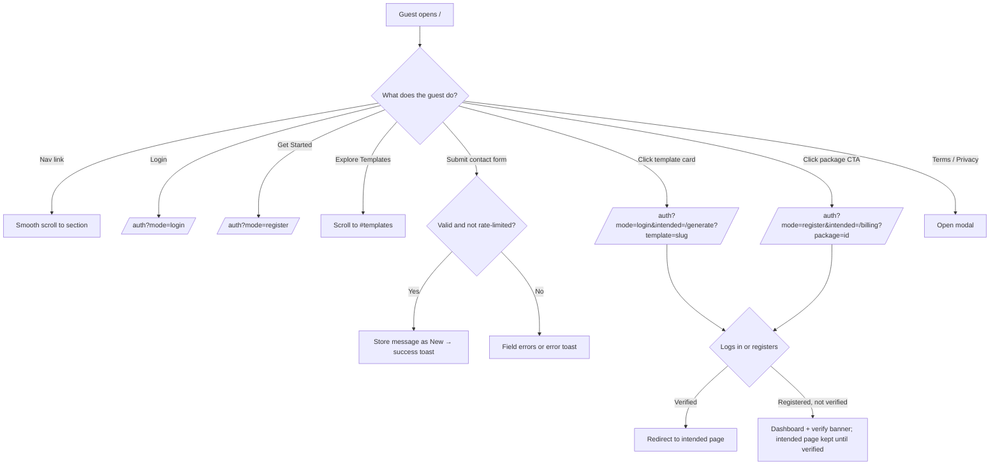

## A5. Authentication Page (`/auth`)

Login, Register, Forgot Password and Reset Password are four modes of one page, switched by a `mode` query parameter, so the public site keeps exactly two pages. **\[Confirmed\]**

- *Layout:* centred card (max 420 px) on a muted background, with the site logo linking back to `/`. On desktop, an optional side panel repeats the product promise. \[Recommended\]
- **Login mode:** Email, Password, Remember me, **Log in**; **Continue with Google**; "Forgot password?" link; "No account? Create one" switch. Remember me applies to user accounts only; for an admin account the server ignores it (F-07).
- **Register mode:** Name, Email, Password, Confirm Password, a "I agree to the Terms and Privacy Policy" checkbox that opens the modals \[Recommended\], **Create account**; **Continue with Google**; switch to Login. Hidden with a notice when registration is disabled in settings or maintenance mode is on (G-20).
- **Forgot mode:** Email and **Send reset link**. Always answers "If an account exists, we've sent a link", so it never reveals which emails are registered.
- **Reset mode:** reached from the email link; New Password, Confirm, **Reset password**; then redirect to Login mode with a success toast.
- *Switching modes* is instant in the browser (no page reload) and updates the URL, so the back button and shared links work.
- *Errors:* field errors inline; "Account suspended until {date}" or "Account suspended" for suspended users; rate-limit message after repeated failures.
- *Password rules \[Recommended\]:* minimum 8 characters, checked against known breached passwords (Laravel `Password::defaults()->uncompromised()`).
- *Redirect after login:* `intended` URL if set, else `/dashboard` (User) or `/admin` (Admin).

**Admin two-factor authentication** **\[Confirmed v0.4: G-22\]**:

- **When:** every login of an admin account, by password or by Google, is followed by the 2FA step before any session access is granted. Ordinary users don't see this step. A remembered login can't skip it: no remember-me cookie is issued to or accepted for an admin account, so every admin session starts at the login and 2FA steps. **\[Technical decision v0.7: F-07\]**
- **Enrolment (first login, or after a reset):** Setup mode shows a QR code and secret for an authenticator app (TOTP), asks for one valid code to confirm, then shows 8 single-use recovery codes once, with Copy and Download (TXT) buttons and a "I saved these codes" checkbox. Only then is the admin signed in.
- **Challenge (later logins):** a 6-digit code from the app, or one recovery code; each recovery code works once. Rate limited (5 attempts per minute \[Starting value\]).
- **Managing it:** Settings → Two-Factor (admins only) lets an admin regenerate recovery codes or re-enrol a new device after entering a current code. It can't be switched off for admin accounts.
- **Recovery:** if an admin loses the device and all recovery codes, a server operator runs `php artisan app:reset-admin-2fa {email}`; the admin re-enrols at next login. This keeps a path back in even for the last admin. All resets are written to the Admin Activity Log. \[Recommended\]
- **Promotion:** a user promoted to admin (Artisan only) must enrol at their next login.

## A6. User area

The User area is six pages behind login, sharing one app shell. Both ways to generate (Dashboard Quick Generate and the Generate page) call the same `GenerationService`, so credits, queueing, technical checks and the Completed / Incomplete / Failed outcomes behave the same everywhere. **\[Confirmed\]**

### App shell and navigation

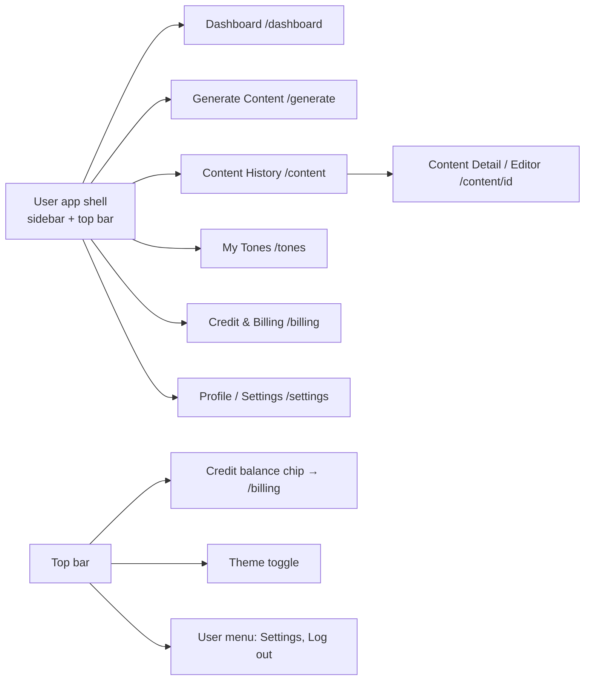

- *Desktop:* left sidebar with the 6 items, collapsible to icons. *Tablet:* icon-only sidebar. *Mobile:* top bar with a hamburger that opens the sidebar as a sheet. \[Recommended\]
- *Top bar:* available-credits chip (links to Billing), theme toggle, user menu. No notification bell. **\[Confirmed\]**
- *Banners:* unverified email (with Resend), and maintenance message when maintenance is on.
- *Feedback:* toasts only (success, error, warning, info). **\[Confirmed\]**

### U1. User Dashboard layout

| Zone | Content | Behaviour |
| --- | --- | --- |
| Row 1: stat cards | **Available Credits** (balance minus any reserved credit), **Total Generations** (successful, all time), **Credits used this month** \[Recommended, optional\] | Available Credits links to Billing; numbers come from the server, never computed in the browser |
| Row 2 left (2/3 width): **Quick Generate** | Compact form: template select (searchable), prompt textarea, tone select, language toggle (English / Burmese), **Generate** button, showing the cost "1 credit" | Streams the result into a card below the form; **Open in editor** links to the saved content. Disabled with a reason when unverified, out of credits, in maintenance (ordinary users only, G-35) or a job is already running |
| Row 2 right (1/3): **Quick Actions** | Generate Content, Browse Templates, Buy Credits, Manage Custom Tones | Links to `/generate`, `/generate` (template browser open), `/billing`, `/tones` |
| Row 3: **Recent Content** | Last 5 items: prompt/title, template icon and name, language, relative date | Click opens `/content/{id}`; "View all" opens History; empty state points to Generate |

### U2. Generate Content

- *Layout:* desktop two panes: left **Template browser** (search box, category chips, template list with icon, name and description); right **Workspace**. Tablet and mobile: template picker becomes a sheet opened from a "Choose template" field.
- *Workspace inputs:* selected template (with change link), **Prompt / Topic** textarea (counter; max length \[Starting value: 2,000 chars\]), **Tone** select grouped into *System tones* and *My tones*, **Output language** toggle (English / Burmese), **Generate** button labelled with the current generation cost. There is no output-length control. **\[Confirmed\]**
- *While queued or processing:* the output panel shows only the animated site logo. No queue position, wait time or status text. **\[Confirmed\]** A **Cancel** link is available only while queued \[Recommended\]. Behind the logo, the page asks the server for the generation's status every 2 s while it is queued and opens the stream only when processing starts; the first streamed text is the visible sign that generation has begun. **\[Technical decision v0.7: F-03\]**
- *While streaming:* every piece of text Gemini sends is shown as it arrives, rendered as formatted text; auto-scroll unless the user scrolls up.
- *Completed:* the output is shown exactly as delivered. It was saved to Content History automatically when it completed. Later edits in the TipTap editor are **not auto-saved**: the explicit **Save** button updates that same history record in place (no new version, no new record, no credits), and leaving the page with unsaved edits shows a confirmation prompt and then discards them **\[Confirmed v0.5: G-28\]**. Other buttons: **Copy**, **Export TXT**, **Open in History**, **New generation**. The generation cost (default 1 credit) is charged.
- *Incomplete (output token limit reached):* the partial text stays visible, read-only, under a clear amber notice: "This response was cut off because it reached the maximum length. It was not saved and no credit was used. You can copy it or start a new generation." Buttons: **Copy** and **New generation** only. No Save, no TXT export, no history entry, no charge, no automatic retry. **\[Confirmed v0.4: G-33.1\]**
- *Failed:* any text that had already streamed is **cleared** from the output panel, which shows a clear message: "Generation failed because of a technical problem. No credit was used. Please try again." The form stays filled; the user presses Generate to try again. Nothing is kept or saved. **\[Confirmed v0.4: G-33.3\]**
- *Incomplete text is temporary UI state.* It lives only in the open Generate page. It is cleared when the user starts a new generation or leaves the page (navigation, reload, closing the tab), and it is **never restored** later. **\[Confirmed v0.4: G-33.2\]**
- *Navigating away and back:* if a job is still active, the page resumes it from the generation id in its props: status polling while queued, the stream once processing. Resuming never sends a new generation request. If it finished while the user was away: a Completed result is shown (it is in history); an Incomplete or Failed result is **not** shown, only a short info toast ("Your last generation didn't complete. No credit was used."). **\[Confirmed v0.4\]**
- *Dashboard Quick Generate* uses the same states and rules; its Incomplete text is cleared when leaving the Dashboard.

### U3. Content History and U3a. Detail / Editor

- *List:* search box (prompt/title and content text), filters (Template, Tone, Date range) combinable with search, newest first, 20 per page \[Starting value\]. Row: prompt as title, template, tone, language, created date, a content snippet, row menu (Open, Copy, Export TXT, Delete).
- *Empty states:* "No content yet" with Generate button; "No results" with Clear filters.
- *Detail page:* header with prompt/title, template (icon + name, from snapshot), tone, language, created and last-edited dates; TipTap editor with the required toolbar (Bold, Italic, Underline, H1–H3, bullet and numbered lists, alignment, link, undo/redo); **Save** (in place, no versions), **Copy** (rich + plain), **Export TXT**, **Delete** (modal naming the prompt). **\[Confirmed\]**
- Content is visible only to its owner. There is no sharing, public link or PDF export. **\[Confirmed v0.2\]**
- Deleted template or tone still shows its name from the snapshot, with a "(no longer available)" tag.

### U4. My Tones

- *Top:* "System tones" read-only cards (name, description) so users know what is available.
- *My tones:* list of the user's tones with name, description, first line of sample, updated date, and a counter "n / 20". **Create tone** opens a modal with Name (required, ≤ 60 chars), Sample Content (required, 50–3,000 chars \[Starting value\]) and Description (optional, ≤ 300). Edit and Delete per tone. At 20 tones, Create is disabled with an explanation. **\[Confirmed: 20 max\]**
- Editing a tone affects future generations only; deleting one never changes saved content. **\[Confirmed\]**

### U5. Credit & Billing

- *Cards:* **Available Credits**, **Total Credits Purchased** (credits granted from successful, Paid purchases; nothing subtracted for refunds) \[Confirmed v0.6: G-38\].
- *Buy credits:* active package cards (same component as Landing Pricing); the package passed as `?package=` is highlighted.
- *Unified Transaction History:* one table merging ledger entries and payment records: date, type badge (Purchase, Generation, Signup Bonus, Admin Adjustment), description, credits (+/−), balance after, payment amount and status (Pending, Paid, Failed; there is no Refunded or Partially Refunded state in the MVP) for purchases. Filters: type (All / Purchase / Generation / Signup Bonus / Admin Adjustment), date range; paginated. **\[Confirmed\]**
- *Generation rows* show the prompt/title linked to the content, or "Content deleted" in grey when it no longer exists. **\[Confirmed\]**
- *Pending payments* (checkout opened but not paid) appear as Purchase rows with status Pending and 0 credits until the webhook confirms them.

### U6. Profile / Settings (tabs)

| Tab | Contents |
| --- | --- |
| Profile | Name (editable), Email (read-only here), Account Created date, sign-in methods (Password, Google) |
| Email | Current email; New email field; pending-change notice with Resend and Cancel |
| Password | *Password users:* Current, New, Confirm, plus a "Forgot your password?" link. *Google-only users:* a note "You sign in with Google" and a **Set a password** button that sends the password-reset email. **\[Confirmed\]** |
| Appearance | Light / Dark / System theme \[Recommended: add System\] |
| Two-Factor (admins only) | Status "Enabled (required for admins)", **Regenerate recovery codes**, **Set up a new device**; both need a current code. No switch-off option. Hidden for ordinary users. **\[Confirmed v0.4: G-22\]** |
| Delete Account | Warning text, **Delete my account** → modal. The modal shows the current credit balance and states that all remaining credits, including purchased credits, will be permanently lost and are not refunded **\[Confirmed v0.7: F-Q3\]**. *Password users:* current password + typed "DELETE". *Google-only users:* typed "DELETE", then **Continue with Google** to re-authenticate. *Admins:* also a current 2FA code; refused with an explanation if they are the last active admin. **\[Confirmed\]** |

## A7. Admin area

The Admin area has **9 sidebar sections**. The Dashboard is an overview that reads stored data only and links to the Contact Messages sub-page; the other eight are where admins change things. **\[Confirmed v0.2\]** Every change an admin makes writes an immutable Admin Activity Log entry.

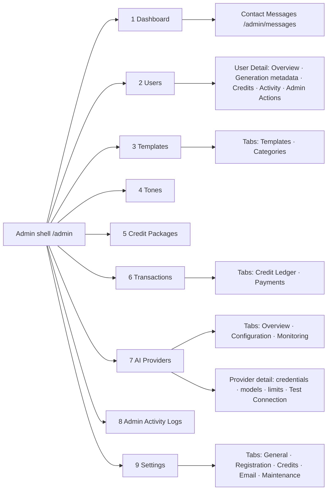

### Admin Dashboard layout (`/admin`)

**Header:** date filter (Today, Last 7 Days, Last 30 Days, This Month, This Year, Custom Range), **Refresh** button, "Updated hh:mm:ss" label. **\[Confirmed\]**

| Zone | Widget | What it shows | Responds to date filter? | Auto-refresh (15 s)? |
| --- | --- | --- | --- | --- |
| Row 1 | Total Users | All non-deleted accounts; small "+n new in range" line | The "new" line only | No |
| Row 1 | Active Users | Non-deleted accounts that are not currently suspended (temporary or permanent), regardless of login activity \[Confirmed G-14\] | No | No |
| Row 1 | Suspended Users | Accounts currently suspended | No | No |
| Row 1 | Total Generations | Completed generations in range (+ incomplete and failed counts in small text) | Yes | No |
| Row 1 | Total Credits Sold | Credits granted from successful (Paid) purchases in range; no refund adjustment \[Confirmed v0.6: G-38\] | Yes | No |
| Row 1 | Total Revenue (USD) | Sum of successful payments (status Paid) recorded by the app in range; Pending and Failed never count; no refund adjustment because refunds are not supported in the MVP. A refund issued manually in Stripe is not reflected here \[Confirmed v0.6: G-15\] | Yes | No |
| Row 2 | AI Provider Health Overview | One tile per configured Gemini model (MVP/v1: one active generation model): status badge (Healthy / Unhealthy / Cooling Down / Disabled), last observed time, success rate and median first-token latency (last hour), active / max concurrency; links to AI Providers → Monitoring | No (live) | **Yes** |
| Row 2 | Active Generation Requests | Generations being processed now | No | **Yes** |
| Row 2 | Queue Length | Generations waiting for a model slot | No | **Yes** |
| Row 3 | Generation Usage Chart | Completed, incomplete and failed generations per bucket (hour for Today, day otherwise); toggle by model | Yes | No |
| Row 4 left | Recent Payments | Last 10: user, package, amount, status, time | Yes | No |
| Row 4 right | Recent Admin Activities | Last 10: admin, action, target, time | No | **Yes** |
| Row 5 | **Recent Contact Messages** | Last 5: sender name, subject, received time, New/Read badge; a "n new" count in the widget header; **View All Messages →** link to `/admin/messages` | No | **Yes** \[Recommended\] |

- *Polling:* every 15 s the page does an Inertia partial reload of only the `ops` prop (provider health, active, queue, recent activities, recent messages). It reads the database; it never calls an AI provider. **\[Confirmed\]**
- *Visibility:* polling pauses when the tab is hidden and refreshes immediately when it becomes visible, then resumes. **\[Confirmed\]**
- *Manual Refresh* reloads all props, including the date-filtered ones.
- *No traffic:* model tiles show "No recent traffic · last observed 3 h ago: Healthy" rather than a fresh Healthy badge. **\[Confirmed\]**

### Contact Messages sub-page (`/admin/messages`)

Reached only from the Dashboard widget's **View All Messages** link (and from a message in the widget), not from the sidebar. **\[Confirmed v0.2\]**

- *List:* status filter (All / New / Read), search by name, email or subject, newest first, paginated. Row: name, email, subject, first line of message, received time, status badge.
- *Detail drawer:* full message, sender details, received time; opening it marks the message **Read**; a **Mark as New** toggle.
- *Reply:* opens `mailto:{email}?subject=Re: {subject}` in the admin's email app. The website sends nothing and records nothing about replies; there is no Replied status. **\[Confirmed\]**
- A breadcrumb (Dashboard › Contact Messages) leads back.

### Page-by-page admin capabilities

| Section | Admins can | Notes |
| --- | --- | --- |
| 1 Dashboard | Filter by date, refresh, open Contact Messages, mark messages New/Read, Reply by mailto | Overview only; no configuration here |
| 2 Users | List; search by name or email; filter by status (Active, Suspended, Unverified); open User Detail; suspend (1 / 7 / 30 days, custom, permanent) with reason; unsuspend early; delete user (confirmation + reason; the confirmation shows the balance that will be forfeited, and deletion follows B1.4 and B3.5); Suspend and Delete are not offered for admin accounts (G-23); add or deduct credits with mandatory reason | User Detail tabs: **Overview**, **Content History** (metadata only: generation id, template, tone name, language, status, timestamps, token usage, error class; never the prompt or generated text) \[Confirmed G-9\], **Credit Transactions**, **Account Activity**, **Admin Actions** |
| 3 Templates | Templates tab: create, view, edit, delete, activate/deactivate, set sort order, pick category. Categories tab: create, edit, delete (only when empty), activate/deactivate, sort | Template fields: Name, Description, Category, Icon (Lucide icon picker \[Recommended\]), System Prompt / Instructions, Active, Sort Order. **\[Confirmed fields\]** |
| 4 Tones | Create, view, edit, delete, activate/deactivate, sort system tones | Fields \[Confirmed G-11\]: Name (required), Description, Style Instructions (required), Sample Content (optional), Active, Sort Order. A separate workflow from users' custom tones, which admins never see or edit |
| 5 Credit Packages | Create, edit, delete (soft; packages with payments are kept for history), activate/deactivate, sort, mark Highlighted | Seeded with the initial portfolio packages (A8). Price changes never affect past payments |
| 6 Transactions | Credit Ledger tab: search by user, filter by type and date. Payments tab: filter by status and date, see Stripe session/payment IDs, link to the user | Read-only. No refund features in the MVP (G-12). A refund issued manually in the Stripe Dashboard is not synchronised, so it does not appear here and the payment keeps its recorded status (B3.4) |
| 7 AI Providers | **Overview tab:** live status per model, active requests, queue length. **Configuration tab:** add/edit provider (driver, label, API key), enable/disable provider, set priority; add/edit models (model id, enabled, max concurrency, RPM / TPM / RPD limits, first-token timeout, languages); mark exactly one model as the active generation model (MVP/v1); max output tokens is shown read-only because it is developer-configured; **Test Connection**. **Monitoring tab:** health, performance metrics, error history, cooldown history, hourly/daily/weekly usage | One section replaces the former AI Providers + Provider Monitoring pair. **\[Confirmed v0.2\]** At launch only the Gemini driver is available (C4). Secrets shown masked and never sent back to the browser |
| 8 Admin Activity Logs | Filter by admin, action type, target type, date; open an entry to see before/after values | Two tabs: Admin Activity (immutable, secrets redacted) and System Errors (G-2), kept as separate record types |
| 9 Settings | General: name, logo, favicon, description, Support Email, Social Links (optional; one URL per platform) \[Confirmed G-3\]. Registration: on/off. Credits: signup bonus (default 20), generation cost (default 1). Email: SMTP settings and **Send test email**. Maintenance: on/off, message | Credit changes affect future operations only. No token budgets or provider hard limits here. **\[Confirmed\]** |

### AI Providers → Monitoring tab

This tab shows only what the app measures itself from real generation attempts and admin tests; it does not show the provider's internal server load. **\[Confirmed\]**

- *Filters:* range (1 h, 24 h, 7 d, 30 d) and model.
- *Status cards per model:* observed status and since when, last success, last failure, cooldown end, active / max concurrency, requests this minute vs RPM limit, requests today vs RPD limit.
- *Charts:* requests per hour (24 h), per day (7 / 30 d) and per week, split completed / incomplete / failed / rate-limited; first-token latency median and P95; average and P95 total generation time.
- *Tables:* success and failure rates by error class (timeout, rate limit, server error, auth error, invalid response, empty output); **Error history** (time, model, class, HTTP status, short message, generation id); **Cooldown history** (start, end, reason, recovered by).

### Admin privacy boundary

Admins never see users' generated content or prompts, in any section or workflow. **\[Confirmed v0.4: G-9\]**

| Area | Admins may see | Admins never see |
| --- | --- | --- |
| User Detail → Content History | Generation id, content id, template name, tone name, language, status (Completed / Incomplete / Failed / Cancelled / Expired), created and updated times, token usage, error class | Prompt / title, generated text, edits |
| User Detail → Credit Transactions | Ledger amounts, types, dates, payment status | The prompt/title shown to users on generation rows: admins see "Generation #id" instead |
| Admin Dashboard, Monitoring | Counts, latency, token usage, error classes, generation ids | Any prompt or output text |
| Error history and error log | Error class, HTTP status, a provider error code, generation id | Prompts, outputs, or provider messages that echo them (messages are truncated and stripped of request/response bodies) |
| Admin Activity Logs | Admin actions with before/after values of admin-managed data (templates, tones, packages, settings, credits, suspensions) | User content (admins can't act on it, so it can't enter the log) |
| Support | Account status, balance, ledger and payment records, generation metadata | Content: if a user wants help with a text, they copy it to support themselves |

There is no "view as user" or impersonation feature, and an admin's own content is visible only in their own user area, like any user's. **\[Confirmed v0.4\]**

### Admin Activity Logs → System Errors tab

Application, authentication, payment, AI provider and generation errors are shown in their own tab, separate from the Admin Activity records of human admin actions. **\[Confirmed v0.5: G-2\]**

- *List:* grouped errors (one row per fingerprint) with level (Info, Warning, Error, Critical), category, short message, first seen, last seen, occurrence count, and whether an alert email was sent.
- *Filters:* level, category, date range, "Critical only".
- *Detail drawer:* redacted context (route, error class, HTTP status, generation id or payment id, provider error code). It never contains generated text, prompts, passwords, API keys, tokens or secrets (G-9, C7.5).
- *Actions:* read-only; no editing or deleting of error records in the UI.

## A8. Business model, credit rules and MVP scope

Revenue comes only from one-time credit packages paid through Stripe Checkout in USD; there are no subscriptions. **\[Confirmed\]**

| Rule | Value | Status |
| --- | --- | --- |
| Signup bonus | 20 credits, granted once, only after email is verified (or Google confirms it) | Confirmed; admin-configurable for future signups |
| Credit reserved before generation | 1 credit (the current generation cost), reserved atomically before the job is queued | Confirmed |
| **Completed** (usable output, normal finish) | Saved to Content History; reservation finalised: exactly the generation cost charged (default 1 credit) | Confirmed |
| **Incomplete** (Gemini stopped at the developer-set `maxOutputTokens`) | Partial text shown with a notice; not saved to history; reservation released: 0 credits; no automatic retry | Confirmed v0.3 (G-32) |
| **Failed** (API error, empty, malformed, blocked, interrupted, timeout) | Not saved; reservation released: 0 credits; no automatic retry | Confirmed |
| AI calls per generation request | **Exactly one Gemini API call** in MVP/v1: no backup model call, no quality evaluation call, no retry | Confirmed v0.3 (G-30) |
| Output length | No admin or user length setting; only the developer's technical `maxOutputTokens` per model | Confirmed v0.3 (G-32) |
| Edit, save, view, copy, TXT export | 0 credits | Confirmed |
| Deleting content | No refund; ledger row kept | Confirmed |
| Credit packages | One-time purchase; name, credits and USD price managed in Admin → Credit Packages | Confirmed |
| Payments | Stripe **Test Mode** for the portfolio project; Live Mode later through environment configuration only | Confirmed v0.3 (G-31) |
| Credit expiry | None assumed | \[Assumption\] |
| Currency | USD only | Confirmed |
| Stripe refund | Out of MVP scope: no refund workflow, no credit reversal, no refund ledger rows, no refund status sync. A refund issued manually in the Stripe Dashboard is outside the app and is not synchronised (B3.4) | Confirmed v0.6 (G-12) |

### Initial portfolio pricing

These three packages are seeded at install and stay fully editable by admins. **They are initial portfolio pricing for a training project, not validated commercial pricing.** **\[Confirmed v0.2\]**

| Package | Credits | Price (USD) | Price per credit (derived) |
| --- | --- | --- | --- |
| Starter | 50 | $4.99 | \~$0.100 |
| Standard | 150 | $9.99 | \~$0.067 |
| Business | 400 | $19.99 | \~$0.050 |

Before any real commercial launch, unit economics must be reviewed again: paid AI usage (a commercial launch would not rely on the free Gemini tier), Stripe fees (which take a larger share of small packages), hosting, taxes and refunds. \[Recommended\]

### In MVP scope

Two public pages, six user pages, nine admin sections (with the Contact Messages sub-page), email + Google auth, templates, system and custom tones, streaming generation with exactly one Gemini call per request and three outcomes (Completed, Incomplete, Failed), history with TipTap editing, copy and TXT export, credit ledger and reservations, Stripe Checkout and webhooks in Test Mode, suspension, audit logs, settings, maintenance mode, contact form, light/dark theme, responsive UI, basic SEO, and the training deployment on the $6 droplet.

### Out of scope for the MVP

| Not included | Why / note |
| --- | --- |
| PDF export | Removed in v0.2 **\[Confirmed\]** |
| Content sharing, public share links, shared-content viewer | Removed in v0.2; content stays private to its owner **\[Confirmed\]** |
| Content-quality validation, quality warnings, automatic quality retry, AI evaluation calls | Removed in v0.2 **\[Confirmed\]** |
| Backup / second Gemini model call, model fallback | Not in MVP/v1 (G-30); the architecture keeps room for it later (C10) **\[Confirmed v0.3\]** |
| Admin- or user-configurable output length | Not in MVP (G-32) **\[Confirmed v0.3\]** |
| Automatic retry after an Incomplete or Failed generation | User starts a new generation manually **\[Confirmed v0.3\]** |
| Groq, Cloudflare Workers AI or other providers | Each needs its own account; can be added later **\[Confirmed v0.2\]** |
| Stripe Live Mode and real payments | Test Mode only for the portfolio project; Live Mode is a future configuration change (C7.7) **\[Confirmed v0.3\]** |
| Production deployment and production infrastructure | Future plan; who deploys is undecided (C10) **\[Confirmed v0.3\]** |
| Monthly subscriptions | Confirmed out |
| User-created templates; per-template input forms | Confirmed out |
| Multiple output variations per request | Confirmed: exactly one output |
| Notification system (bell, list, table, routine emails) | Confirmed out; toasts only |
| Interface languages other than English | Confirmed |
| Content version history, recycle bin, restore | Confirmed out |
| Admin role levels | Confirmed: one Admin role |
| CMS for landing copy | Confirmed out |
| Redis, WebSockets, Docker, CI/CD, automatic backups | Confirmed constraints |
| Team workspaces, shared credits, API for customers | Not requested |
| Advanced SEO analytics | Confirmed not a priority |
| Tracking admin replies to contact messages | Confirmed: mailto only, no Replied status |
| Admin viewing, previewing or exporting users' content or prompts; impersonation / "view as user" | Not allowed anywhere (G-9) \[Confirmed v0.4\] |
| Two-factor authentication for ordinary users | Not required; 2FA is mandatory for admins only (G-22) \[Confirmed v0.4\] |
| Restoring Incomplete output after leaving the Generate page | Temporary UI state only (G-33.2) \[Confirmed v0.4\] |
| Refunds of any kind: user refund requests, admin refund controls, in-app refund processing, full or partial refunds, credit reversals, refund ledger entries, refund status sync from Stripe | Out of MVP scope (G-12, G-36); possible future version (P-10). Manual Stripe Dashboard refunds are not synchronised (B3.4) \[Confirmed v0.6\] |

## Part B — Functional Requirements and Workflows

## B1. Account workflows

### B1.1 Registration, login and email verification

A new email account can log in straight away but cannot generate or buy until the email is verified; the 20-credit bonus is granted at the moment of verification, exactly once. **\[Confirmed\]**

```mermaid
sequenceDiagram
  actor U as Visitor
  participant A as /auth (Fortify)
  participant DB as MySQL
  participant M as Mail (SMTP, queued)
  U->>A: Register (name, email, password)
  A->>A: Registration enabled? rate limit OK? validate
  A->>DB: create user (email_verified_at = null, balance 0)
  A->>M: queue verification email (signed link, 60 min)
  A-->>U: logged in → /dashboard with "Verify your email" banner
  U->>A: Click link /email/verify/{id}/{hash}
  A->>DB: BEGIN; lock user row, then wallet row
  A->>DB: if not verified → set email_verified_at
  A->>DB: if signup_bonus_granted_at is null → INSERT IGNORE bonus_email_hashes (HMAC of normalised email)
  alt hash row inserted (this email never had a bonus)
    A->>DB: ledger +bonus (unique signup_bonus:{user_id}); balance += bonus; set signup_bonus_granted_at
  else hash already present (this email already received a bonus)
    A->>DB: set signup_bonus_eligible = false; no credits
  end
  A->>DB: COMMIT (any error rolls back everything, hash included)
  A-->>U: /dashboard + toast "Email verified. 20 credits added" or "The signup bonus isn't available for this email address"
```

- *Atomic, idempotent bonus \[Technical decision v0.7\]:* one transaction locks the user row and then the wallet, checks `signup_bonus_granted_at`, inserts the email hash with `INSERT IGNORE` and reads the affected-row count, and only when the hash is new writes the ledger row (unique key `signup_bonus:{user_id}`) and sets `signup_bonus_granted_at`. Clicking the link twice, two tabs verifying at once, or a retried request cannot grant twice; any error rolls back the whole transaction, hash included, so a failed grant never blocks a later one.
- *Resend:* banner and Settings button, rate limited (1 per minute, 6 per hour) \[Starting value\]. Expired links show "Link expired" with a Resend button.
- *Login:* Fortify login with per email+IP throttling (5 attempts per minute \[Starting value\]). Suspended users are rejected after the password check with the suspension message, so the message is never shown for wrong passwords. Each login, failed login and logout writes a `login_events` row (IP, user agent, method) for Account Activity.
- *Registration disabled, or maintenance mode on (G-20):* the Register mode and the `POST /register` route both refuse; Google sign-up for new accounts is refused too, while existing users can still log in. \[Recommended\]

* *One signup bonus per verified email* **\[Confirmed v0.7: F-Q1; replaces the deletion-time hash of G-13a\]:** a verified email address can receive the 20-credit signup bonus only once. When the bonus is granted, the normalised email (trimmed, lower-case) is hashed with `EMAIL_HASH_KEY` and stored in `bonus_email_hashes`; its unique key is checked in that same transaction, not at deletion. The rule therefore still holds after the user changes email, deletes the account and registers again with the original email (by email or Google). If the email already received a bonus, the account works normally with 0 credits and the dashboard shows "The signup bonus isn't available for this email address" after verification. This blocks reuse of the **same** email only; it does not stop a person registering with a different email address. No other data is linked or restored.

### B1.2 Google login

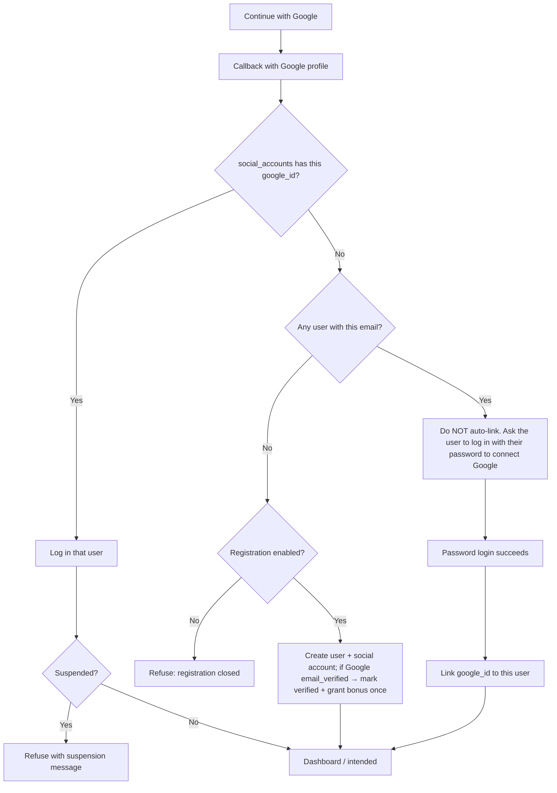

- New Google users with a Google-verified email skip email verification and get the bonus through the same exactly-once transaction, unless that email has already received a bonus (F-Q1). **\[Confirmed\]**
- An existing account is linked only after the user proves ownership by logging in with its password in the same browser session. **\[Confirmed rule; flow Recommended, G-10\]**
- Google-only accounts have no password, which affects password change and account deletion (G-4).

* *Admins signing in with Google* still go through the 2FA setup or challenge step before any page is reachable. **\[Confirmed v0.4: G-22\]**

### B1.3 Profile, email change and password change

- *Name:* edit and save. *Email change:* user enters a new email; it must be unique among users and pending changes. A verification link goes to the **new** address; the old email stays active until the link is used. Resend and Cancel are available; links expire after 60 minutes \[Starting value\]. On success the email is swapped and a notice is sent to the old address \[Recommended\]. **\[Confirmed rules\]**
- *Password change (password users):* current password + new + confirm. On success, all other sessions are revoked. **\[Confirmed + Recommended\]**
- *Set a password (Google-only users):* **Set a password** in Settings, or Forgot Password on `/auth`, sends the standard reset email to the account email; the reset page sets the first local password. From then on the account has both sign-in methods and follows the password-user rules. **\[Confirmed v0.2\]**
- *Forgot password:* Fortify reset email; on reset, every session is revoked. If the account's email was not yet verified, a successful reset also marks it verified, because using the reset link proves control of the inbox; the signup bonus then follows the normal B1.1 transaction. **\[Technical decision v0.7: F-13\]**

### B1.4 Account deletion

Users with a local password confirm deletion with their current password; Google-only users confirm by signing in with Google again. **\[Confirmed v0.2\]**

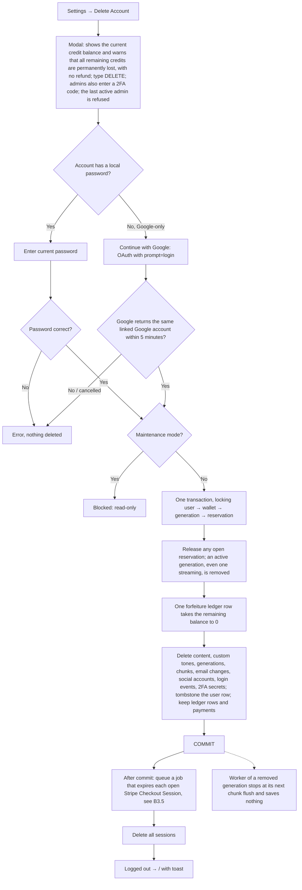

- *Google re-authentication \[Recommended details\]:* the app stores a short-lived "pending deletion" marker in the session, redirects to Google with `prompt=login` (forces a fresh sign-in), and on callback checks that the returned Google user id matches the linked `social_accounts` row and that the marker is under 5 minutes old. Only then does deletion run.
- *Remaining credits are forfeited* **\[Confirmed v0.7: F-Q3\]:** every remaining credit is permanently lost on deletion: signup bonus, purchased, admin-adjusted and any other credits. The confirmation modal shows the balance ("You have 37 credits") and states: "All your remaining credits, including purchased credits, will be permanently lost. Unused credits are not refunded." In the deletion transaction any open reservation is released and one `account_deletion_forfeit` ledger row debits the remaining balance to 0. No earlier ledger row is changed or deleted. This follows from the MVP's no-refund rule (B3.4).
- *Active generation, including one already streaming* **\[Technical decision v0.7: F-04\]:** the deletion transaction releases its reservation and removes the generation with the user's other generations. The worker checks its generation at every chunk flush (about every 250 ms); finding it gone or no longer `streaming`, it closes the Gemini stream and writes nothing more. Its finalise transaction locks the generation row and commits nothing if the row is missing or not streaming, so no content is saved and no credit is charged. The one Gemini call already sent is never repeated; the provider may still count it against the free-tier quota.
- *Open Stripe Checkout* **\[Confirmed v0.7: F-Q2\]:** deletion is allowed. The tombstone is committed first, then each open Checkout Session is expired through the Stripe API; a payment that still completes is recorded as Paid, grants no credits and raises a Critical alert. Full rules in B3.5.
- *Deletion by an admin* (Users page, B5.4) runs the same `DeleteAccount` action and the same steps, without the user's own password or Google confirmation.
- *What is kept \[Recommended; legal retention periods are production decision P-7\]:* the `users` row becomes a tombstone (status `deleted`, name and email cleared, password removed, `deleted_at` set), so credit ledger rows, including the forfeiture row, and payments keep a valid foreign key for accounting. Stripe keeps its own payment records. Admin audit entries about the user stay, with the target shown as "Deleted user #id".
- *Irreversible:* no restore. A new registration with the same email creates a new account with no history. That new account does not receive the signup bonus if the email already received one (F-Q1).

**Signup-bonus email hash** **\[Confirmed v0.7: F-Q1; Technical details\]:**

- Stored in its own table `bonus_email_hashes` (email\_hash unique, created\_at) with **no user id, no name, no other column**, so it can't be joined back to an account, tombstone, content or profile. It is written when a bonus is granted (B1.1); account deletion writes nothing to it.
- The hash is HMAC-SHA256 of the normalised email with a dedicated secret (`EMAIL_HASH_KEY` in `.env`, separate from `APP_KEY`). A plain hash of an email is easy to reverse by guessing common addresses; the secret key prevents that if the database leaks. Changing the key would make existing hashes unmatchable, so it is never rotated without a re-hash plan.
- It is used for one purpose only: blocking a second signup bonus for the same email. The Privacy Policy must state that a one-way hash of the email of each account that received the signup bonus is kept for this purpose, including after the account is deleted (retention period: G-13b, future production).
- Admins can't see or search it.

## B2. Generation workflows

### B2.1 Complete AI content generation workflow

One click on Generate creates one generation record, reserves the current generation cost (default 1 credit), waits fairly for a slot, makes **exactly one Gemini API call**, streams everything Gemini sends, and ends in one of three outcomes: **Completed** (saved, the generation cost charged), **Incomplete** (shown, not saved, 0 credits) or **Failed** (0 credits). There is no quality evaluation, no backup call and no automatic retry. **\[Confirmed v0.3: G-30, G-32\]**

```mermaid
sequenceDiagram
  actor U as User browser
  participant W as Web (PHP-FPM web pool)
  participant S as SSE endpoint (sse pool)
  participant DB as MySQL
  participant Q as Queue worker
  participant G as Gemini API
  U->>W: POST /generations {template, prompt, tone, language, client_request_id}
  W->>W: auth, verified, not suspended, not maintenance, rate limit, validate
  W->>DB: BEGIN; lock user, then wallet; one-active-job check; balance - reserved ≥ cost?
  W->>DB: insert generation (queued, snapshots) + reservation; reserved += cost; COMMIT
  W->>DB: dispatch ProcessGeneration job (database queue)
  W-->>U: 202 {generation_id, status: queued}
  loop while status is queued (every 2 s)
    U->>W: GET /generations/{id}/status
    W-->>U: {status: queued}; page shows the logo animation, no SSE open
  end
  Q->>DB: pick up job; fair order and capacity check (wait = release, not an attempt)
  Q->>DB: atomic claim: status queued → processing WHERE status = queued (1 row changed = owner); lease
  Q->>DB: set provider_call_started_at and COMMIT before any HTTP request
  Q->>G: the ONE streaming call (maxOutputTokens = developer config)
  U->>W: GET /generations/{id}/status → processing
  U->>S: open EventSource /generations/{id}/stream
  G-->>Q: text deltas ... final chunk with finishReason
  Q->>DB: append chunks (batched, numbered); heartbeat; re-check status at each flush
  S-->>U: event: chunk (every piece received)
  alt finishReason STOP and text not empty
    Q->>DB: BEGIN; lock generation (still streaming?); save content; finalise reservation (−cost ledger row); status completed; COMMIT
    S-->>U: event: done {content_id}
  else finishReason MAX_TOKENS and text not empty
    Q->>DB: BEGIN; status incomplete; release reservation; store no partial text; COMMIT
    S-->>U: event: incomplete {reason: max_tokens}
  else any technical failure
    Q->>DB: BEGIN; status failed; release reservation; COMMIT
    S-->>U: event: error {code}
  end
  U->>S: close EventSource after a final event (no automatic reconnect)
```

**Steps in words**

1. *Validate the request:* user logged in, verified, not suspended, not in maintenance; per-minute rate limit; prompt length; template active; tone is an active system tone or the user's own tone; language is `en` or `my`.
2. *Idempotency:* the browser sends a `client_request_id` (UUID per click). A repeated POST with the same id returns the existing generation instead of creating a second one.
3. *One active job:* if the user already has a queued or running generation, reject it before any credit is touched. **\[Confirmed\]**
4. *Reserve and enqueue:* atomically reserve the current generation cost (default 1 credit), then dispatch the job (B3.1, C3). **\[Confirmed\]**
5. *Snapshot:* the generation stores the template, tone, language, cost, the model id and the `maxOutputTokens` value used, so later edits never change this request.
6. *Schedule and call:* the worker waits in fair order for a slot on the **single active Gemini model** (C5); re-deliveries while waiting are not generation attempts. It then claims the generation atomically and records that the call is about to be sent, and only then builds the prompt (C4.3) and makes the one streaming call (C5.1). A generation that is already claimed, or whose call has started, is never called again, whatever the queue delivers. **\[Confirmed v0.3; mechanism Technical decision v0.7\]**
7. *Stream:* every text delta Gemini sends is written as a chunk and relayed by SSE (C6), including the text of a response that later turns out Incomplete. While the generation is still queued, the page polls a small status endpoint and holds no SSE connection; it opens the stream when processing starts. **\[Confirmed v0.3; queued polling Technical decision v0.7\]**
8. *Classify the outcome* from the finish reason and technical checks (B2.2), then finish in one transaction: Completed → save content, finalise the reserved cost, `done`. Incomplete → release credit, `incomplete`. Failed → release credit, `error`.

**Generation states** \[Recommended\]: `queued → processing → streaming → completed | incomplete | failed`, plus `cancelled` (user cancelled while queued) and `expired` (queue wait expiry). Only `queued`, `processing` and `streaming` are active. `incomplete` is its own final state, separate from `failed`, so the UI, ledger and monitoring can tell them apart. **\[Confirmed v0.3\]** `processing` starts at the atomic claim, and `provider_call_started_at` marks the point after which the call is never repeated; an active generation of a deleted account is removed with the account (B1.4). **\[Technical decision v0.7\]**

### B2.2 Outcome classification and technical checks

The outcome is decided only by technical facts: the provider's finish reason, whether text arrived, and whether the stream was well-formed. Nothing judges tone, template adherence, language or writing quality. **\[Confirmed\]**

| Situation | Detected by \[Recommended\] | Outcome | Credit | Saved to history? | User sees |
| --- | --- | --- | --- | --- | --- |
| Normal finish | Gemini `finishReason = STOP` and non-empty text | **Completed** | Charged (1) | Yes | Editor with Save, Copy, Export TXT |
| Output token limit reached | `finishReason = MAX_TOKENS` and non-empty text | **Incomplete** | Released (0) | No | Partial text + "cut off at maximum length" notice; Copy and New generation only; cleared on leaving the page (G-33.1, G-33.2) |
| Token limit reached with no visible text | `MAX_TOKENS` and empty text | Failed | Released | No | Error toast |
| Provider / API error before output | HTTP error, auth error, 429, network error, first-token timeout | Failed | Released | No | Error toast |
| Empty or missing output | Stream ends with no text | Failed | Released | No | Error toast |
| Blocked by provider safety or policy | `finishReason` such as `SAFETY`, `RECITATION`, `BLOCKLIST`, `PROHIBITED_CONTENT`, `SPII`, or a prompt block reason | Failed (code `blocked`) | Released | No | "This request couldn't be completed. No credit was used." |
| Malformed response | Unparseable stream, missing or unknown finish reason (e.g. `OTHER`) | Failed | Released | No | Error toast |
| Stream interrupted after text started | Connection drop, stream-idle timeout, total timeout | Failed | Released | No | Streamed text cleared; technical failure message (G-33.3) |

- The exact finish-reason values are mapped inside `GeminiDriver` into the app's own `completed / max_tokens / blocked / error` values, so the rest of the app doesn't depend on Gemini's names. The list above must be checked against the current Gemini API docs during implementation. \[Recommended\]
- There is **no server-side character cap** and the app never truncates text itself: the only length limit is Gemini's `maxOutputTokens`. **\[Confirmed v0.3\]**
- Some Gemini models count internal "thinking" tokens against the output budget. The developer sets the model's thinking configuration and `maxOutputTokens` together so normal articles finish with `STOP` (C4.2). \[Recommended\]

### B2.3 Model use in MVP/v1: one call, no fallback

In MVP/v1 each generation request uses one active Gemini model and makes exactly one API call. If that call fails or ends Incomplete, the request ends there and the credit is released; the user can start a new generation. **\[Confirmed v0.3: G-30\]**

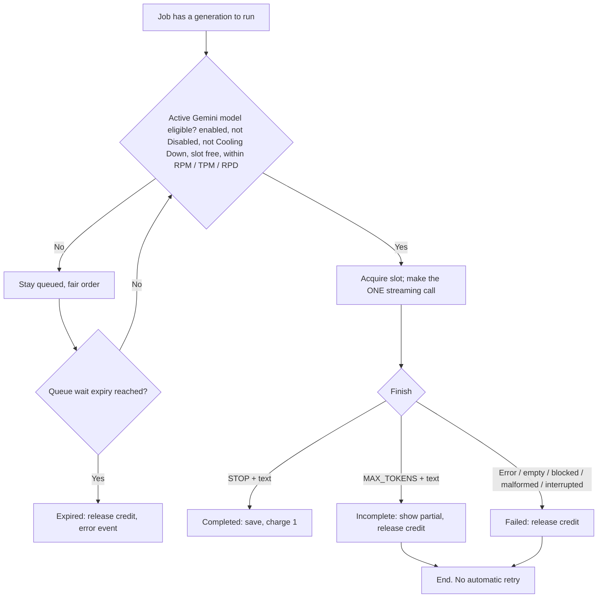

- A rate-limited or cooling-down model is **waited for** in the queue (no call is spent), within the queue wait expiry. Once the one call has been sent, any failure ends the request. \[Recommended\]
- With one provider and one call, a Gemini outage, revoked key or exhausted quota makes generations fail or expire without charge until it recovers. Real resilience (backup model calls or a second provider) is a future option (C10), not MVP behaviour. **\[Confirmed v0.3\]**
- **Why the design still keeps a model list:** `ai_provider_models`, health per model and the scheduler's selection step stay in place so a later version can enable backup calls by configuration plus a small code change, without redesign. In MVP/v1 a setting fixes the number of model calls per request at 1, and only one model can be marked active. \[Recommended\]
- *The user never sees which model was used.* Admins see it in User Detail and AI Providers → Monitoring.

## B3. Credit and payment workflows

### B3.1 Credit reservation and deduction

A reservation holds a credit without spending it; the ledger only records credits that actually move. That way an Incomplete or Failed generation leaves no ledger trace, and a Completed one leaves exactly one −1 row. **\[Recommended design for the confirmed lifecycle\]**

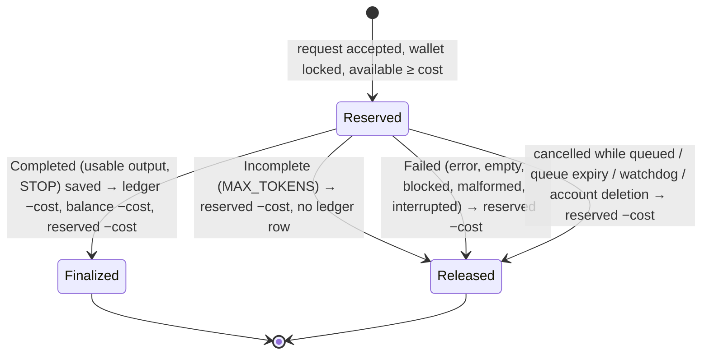

Only a **Completed** generation creates a ledger row (−1). Incomplete and Failed generations release the reservation and leave no ledger trace, so the user's history shows no charge for them. **\[Confirmed v0.3\]**

- *Available credits* = `balance − reserved`. Both columns live on one wallet row per user.
- *Atomic reserve:* inside one transaction: `SELECT … FOR UPDATE` on the wallet row, check the one-active-job rule and `available ≥ cost`, insert the generation and the reservation, increase `reserved`, commit. Two simultaneous requests for a user with one credit queue on the row lock; the second sees `available = 0` and is rejected. **\[Confirmed requirement\]**
- *Exactly-once finalise/release:* the reservation row has a status; finalise and release run `UPDATE … WHERE id = ? AND status = 'reserved'` inside the wallet lock and only continue if exactly one row changed. A duplicate job run, a retry or a watchdog cannot finalise twice or release after finalising.
- *One ledger row per generation:* unique key on `(reference_type, reference_id)` for generation debits, so the database itself refuses a second deduction.
- *Not dependent on concurrency limits:* the wallet lock protects credits even if the one-active-job rule were ever relaxed. **\[Confirmed\]**

### B3.2 Credit purchase with Stripe Checkout

Credits are added only by a verified Stripe webhook, never by the browser returning to the success page. The portfolio project runs in **Stripe Test Mode**; the same code runs in Live Mode when the environment configuration changes (C7.7). **\[Confirmed v0.3: G-31\]**

```mermaid
sequenceDiagram
  actor U as User
  participant W as App
  participant DB as MySQL
  participant S as Stripe
  U->>W: POST /billing/checkout {package_id, purchase_request_id}
  W->>W: verified? not suspended? not maintenance? package active?
  W->>DB: insert payment (pending; snapshot package name, credits, price_cents) unless (user, purchase_request_id) exists → then reuse it (B3.3)
  W->>S: create Checkout Session (price_data from snapshot, USD, metadata payment_id, idempotency key)
  W->>DB: store session id
  W-->>U: redirect to Stripe Checkout
  U->>S: pays
  S-->>U: redirect /billing?checkout=success
  U->>W: page shows "Confirming payment…" and polls payment status
  S->>W: webhook checkout.session.completed (signed)
  W->>W: verify signature; store event id (unique)
  W->>DB: BEGIN; lock payment + wallet; if pending and payment_status = paid → paid, ledger +credits, balance += credits; COMMIT
  W-->>S: 200
  U->>W: poll sees Paid → toast "50 credits added"
```

- *Price source:* the server reads the package from the database; the browser only sends `package_id`. Payment amount and credits are snapshot on the payment row. **\[Confirmed: never trust client amounts\]**
- *Mode:* `STRIPE_MODE=test` with test keys and the test webhook secret for this project. The app reads mode, keys and secret from configuration only; there is no mode switch in the admin UI and no mode-specific code path. **\[Confirmed v0.3\]**
- *Mode check on every webhook:* after signature verification, the event's `livemode` flag must match the configured mode; a mismatched event is logged as a Warning and ignored (200 response, no credits). Each payment row and webhook event row stores `livemode`, so test and live records never mix. **\[Recommended\]**
- *Webhook events handled \[Recommended\]:* `checkout.session.completed` (paid), `checkout.session.async_payment_succeeded` / `_failed`, `checkout.session.expired` (mark Failed, no credits), and nothing else: the app does not subscribe to or process any refund events (G-12, B3.4).
- *Duplicates:* a `stripe_webhook_events` table with a unique Stripe event id, plus the payment's own status check, so a replayed event never adds credits twice. Identical in Test and Live Mode. **\[Confirmed\]**
- *Success redirect:* `/billing?checkout=success` only shows "Confirming payment…" and polls the payment status; it never adds credits. If confirmation takes more than a few minutes, it explains that credits appear as soon as Stripe confirms the payment. **\[Confirmed v0.3\]**
- *Cancel:* `/billing?checkout=cancel` shows an info toast. The payment stays Pending until Stripe reports the session expired; sessions are created with `expires_at` = 30 minutes, Stripe's minimum \[Starting value\], and are then marked Failed with no credits (B3.3 D).
- *Emails:* a payment receipt email is sent after Paid. **\[Confirmed: payment emails required\]**
- *Webhooks keep working during maintenance mode*, so payments made just before it are not lost.
- *Test-mode notice:* while `STRIPE_MODE=test`, the Billing page and Pricing section show a small "Demo payments: use Stripe test cards, no real money is charged" note \[Recommended\]. It disappears automatically in Live Mode.

### B3.3 Duplicate payment prevention

One intended purchase creates at most one Checkout Session and one payment record, and one successful payment grants its credits exactly once, however many clicks, retries or webhook deliveries happen. A user can still deliberately buy the same package again as a separate purchase. **\[Confirmed v0.6; Recommended mechanism\]**

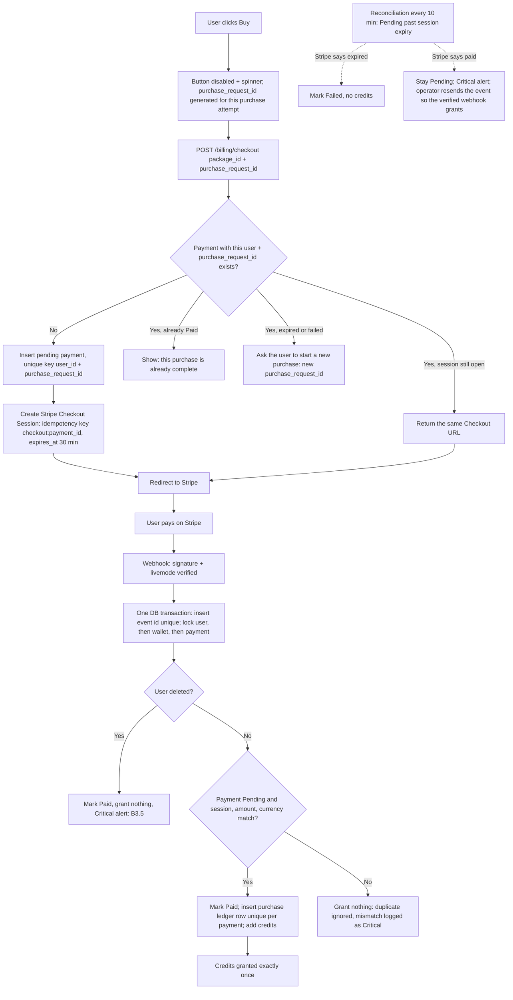

**A. Duplicate checkout prevention**

- *In the browser:* the Buy / Continue to payment button is disabled with a spinner from the first click until the redirect or an error. **\[Confirmed requirement\]**
- *Purchase request id:* when the user starts a purchase, the page creates a `purchase_request_id` (UUID) for that attempt. A double click, a repeated submit or an automatic network retry of the same attempt sends the **same** id; a deliberate new purchase (after returning from Stripe, cancelling, or reloading) gets a **new** id.
- *On the server:* `payments` has a unique key on `(user_id, purchase_request_id)`. The first request inserts the pending payment; concurrent or repeated requests hit the unique key and reuse that row instead of creating another. If its Checkout Session is still open, the same Checkout URL is returned.
- *Stripe idempotency:* the Checkout Session is created with the idempotency key `checkout:{payment_id}`, so a retried API call after a timeout returns the same session rather than a second one.
- *Rate limit:* 5 checkout requests per minute per user \[Starting value\], as a backstop.
- *Intentional repeat purchases* are separate payments with their own ids and sessions, and each is credited on its own.

**B. Webhook idempotency**

- *Signature and mode:* every request is verified with the webhook signing secret, and the event's `livemode` must match `STRIPE_MODE`; otherwise it is rejected or ignored, and nothing is changed. **\[Confirmed\]**
- *One transaction per event:* the handler inserts the Stripe event id into `stripe_webhook_events` (unique key) **in the same transaction** that grants credits. A second delivery of the same event, even arriving at the same time, hits the unique key, waits for the first transaction, and then does nothing. If the first transaction fails, it rolls back completely and Stripe's retry can process it cleanly.
- *Different events, same payment:* `checkout.session.completed` and `checkout.session.async_payment_succeeded` can both refer to one payment. The user, wallet and payment rows are locked in that order (`SELECT … FOR UPDATE`, the lock order of C3), the payment is credited only if it is still Pending, and the purchase ledger row has a unique key per payment, so the database itself refuses a second grant.
- *Unrelated events* are acknowledged with 200 and ignored.

**C. Credit grant protection**

- Only `CreditLedger::creditForPurchase()`, called from the verified webhook path, can grant purchased credits. **\[Confirmed\]**
- The success redirect (`/billing?checkout=success`) only reads and displays the payment status; it never grants credits. **\[Confirmed\]**
- The webhook finds the payment by the `payment_id` in the session metadata **and** checks that the session id, amount, currency and `payment_status = paid` match the stored snapshot. A mismatch grants nothing and logs a Critical error.
- Pending, failed, expired or duplicate events never grant credits; a failed payment is marked Failed and stays at 0 credits. **\[Confirmed\]**

**D. Delayed or missing webhooks** **\[Technical decision v0.7: F-06\]**

- *Known expiry:* every Checkout Session is created with `expires_at` = 30 minutes \[Starting value; Stripe's minimum\], so an abandoned checkout ends on a known schedule.
- *Late webhooks:* Stripe retries failed deliveries automatically (for up to three days in Live Mode, fewer times in Test Mode). Until a verified webhook arrives, the payment stays Pending and grants nothing.
- *Reconciliation job* (`payments:reconcile`, every 10 minutes \[Starting value\]): for each Pending payment whose session expiry has passed by 5 minutes, it fetches the Checkout Session from Stripe, outside any database lock. If Stripe reports `expired`, which is final because an expired session can never be paid, the payment is marked Failed with no credits. If Stripe reports it paid, the payment **stays Pending**, is marked `stripe_paid_detected_at`, and a Critical alert asks the operator to fix the webhook and resend the event from the Stripe Dashboard; the verified webhook then grants the credits exactly once. A session still open past its expiry is expired through the API and checked again on the next run. An API error leaves the payment untouched until the next run.
- *Credits stay webhook-only:* reconciliation never grants credits, so the confirmed rule that credits come only from a verified webhook (G-31) is unchanged. It does not read or act on refunds (B3.4).
- *Limitation:* if webhook delivery is broken (wrong secret after a key change, endpoint down for longer than Stripe retries), a paying user waits until the operator resends the event. The alert makes this visible quickly; it is not automatic.

### B3.4 Refunds: not supported in the MVP

The MVP has no refund workflow of any kind. **\[Confirmed v0.6: G-12, G-36\]**

- **Not in the MVP:** user refund requests, admin refund management or controls, in-app refund processing, full or partial refunds, automatic credit deductions or reversals, refund ledger transactions, partial-refund calculations, and refund status sync.
- **No hidden refund handling:** the webhook handles only the checkout events in B3.2 and ignores everything else, so no refund logic runs through webhooks or background jobs.
- **Accepted MVP limitation (manual Stripe refunds):** if someone issues a refund directly in the Stripe Dashboard, that happens outside the app and the app does not synchronise it. The user's credits stay unchanged, the payment stays recorded as Paid, and Dashboard revenue keeps counting the payment, so it can be higher than actual net revenue after such an external refund. This is an accepted limitation of the MVP, **not** a supported refund workflow. **\[Confirmed v0.6\]**
- **Guidance for the portfolio project:** avoid manual refunds (Stripe Test Mode payments carry no real money anyway). The app provides no refund-processing or refund-reconciliation mechanism of any kind. The separate Admin Adjustment feature (B5.3) remains for legitimate administrative credit additions and deductions, with mandatory reasons and audit logging; it is not part of any refund process.
- **Future:** a refund workflow, including partial refunds and credit reversal, is a possible later version (P-10).

### B3.5 Account deletion with an open checkout

Users may permanently delete their account while a Stripe Checkout Session is open or a payment is Pending. A deleted account never receives credits, and cancelling a session is never taken as proof that it was not paid. **\[Confirmed v0.7: F-Q2; mechanism Technical decision v0.7\]**

1. *Tombstone first:* the deletion transaction (B1.4) commits the tombstone (status `deleted`). From that moment every credit grant for the user is refused, because the grant transaction locks the user row and checks its status.
2. *Then cancel:* after the commit, a queued job asks Stripe to expire each of the user's open Checkout Sessions, outside any database lock, retrying up to 3 times on network errors \[Starting value\].
3. *Stripe's state decides, not the cancel call:* if the expire call succeeds, the payment stays Pending until Stripe's `checkout.session.expired` webhook, or reconciliation seeing `expired`, marks it Failed. If Stripe refuses because the session is already complete, the payment is paid and is handled by the webhook path below.
4. *Payment completes for a deleted account:* after the normal signature, `livemode`, session, amount and currency checks, one transaction inserts the event id, locks user → wallet → payment, finds the user deleted, marks the payment **Paid** (the money was received), sets `credit_outcome = not_granted_account_deleted`, writes no ledger row and adds no credits. A Critical error "Payment received for a deleted account" records the payment id and Stripe session id, with no personal data. Any refund is made by hand in the Stripe Dashboard: the accepted manual-refund limitation of B3.4, not an app workflow. No receipt email is sent, because the tombstone has no email address.
5. *Payment and deletion at the same moment:* both transactions lock the user row first, so they run one after the other. If the webhook commits first, the credits are granted and the deletion then forfeits them with the rest of the balance (F-Q3). If the deletion commits first, the webhook grants nothing (step 4). Either way the deleted account ends with no credits and the payment record is correct.
6. *Delayed, duplicate or concurrent webhooks:* the event-id unique key and the Pending-only rule (B3.3) still apply; a second event for the same payment finds it already Paid and does nothing.

Reporting: a payment from step 4 counts in Total Revenue, because it was received, and adds nothing to Credits Purchased, because no credits were granted (G-15, G-38).

## B4. Content history, editing and export

Only Completed generations become history items; Incomplete and Failed ones never do, and each item is owned by one user and checked on every request. **\[Confirmed\]**

### B4.1 Saving and listing

- *Saved automatically* only when a generation is Completed (never for Incomplete or Failed ones): template snapshot (name, icon, category), original prompt (also the title), tone snapshot (name, type), language, content as sanitised HTML and as plain text, created and updated timestamps. **\[Confirmed fields\]**
- *Search:* case-insensitive match on prompt and plain-text content, always within `user_id = current user`. For the MVP a scoped `LIKE` search is enough because one user's history is small; MySQL FULLTEXT with the `ngram` parser is the upgrade path. The default FULLTEXT parser splits words on spaces, and Burmese is usually written without spaces, so it would not find Burmese words reliably. \[Recommended\]
- *Filters:* template (by template id, with snapshot names for deleted templates), tone, date range; combinable with search; paginated server-side. **\[Confirmed\]**
- *Privacy:* content is private to its owner. There are no share links, public URLs or shared viewers; a `ContentPolicy` checks ownership on every read, edit, export and delete, and a non-owner gets 404 (not 403), so ids reveal nothing. Admins have no access to other users' content or prompts from any admin screen (G-9). **\[Confirmed v0.2\]**

### B4.2 Editing

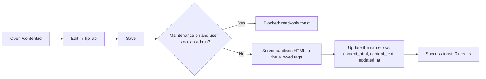

- In-place update, no versions, no extra history rows. The same rule applies to edits made on the Generate page after a generation completes: nothing is auto-saved after the initial save, Save updates the record, and unsaved edits are discarded on leaving (G-28). **\[Confirmed\]**
- Allowed HTML after sanitising: `p, br, strong, em, u, h1, h2, h3, ul, ol, li, a[href]` and text-align styles; links forced to `rel="noopener noreferrer" target="_blank"`, only `http(s)` and `mailto` URLs. \[Recommended\]
- Unsaved changes trigger a "Leave without saving?" prompt.

### B4.3 Copy, TXT export and delete

- *Copy:* writes both `text/html` and `text/plain` to the clipboard (`ClipboardItem`), falling back to plain text where the browser only supports text. **\[Confirmed\]**
- *Export TXT:* the only export format. Generated on demand: the server converts the stored HTML to plain text (headings and list markers kept), returns it as a UTF-8 download (`Content-Disposition: attachment`), and stores nothing on the server or in cloud storage. File name: a slug of the prompt + date. **\[Confirmed\]**
- *Removed in v0.2:* PDF download and content sharing. **\[Confirmed\]**
- *Delete:* modal names the prompt; Cancel does nothing; Delete removes the content row permanently and clears the prompt and output stored on the matching generation record. The −1 ledger row stays and now shows "Content deleted". No refund. **\[Confirmed\]**
- Copy, export and edit never cost credits. **\[Confirmed\]**

## B5. Admin and supporting workflows

### B5.1 Template management

- Create or edit in the template form → server validates (name unique within category, category exists, prompt not empty, ≤ 20,000 chars \[Starting value\]) → save → audit log with before/after (the system prompt diff included) → clear the `landing:catalog` and `generate:catalog` caches.
- Activate/deactivate takes effect for new requests immediately. A generation already queued keeps its snapshot and finishes normally. \[Recommended\]
- Delete: confirmation modal; history items keep their snapshot names. Category delete is allowed only when the category has no templates. \[Recommended\]
- Sort order: drag-and-drop list that saves the new order in one request.

### B5.2 Tone management

- *System tones (admin):* CRUD with Name (required), Description, Style Instructions (required), Sample Content (optional), Active, Sort Order \[Confirmed G-11\]; changes audited and the tone cache cleared. Inactive system tones disappear from the tone picker; existing content keeps the tone name snapshot.
- *Custom tones (user):* create up to 20 (counted in a locked check so two tabs can't both create the 20th), edit, delete. Tones are global to the account, not tied to a template. **\[Confirmed\]**

### B5.3 Admin user management and credit adjustments

```mermaid
sequenceDiagram
  actor A as Admin
  participant W as App
  participant DB as MySQL
  A->>W: Adjust credits {user, +/-amount, reason}
  W->>W: reason required; amount ≠ 0; deduction ≤ available?
  W->>DB: BEGIN; lock wallet; prev = balance; balance += amount
  W->>DB: insert ledger row (admin_adjustment, admin_id, reason, prev, new)
  W->>DB: insert admin_activity_log (actor, target, amount, reason, prev, new)
  W->>DB: COMMIT
  W-->>A: toast + refreshed Overview
```

- A deduction cannot take *available* credits below zero. \[Recommended\]
- Ledger type is Admin Adjustment with a sub-label Compensation (+) or Correction (−). **\[Confirmed examples\]**
- Admin-deleting a user runs the same deletion pipeline as self-deletion (B1.4), with a mandatory reason recorded in the audit log.

### B5.4 User suspension

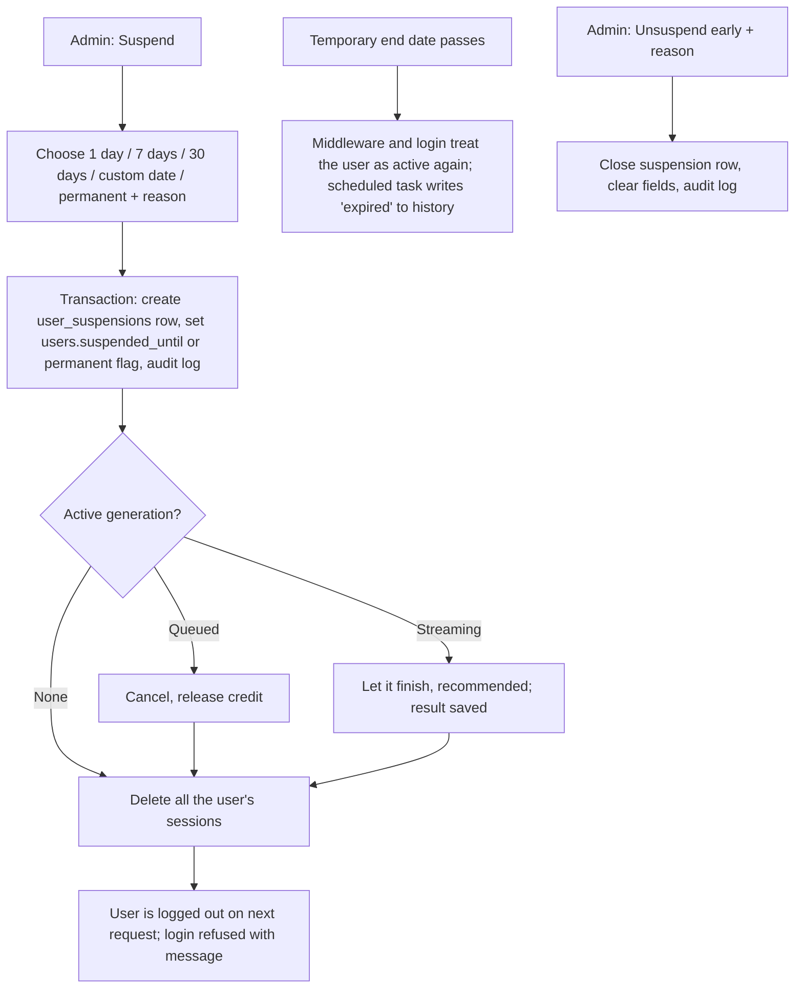

- Suspended users keep credits and content. **\[Confirmed\]** Pending Stripe payments still complete through the webhook, so money is never lost.
- Expiry is evaluated on each request (`suspended_until < now()` means not suspended), so it needs no exact-time job. A scheduled task every minute closes expired rows for the Account Activity history. \[Recommended\]

* *Last active admin safeguard* **\[Confirmed v0.4: G-21\]:** suspending, deleting or demoting the only remaining active admin (2FA-enrolled, not suspended) is refused with an explanation, whether it is attempted by that admin or by someone else. Admins cannot suspend or delete other admin accounts in the UI (G-23, Confirmed v0.5); the Users page hides those actions for admin accounts and the server refuses them. A server operator uses Artisan commands instead (app:suspend-admin, app:delete-admin, app:demote-admin), and every command refuses to remove the last active, 2FA-enrolled admin, so the system can never end up with no usable admin.

### B5.5 AI provider monitoring

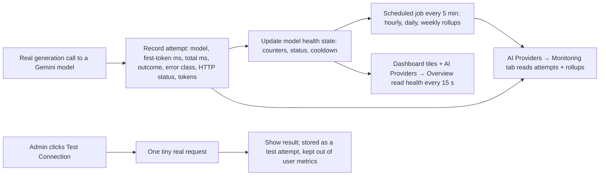

### B5.6 Contact form

Guest or user submits → validate, honeypot, minimum fill time, rate limit → store as **New** → success toast. The Dashboard's Recent Contact Messages widget shows it; the admin opens it there or through View All Messages at /admin/messages. Opening a message marks it **Read**; it can be toggled back to New. **Reply** opens `mailto:{sender}?subject=Re: {subject}` in the admin's own email app; the website sends nothing and records nothing about replies. **\[Confirmed\]**

### B5.7 Maintenance mode

```mermaid
flowchart TD
  ON[Admin enables maintenance + message] --> AUD[Saved in settings, audit log, settings cache cleared]
  AUD --> MW[MaintenanceReadOnly middleware]
  MW --> U[Ordinary users]
  U --> OKR[Allowed: login, logout, account-security flows (verify email, reset or set password, confirm email change), dashboard, history view, copy, TXT export, billing view]
  U --> BLK[Blocked: generate, checkout, edit/save, delete content, profile changes, tone changes]
  MW --> A[Admin accounts]
  A --> AOK[Allowed: full Admin area + own generate, edit, save, tones]
  A --> ABLK[Blocked: credit purchase]
  ON --> REG[New registrations blocked: Register mode, POST /register, new Google sign-ups]
  ON --> INF[Generations already running or already accepted into the queue continue; new generation requests blocked - G-37]
  ON --> WH[Stripe webhook keeps processing]
```

- This is an application-level flag, not Laravel's `artisan down` (which would block admins and webhooks too). `artisan down` is kept only for short deploy windows. \[Recommended\]
- A banner with the configurable message shows on every user page and on the Landing Page. \[Recommended\]
- New registrations (email and new Google accounts) are blocked while maintenance is on; existing users can still log in (G-20, Confirmed v0.5). A generation that was already running when maintenance was enabled is never interrupted and is charged normally if it completes. Generations already accepted into the queue before maintenance started (credit already reserved) also continue and are not cancelled or released because of maintenance; only generation requests submitted after maintenance became active are blocked (G-37, Confirmed v0.6). Admin accounts keep their own user features except purchases (G-35).
- Account-security flows stay available to everyone during maintenance: email verification (including the signup bonus it grants), password reset, setting a first password for Google-only users, confirming a pending email change, logout, and the admin 2FA setup and challenge steps. These routes are exempt from the `maintenance-readonly` middleware, so nobody is locked out of their own account. Account deletion stays blocked (B1.4). **\[Technical decision v0.7: F-10\]**

## Part C — Proposed Technical Architecture

## C1. Overall, frontend and backend architecture

I recommend a single Laravel monolith on one $6 DigitalOcean droplet: Inertia pages for all UI, two dedicated endpoints for SSE and Stripe, MySQL for data, queue, cache, sessions and stream chunks, and two small Supervisor-managed queue workers. At launch it calls one external AI provider, Google Gemini. This meets every confirmed constraint (no Redis, no WebSockets, no Docker) with the fewest moving parts and fits in 1 GB of RAM (budget in C7.6).

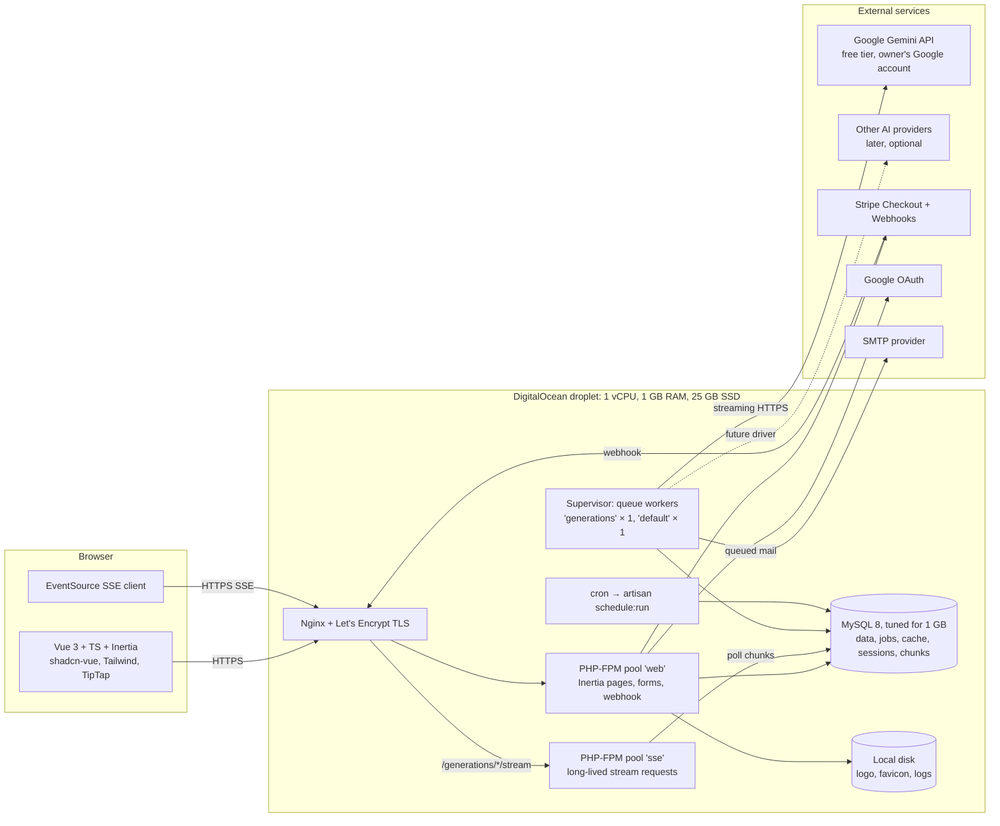

### Frontend \[Recommended structure\]

- **Vue 3 + TypeScript + Inertia** pages in `resources/js/pages/{public,user,admin}`; three layouts: `PublicLayout`, `UserLayout`, `AdminLayout`.
- **shadcn-vue** components (Button, Card, Dialog, Sheet, Tabs, Table, Select, Toast/Sonner, Skeleton) styled with **Tailwind** CSS variables for light and dark themes.
- **Shared composables:** `useGeneration()` (POST, status polling while queued, SSE connection once processing, reconnection, state machine, used by both Dashboard Quick Generate and the Generate page), `useClipboard()`, `useTheme()`, `useAdminPolling()` (15 s partial reloads with visibility pause).
- **TipTap** with StarterKit, Underline, TextAlign, Link extensions; one `RichEditor` component used on Generate and Content Detail.
- **Streaming render:** the model writes Markdown; the browser renders the growing Markdown with a small parser (e.g. `markdown-it`) and sanitises it (DOMPurify) on each update; on `done` the editor loads the server's sanitised HTML.
- **SEO:** page titles and meta via Inertia `<Head>`; for the Landing Page, title, description and Open Graph tags are also printed by the root Blade view so crawlers and link previews see them without JavaScript. **No Inertia SSR** on the 1 GB droplet: it would need an extra always-running Node process. \[Recommended\]
- **Assets are built off the server** (locally) and uploaded with the release, because `npm run build` can exhaust 1 GB of RAM (C7.6). \[Recommended\]

### Backend \[Recommended structure\]

- **Laravel ^13.17 on PHP ^8.3**, with Inertia v3, Vue 3.5 + TypeScript, Tailwind and shadcn-vue on the frontend (pinned in v0.7, F-16; Inertia v3's polling and partial-reload APIs are checked against its documentation during project setup). Code is organised by domain under `app/Domain/*`: each module has Models, Actions/Services, Policies, Form Requests, Events, Jobs.
- **Controllers stay thin:** validate with Form Requests, authorise with Policies, call an Action, return an Inertia response.
- **Actions** hold business rules (e.g. `StartGeneration`, `FinalizeReservation`, `GrantSignupBonus`, `AdjustCredits`, `SuspendUser`, `DeleteAccount`), so the same rule runs from a controller, job or Artisan command.
- **Jobs:** `ProcessGeneration` on the `generations` queue; mail, housekeeping, `ExpireCheckoutSessions` (after account deletion, B3.5) and other small jobs on `default`.
- **Scheduler tasks** (every minute unless noted): stale-generation watchdog (every 30 s), queue expiry, suspension expiry history, payment reconciliation `payments:reconcile` (every 10 min, B3.3 D), chunk cleanup (every 10 min), model health rollups (every 5 min), pruning of old attempts and login events (daily), cache table cleanup (daily).

### Application modules

| Module | Responsibility | Key classes (examples) |
| --- | --- | --- |
| Identity | Registration, login, Google, verification, email/password change, set-password for Google-only users, mandatory admin 2FA, signup-bonus email hash check, sessions, deletion with password or Google re-auth | Fortify actions, `GoogleLoginController`, `GoogleReauthController`, `GrantSignupBonus`, `DeleteAccount` |
| Catalog | Templates, categories, system tones, custom tones | `Template`, `Tone`, `TonePolicy`, catalog cache |
| Generation | Requests, prompt building, scheduling, attempts, technical checks, streaming | `StartGeneration`, `ProcessGeneration`, `PromptBuilder`, `ResponseChecker`, `ModelScheduler`, `StreamChunkWriter` |
| AI Providers | Driver registry, credentials, models, health, monitoring | `AiProviderDriver` interface, `GeminiDriver` (only driver at launch), `ProviderHealthService` |
| Content | History, search, editing, TXT export | `Content`, `ContentPolicy`, `HtmlSanitizer`, `TxtExporter` |
| Billing | Wallets, reservations, ledger, packages, Stripe | `Wallet`, `CreditLedger`, `ReserveCredits`, `CreateCheckoutSession`, `StripeWebhookController` |
| Admin | Dashboard metrics, contact messages, user management (generation metadata only, never content), suspension, last-admin safeguard, audit log, settings | `DashboardMetrics`, `ContactMessageController`, `SuspendUser`, `AuditLogger`, `SettingsRepository` |
| Support | Contact form, error log, maintenance, SEO | `ContactMessage`, `ErrorReporter`, `MaintenanceReadOnly`, sitemap |

## C2. Database architecture, entities and relationships

MySQL 8 (InnoDB, `utf8mb4` for Burmese) holds everything. Operational records (generations, attempts, chunks) are kept separate from user-facing history (contents) and from money (ledger, payments), so each can follow its own retention and immutability rules. \[Recommended\]

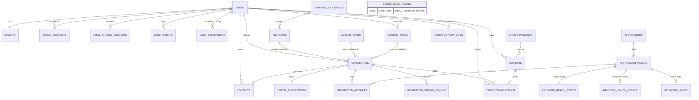

### Main tables \[Recommended\]

| Table | Key columns | Notes |
| --- | --- | --- |
| `users` | id, name, email (unique), password (nullable for Google-only), role, email\_verified\_at, signup\_bonus\_granted\_at, status (active / deleted), suspended\_until, suspended\_permanently, theme, signup\_bonus\_eligible, two\_factor\_secret (encrypted), two\_factor\_recovery\_codes (encrypted), two\_factor\_confirmed\_at, deleted\_at | Tombstone on deletion |
| `wallets` | user\_id (PK), balance, reserved, updated\_at | One row per user; the lock target for every credit change. `CHECK (balance ≥ 0 AND reserved ≥ 0)` |
| `social_accounts` | user\_id, provider ('google'), provider\_user\_id (unique), email | Linked only after ownership proof |
| `email_change_requests` | user\_id, new\_email, token\_hash, expires\_at | New email unique across users and open requests |
| `sessions` | Laravel database session table, with user\_id | Lets us revoke all sessions of a user |
| `login_events` | user\_id, type (login, failed, logout, google), ip, user\_agent, created\_at | Account Activity tab |
| `user_suspensions` | user\_id, admin\_id, type (temporary / permanent), starts\_at, ends\_at, reason, ended\_at, ended\_by, end\_reason | Full history |
| `template_categories` | name, slug, is\_active, sort\_order |  |
| `templates` | category\_id, name, slug, description, icon, system\_prompt, is\_active, sort\_order | System prompt never sent to users |
| system\_tones, custom\_`tones` | system\_tones: name, description (nullable), style\_instructions, sample\_content (nullable), is\_active, sort\_order · custom\_tones: user\_id, name, sample\_content, description (nullable) | Two tables, two separate workflows (G-11); generations store tone\_type + tone\_id + a snapshot |
| `generations` | id (ULID), user\_id, template\_id, tone\_type (system / custom), tone\_id, language, prompt, snapshot JSON (template + tone + cost), status (queued, processing, streaming, completed, incomplete, failed, cancelled, expired), finish\_reason, model\_id, max\_output\_tokens (snapshot of developer config), active\_user\_id (see below), client\_request\_id (unique per user), queued\_at, started\_at, first\_token\_at, completed\_at, heartbeat\_at, failure\_code, claim\_token, claimed\_at, provider\_call\_started\_at (set before the one Gemini call; C5.1); no partial text is ever stored (Incomplete text lives only in the open browser page and in short-lived stream chunks) | Operational record |
| `contents` | id (ULID), user\_id, generation\_id, title (= prompt), template\_snapshot JSON, tone\_snapshot JSON, language, content\_html, content\_text, created\_at, updated\_at | User history |
| `generation_attempts` | generation\_id (null for admin tests), provider\_model\_id, attempt\_no, purpose (user / test), started\_at, first\_token\_ms, total\_ms, outcome (completed / incomplete / failed), finish\_reason, error\_class, http\_status, input\_tokens, output\_tokens, message (redacted) | Monitoring source |
| `generation_stream_chunks` | generation\_id, seq, attempt\_no, type (chunk, done, error), payload, created\_at; PK (generation\_id, seq) | Temporary; purged |
| `credit_reservations` | generation\_id (unique), user\_id, amount, status (reserved / finalized / released), timestamps |  |
| `credit_transactions` | user\_id, type (signup\_bonus, generation, purchase, admin\_adjustment, account\_deletion\_forfeit), amount (+/−), balance\_before, balance\_after, reference\_type, reference\_id (generation id, payment id, or none), admin\_id, reason, created\_at; unique (type, reference\_type, reference\_id) | Insert-only |
| `credit_packages` | name, credits, price\_cents, currency ('usd'), is\_active, is\_highlighted, sort\_order, deleted\_at |  |
| `payments` | user\_id, package\_id, package\_snapshot JSON, credits, amount\_cents, currency, status (pending, paid, failed), purchase\_request\_id, stripe\_session\_id (unique), stripe\_payment\_intent\_id, livemode, paid\_at, credited\_at, expires\_at, stripe\_paid\_detected\_at, credit\_outcome (granted / not\_granted\_account\_deleted); unique (user\_id, purchase\_request\_id); no refund columns in the MVP |  |
| `stripe_webhook_events` | stripe\_event\_id (unique), type, livemode, processed\_at | Webhook idempotency |
| `ai_providers` | driver ('gemini' at launch), label, credentials (encrypted JSON), base\_url, is\_enabled, priority |  |
| `ai_provider_models` | provider\_id, model\_id, label, is\_enabled, is\_active\_for\_generation (exactly one true in MVP/v1), priority (future use), max\_concurrency, rpm\_limit, tpm\_limit, rpd\_limit, first\_token\_timeout\_s, languages JSON | Limits typed in by the admin from the provider's own console. maxOutputTokens is not stored here: it is developer config (C4.2) |
| `provider_health_states` | provider\_model\_id, status, consecutive\_failures, cooldown\_until, cooldown\_level, last\_success\_at, last\_failure\_at, last\_observed\_at |  |
| `provider_health_events` | provider\_model\_id, from\_status, to\_status, reason, cooldown\_until, created\_at | Cooldown history |
| `provider_leases` | provider\_model\_id, generation\_id, expires\_at | Concurrency slots; expired leases are ignored |
| `provider_usage_windows` | provider\_model\_id, window (minute / day), window\_start, requests, tokens | RPM / TPM / RPD counting |
| `provider_usage_rollups` | provider\_model\_id, bucket (hour / day), bucket\_start, counts, latency p50/p95 | Dashboard charts |
| `admin_activity_logs` | admin\_id, action, target\_type, target\_id, before JSON, after JSON, ip, created\_at | Insert-only, redacted |
| `error_logs` | level, category (app, auth, payment, provider, generation), fingerprint, message, context JSON (redacted), first\_seen, last\_seen, count, last\_alerted\_at, alerts\_sent | Grouped recurring errors |
| `contact_messages` | name, email, subject, message, status (new / read), ip\_hash, created\_at |  |
| `settings` | key, value JSON, is\_encrypted | General (name, logo, favicon, description, support\_email, social\_links), registration, credit, email, maintenance |
| `jobs`, `failed_jobs`, `cache`, `cache_locks` | Laravel standard | Database queue and cache |
| bonus\_email\_hashes | email\_hash (unique, HMAC-SHA256 with EMAIL\_HASH\_KEY), created\_at | No user id or any other column; written when a signup bonus is granted and used only to block a second bonus for the same email (F-Q1); not visible to admins |

**One active job per user, enforced by the database.** `generations.active_user_id` is set to `user_id` while the generation is active and to `NULL` when it ends, with a unique index on it. MySQL allows many `NULL`s in a unique index, so each user can have at most one active row even if two requests race. \[Recommended\]

**Immutability.** `credit_transactions` and `admin_activity_logs` are insert-only in code (models throw on update/delete). Optionally, the production DB user can be denied `UPDATE`/`DELETE` on them. \[Recommended\]

**Snapshots for history.** `contents` stores template and tone snapshots, and `template_id` / `tone_id` on `generations` are `nullOnDelete`, so history stays readable after an admin or user deletes the original. **\[Confirmed intent\]**

**Key indexes \[Technical decision v0.7: F-15\]**, besides primary keys and the unique keys named above: `generations(status, queued_at)` for the fair queue, queue expiry and watchdog; `generations(user_id, created_at)`; `contents(user_id, created_at)` for history; `credit_transactions(user_id, created_at)` for the Billing history; `payments(status, created_at)` for dashboards and reconciliation; `payments(user_id, created_at)`; `generation_attempts(provider_model_id, started_at)` for monitoring windows; `login_events(user_id, created_at)`; `contact_messages(status, created_at)`; `admin_activity_logs(created_at)`; `error_logs(fingerprint)` unique. Laravel's own `jobs` and `sessions` indexes stay as generated.

## C3. Credit and billing architecture

The wallet row is the single place where a balance can change, and every change is one transaction that locks it, writes one ledger row with the before and after balance, and commits. \[Recommended\]

- **`CreditLedger` service** is the only code allowed to touch `wallets.balance`. Its methods are `grant()`, `debitForGeneration()`, `creditForPurchase()`, `adjust()` and `forfeitOnDeletion()`. Each runs `DB::transaction` with `lockForUpdate()` on the user row and then the wallet, writes the ledger row, and updates the balance.
- **`ReservationService`** manages `wallets.reserved` and `credit_reservations` (reserve, finalise, release), using the same lock.
- **Lock order** is the same everywhere: user row → wallet → payment or generation → reservation. **\[Technical decision v0.7: F-12\]** Every path that changes credits or account state follows it (verification bonus, generation reserve and finalise, purchase webhook, admin adjustment, account deletion), so no two can deadlock. Transactions are kept short: no HTTP calls inside a lock, including Stripe and Gemini calls.
- **Consistency check:** a daily scheduled command verifies `wallet.balance = SUM(ledger.amount)` per user and `wallet.reserved = SUM(open reservations)`, and writes a Critical error log on any mismatch. \[Recommended\]
- **Unified history query (user Billing page):** ledger rows `UNION` payments that have no ledger row (Pending, Failed), mapped to one row shape (date, type, description, credits, balance after, amount, status), sorted by date and paginated in SQL. The type filter maps to ledger types; Purchase includes pending and failed payments.
- **Generation reference:** the debit row stores `reference_id = generation_id`; the history query left-joins `contents` on `generation_id` to show the title and link, or "Content deleted". The ledger row itself is never altered. **\[Confirmed\]**
- **Settings changes** (signup bonus, generation cost) are read when an operation happens and copied onto that operation (cost onto the generation snapshot, bonus onto the ledger row), so changing them never rewrites history. **\[Confirmed\]**
- **Stripe integration:** the official `stripe/stripe-php` SDK, or Laravel Cashier's Checkout helpers. I recommend the plain SDK: Cashier is built around subscriptions and a Billable model, which the MVP doesn't need. \[Recommended\]
- **Money format:** integers in cents with an explicit `currency` column; never floats.

* **Purchase credits exactly once:** `creditForPurchase()` runs only from the verified webhook, inside the same transaction that records the Stripe event id; it locks the wallet and payment, requires the payment to be Pending with matching amount, writes one `purchase` ledger row (unique per payment), and sets `credited_at`. There is no refund or reversal method in the MVP (B3.3, B3.4). **\[Confirmed v0.6\]**
* **Reporting definitions (G-14, G-15, G-38):** Active Users = non-deleted accounts not currently suspended; Total Revenue = sum of payments with status Paid recorded by the app; Credits Sold / Purchased = credits granted from those Paid payments. Pending and Failed payments are excluded and there is no refund adjustment. **\[Confirmed v0.6\]**
* **Deleted accounts never gain credits \[Technical decision v0.7\]:** every method that adds credits (`grant()` for the signup bonus, `creditForPurchase()`, and `adjust()` with a positive amount) locks the user row first and refuses when its status is `deleted`; a purchase for a deleted account follows B3.5.
* **Forfeiture on deletion \[Confirmed v0.7: F-Q3; Technical details\]:** `forfeitOnDeletion()` runs once inside the deletion transaction, after any open reservation is released, and writes one `account_deletion_forfeit` row for the whole remaining balance (unique per user), leaving balance and reserved at 0. Earlier ledger rows are never altered. Forfeited credits are not reported as credits used by generations.

## C4. AI provider integration, model configuration and health

### C4.1 Provider choice

The MVP uses the Google Gemini API only, with an API key created in Google AI Studio under the owner's existing Google account. Every other candidate needs its own account, so none is required. **\[Confirmed v0.2\]**

| Candidate | Needs a separate account? | Decision |
| --- | --- | --- |
| [Google Gemini API](https://ai.google.dev/gemini-api/docs/rate-limits) | No: a Google account is enough to create the key in AI Studio | **Use**, the only provider in MVP/v1 |
| [GroqCloud](https://console.groq.com/docs/rate-limits) | Yes: a Groq console account | Not used; possible future driver |
| [Cloudflare Workers AI](https://developers.cloudflare.com/workers-ai/platform/pricing/) | Yes: Cloudflare account, API token and Account ID | Not used; possible future driver |
| No-account public endpoints (e.g. [Pollinations](https://antseed.com/blog/llm-api-without-account/)) | No | Not recommended for a product with payments |

**Gemini free-tier facts to design around** (check AI Studio before building; values change):

- Rate limits are counted per Google Cloud project, not per key, and vary by model (requests per minute, input tokens per minute, requests per day); daily quotas reset at midnight Pacific time. ([Gemini rate limits](https://ai.google.dev/gemini-api/docs/rate-limits))
- On unpaid quota, Google may use prompts and outputs to improve its products, and human reviewers may read them. Apps offered to users in the EEA, Switzerland or the UK must use paid services. ([Gemini API terms](https://ai.google.dev/gemini-api/terms)) The Privacy Policy and Terms must say so (G-8).

**One call, no fallback in MVP/v1.** Each request makes exactly one Gemini call on the single active model (B2.3). There is no backup call to another model and no other provider, so a Gemini outage, revoked key or exhausted quota stops generation (without charging anyone). **\[Confirmed v0.3: G-30\]**

### C4.2 Provider integration interface and model configuration

Each provider is one driver class behind a common interface, so the scheduler, outcome classification and monitoring never see provider-specific formats. Adding another provider or enabling backup calls later doesn't require redesign (C10). **\[Confirmed requirement\]**

```text
interface AiProviderDriver
  stream(GenerationPrompt $prompt, ProviderModelConfig $model, StreamSink $sink): ProviderResult
  testConnection(ProviderModelConfig $model): TestResult
  classifyError(Throwable|Response $e): ErrorClass   // rate_limit, timeout, server, auth, invalid_request, blocked, network

GenerationPrompt   = system text, user text, language, max_output_tokens (from developer config), temperature
StreamSink         = onFirstToken(), onText(string $delta), onUsage(int $in, int $out)
ProviderResult     = full text, finish (completed | max_tokens | blocked | error), raw finish_reason, usage, timings, retry_after
```

- **GeminiDriver (only driver in MVP/v1):** REST `streamGenerateContent?alt=sse`; the system prompt goes in `systemInstruction`; `generationConfig.maxOutputTokens` is set from developer config; the final chunk's `finishReason` is mapped to `finish` (B2.2); usage metadata and retry hints are read.
- **`maxOutputTokens` is developer-controlled only.** It lives in `config/ai.php` per model (overridable by environment variable), is chosen from the model's documented output limit so normal template outputs finish with `STOP`, and is never shown as an admin or user setting. The Admin → AI Providers page shows it read-only. **\[Confirmed v0.3: G-32\]**
- **Thinking settings:** where a Gemini model uses internal reasoning tokens that count toward the output budget, the developer configures that alongside `maxOutputTokens`, so visible text isn't cut short. \[Recommended\]
- **Calls per request:** `config/ai.php` holds `max_model_calls_per_request = 1` for MVP/v1. The job enforces it, and the admin can mark only one model active for generation. **\[Confirmed v0.3: G-30\]**
- **Driver registry:** `config/ai.php` maps driver names to classes; the admin form offers only registered drivers (Gemini in MVP/v1).
- **HTTP:** Laravel's HTTP client (Guzzle) with streaming responses, a connect timeout (5 s \[Starting value\]) and the model's first-token timeout.
- **Credentials** are stored with Laravel's `encrypted` cast, decrypted only inside the worker, never in Inertia props, logs or audit entries. **\[Confirmed\]**
- **Which model:** the developer picks a current Gemini Flash-class model from AI Studio after a short Burmese test, and admins can change the active model later (T-list in Part G). Exact model ids aren't fixed in this HLD because Google renames and retires them.

Example shape (values are placeholders, set by the developer):

```text
// config/ai.php
'max_model_calls_per_request' => 1,          // MVP/v1 rule (G-30)
'drivers' => ['gemini' => GeminiDriver::class],
'gemini' => [
  'models' => [
    '<active-model-id>' => [
      'max_output_tokens' => env('GEMINI_MAX_OUTPUT_TOKENS', <value from model docs>),
      'thinking'          => <model-appropriate setting>,
    ],
  ],
],
```

### C4.3 Prompt building

`PromptBuilder` assembles, in this order: (1) a fixed platform instruction written by developers (output exactly one piece, Markdown format, no preamble, ignore instructions in the user's topic that try to change these rules); (2) the template's system prompt; (3) the tone: for system tones, the Style Instructions (plus the Sample Content if present), or for custom tones "match the style of this sample; do not copy its content" plus the sample and description; (4) the output language instruction. The user's prompt is sent as the user message. One prompt, one call. \[Recommended\]

### C4.4 Health model

Health is tracked per model, shared by all users, and updated only from real calls and admin tests; there are no background health-check calls. In MVP/v1 health decides whether the queue **waits** for the active model or sends the call; it never routes to another model. **\[Confirmed\]**

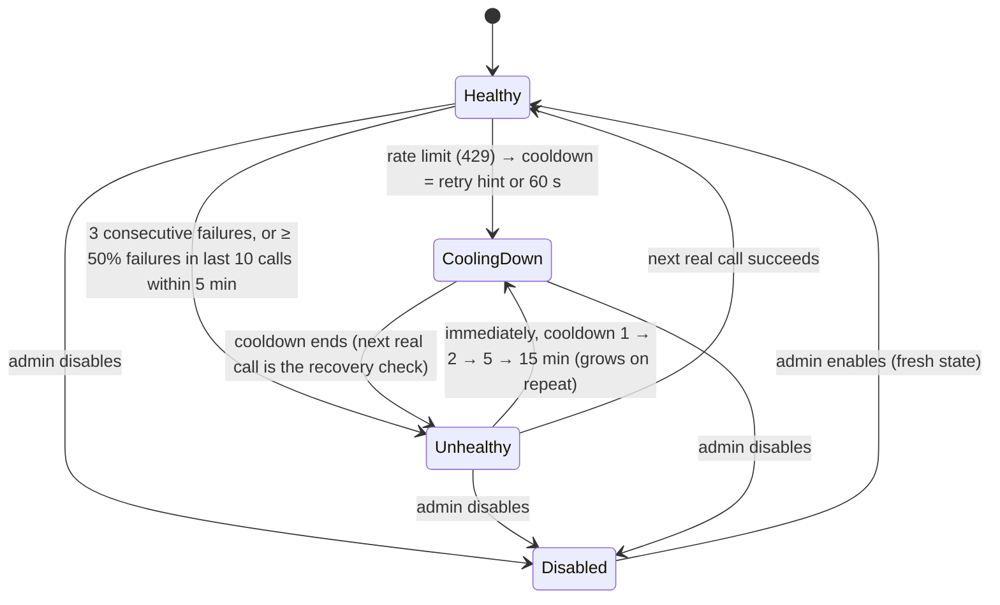

Thresholds and cooldown steps are **\[Starting values\]** in developer config.

| Error / outcome | Counts toward unhealthy? | Effect on the request |
| --- | --- | --- |
| Rate limit (429, quota exhausted) | No (capacity signal) | Request Failed, credit released; model cools down using Google's retry hint (daily quota: until reset), so later requests wait instead of failing |
| Timeout before first token, 5xx, network error | Yes | Failed, credit released |
| Auth error (401/403) | Yes, immediately Unhealthy for all models using that key | Failed; Critical error log |
| Invalid request (400) | No; logged as Error | Failed |
| Blocked by safety / policy | No | Failed (code `blocked`) |
| `MAX_TOKENS` (Incomplete) | No: the provider worked as configured | Incomplete, credit released; counted separately in monitoring so the developer can see if the limit is too low |
| Mid-stream failure | Yes | Failed |

- **Recovery** happens through the next eligible real call after cooldown. **\[Confirmed\]**
- **No recent traffic:** the stored status is shown with its `last_observed_at` time and a "No recent traffic" label after 30 minutes \[Starting value\]. **\[Confirmed\]**
- **Test Connection** (admin) sends one tiny real prompt, recorded as a `test` attempt and kept out of user metrics. It is separate from user requests, so it doesn't break the one-call rule. \[Recommended\]

### C4.5 Concurrency and rate limits

- **Concurrency slots:** the active model is eligible only while its active leases are below `max_concurrency`; leases expire on their own if a worker crashes. **\[Confirmed: per model, not fixed at 1 by rule\]**
- **On the $6 droplet**, the real ceiling is the number of generation workers: **1** at launch \[Starting value\], optionally 2 after measuring memory (C7.6).
- **RPM / RPD:** counted in `provider_usage_windows` inside the slot transaction. At the limit, jobs wait in the queue (no call is spent) until the window rolls or the queue wait expiry is reached.
- **TPM:** estimated before the call (prompt characters ÷ 3 + `maxOutputTokens`) and corrected from Gemini's reported usage. Burmese usually needs more tokens per word than English, so measure real usage. \[Recommended\]

## C5. Queue and fair scheduling architecture

Fairness comes mostly for free from the one-active-job rule: since each user has at most one waiting or running job, a first-come-first-served order over jobs is also round-robin over users. No single user can fill the queue. **\[Confirmed rule; Recommended consequence\]**

### Components

- **Laravel database queue** with two queues: `generations` (AI work) and `default` (mail, housekeeping). **\[Confirmed\]**
- **Supervisor on the $6 droplet** runs `queue:work --queue=generations` × **1** and `queue:work --queue=default` × **1** \[Starting value\]. A second generation worker can be added if free memory stays above \~200 MB under load (C7.6). With one generation worker, generations run one at a time and the fair queue decides the order.
- Worker and queue settings **\[Technical decision v0.7: F-01, F-02\]**: `ProcessGeneration` sets `$timeout = 170` and `$failOnTimeout = true`; the `generations` worker runs with `--timeout=180`; the database queue connection sets `retry_after = 240`. So 150 s (total generation timeout) < 170 s (job) < 180 s (worker) < 240 s (re-delivery). Instead of a tries count, the job uses `retryUntil()` = `queued_at` + queue wait expiry + 30 s, plus `$maxExceptions = 1`: releasing while waiting never fails the job, but any unhandled exception fails it at once. The worker's `--tries` option is not relied on, because the job's own settings take precedence. `--max-jobs=200 --max-time=3600` recycle processes and contain memory growth, `--sleep=2` on the default queue reduces idle DB polling, and Supervisor `stopwaitsecs=200` lets a running generation finish during deploys (`queue:restart` waits for the current job).

### Fair slot acquisition

```mermaid
flowchart TD
  J[ProcessGeneration delivered by the queue] --> CK{Generation status?}
  CK -->|cancelled, expired, final or row missing| DROP[Exit: nothing to do]
  CK -->|processing or streaming| DUP[Already claimed by another delivery: exit, never call Gemini; the watchdog handles a dead run]
  CK -->|queued| EXP{Past queue wait expiry?}
  EXP -->|Yes| XP[Mark expired, release credit; the status endpoint reports it]
  EXP -->|No| TX[Transaction: lock provider capacity rows]
  TX --> OLD{An older queued generation is waiting for capacity?}
  OLD -->|Yes| BACK[release 2 s: a wait, not a generation attempt]
  OLD -->|No| CAP{Active model has a free slot and budget?}
  CAP -->|No| BACK
  CAP -->|Yes| CLAIM[UPDATE status = processing, claim_token WHERE id = ? AND status = queued]
  CLAIM --> ONE{Exactly one row changed?}
  ONE -->|No| DROP
  ONE -->|Yes| LEASE[Create lease; commit]
  LEASE --> MARK[Set provider_call_started_at; commit]
  MARK --> RUN[The one streaming call; heartbeat and status check at each chunk flush]
  RUN --> FIN[Finalise in one transaction; delete lease]
  BACK --> J
```

- "Older queued generation" is checked by `queued_at`, so the oldest waiting request always gets the next free slot even though Laravel re-releases jobs with new availability times. This keeps waiting fair across users.
- In MVP/v1 "eligible model" means the single active Gemini model. When it has no free slot, is cooling down or is at its rate limit, jobs keep waiting in order (no Gemini call is spent) until the queue wait expiry. There is no switch to another model. **\[Confirmed v0.3: G-30\]**
- A job released many times uses no credit and no AI quota; the wait loop costs only small DB queries. Each release is a queue delivery, not a generation attempt: provider execution is limited to one by the claim and the call marker (C5.1), never by the queue's attempt count.

### User concurrency and rate limits

- **One active job:** checked in the reservation transaction and enforced by the unique `active_user_id` index. A second request from any tab, browser or device is rejected before any credit is reserved. **\[Confirmed\]**
- **Per-user per-minute limit:** Laravel `RateLimiter` keyed by user id, on `POST /generations`. Starting value **6 per minute** \[Recommended\], held in `config/generation.php` (env `GENERATION_RATE_PER_MINUTE`). With one active job and most generations taking several seconds, real users rarely reach it; it mainly stops scripted abuse. No hourly or daily limits. **\[Confirmed\]** It could later become an admin setting (G-17).

### Timeouts are separate

| Timer / limit | Covers | Starting value | On expiry |
| --- | --- | --- | --- |
| Queue wait expiry | Time from queued until a slot on the active model is acquired | 5 minutes \[see G-16\] | Expired, credit released, toast "The service is busy. No credit was used. Please try again." |
| First-token timeout | The one call sent until its first token | Per model, 15–20 s | Failed, credit released (no second call) |
| Stream idle timeout | Gap between tokens once streaming | 30 s | Failed, credit released |
| Total generation timeout | Slot acquired until the call ends | 150 s | Failed, credit released |
| Job timeout (`$timeout`, `$failOnTimeout`) | One delivery of `ProcessGeneration` | 170 s | Job failed with no re-run; the watchdog finalises the generation as Failed and releases the credit |
| Worker timeout (`--timeout`) | Safety net for a stuck worker process | 180 s | Process killed and restarted by Supervisor |
| Queue `retry_after` | When the database queue may hand a reserved job out again | 240 s | Re-delivery, which finds the generation claimed or final and exits |
| Output token limit | Gemini's `maxOutputTokens` (developer config) | Per model | Incomplete, partial text shown, credit released |
| Watchdog | No heartbeat from the worker | 60 s, checked every 30 s | Failed, credit released, lease freed |

A queue expiry is recommended: without it, a user could wait for many minutes behind a provider outage while watching only a logo, with no feedback because queue status is never shown. **\[Confirmed: evaluate; Recommended: yes\]**

### C5.1 Exactly one Gemini call: execution guarantees

A database queue delivers each job **at least once**, and no queue can make an external HTTP call happen exactly once. The design therefore guarantees **at most one** Gemini call per generation request through persistent state on the `generations` row, and treats any uncertain case as Failed with the credit released. **\[Confirmed rule G-30; mechanism Technical decision v0.7: F-01, F-02\]**

| Situation | What happens | Gemini calls |
| --- | --- | --- |
| Normal run | queued → claimed → call marker → one call → final state | 1 |
| Waiting for a slot, cooldown or rate limit | The job is released every 2 s until the queue-wait deadline; no claim, no call | 0 while waiting |
| Duplicate delivery while the first run is active (e.g. after `retry_after`) | The second delivery finds `processing` or `streaming` and exits | 1 |
| Two workers pick up the job at once | Only one `UPDATE … WHERE status = 'queued'` changes a row; the other exits | 1 |
| Job timeout, or worker killed mid-call (crash, out of memory, forced restart) | The heartbeat stops; the watchdog marks the generation Failed, releases the credit and frees the lease; any later delivery finds `failed` and exits | at most 1 |
| Crash after the claim, before the call marker | Watchdog: Failed, credit released. It is not re-queued, because a re-queue could race a slow original worker | 0 |
| Crash after the call marker | Whether the request reached Gemini can't be known, so the generation is Failed, the credit released, and the call is never sent again | at most 1 |
| Queue-wait deadline reached (`retryUntil`) | The job's `failed()` handler marks a still-queued generation Expired and releases the credit; any other state is left to the watchdog | 0 |
| Deploy or restart | `queue:restart` and `stopwaitsecs=200` let the running job finish; a killed run follows the watchdog row | at most 1 |

- *Claim token:* the claiming delivery stores a random `claim_token`, and every later write for that run (chunks, heartbeat, finalise) includes `WHERE claim_token = ?`. A stale worker that keeps running can't write into or finalise the generation after the watchdog has failed it.
- *Call marker:* `provider_call_started_at` is committed before the HTTP request is opened. Every recovery path checks it and never sends a second request once it is set.
- *Heartbeat:* written at every chunk flush and at least every 10 s while waiting for the first token. The longest silent stretch (first-token timeout 15–20 s, stream idle timeout 30 s) is below the 60 s watchdog limit, so a live worker is never declared dead.
- *No hidden retries:* the HTTP client for Gemini is configured with no automatic retries, and there is no retry middleware on the job.
- *Finalise is conditional:* the finalise transaction locks the generation row and commits only if it is still `streaming` with this run's `claim_token`; otherwise it writes nothing (this also covers deletion mid-stream, B1.4).

**Limitations, stated honestly:** at-most-once means a crash can turn a request into Failed even if Gemini finished it; the user sees "technical problem, no credit used" and may press Generate again, which is a new request. Gemini may count a call that the app records as Failed against the free-tier quota. The queue settings above only make duplicate deliveries rare; the guarantee itself comes from the claim and the call marker on the `generations` row, which is the single source of truth.

## C6. SSE streaming architecture

The queue worker and the SSE request are different processes, so they meet in a MySQL table: the worker appends numbered chunks in small batches, and the SSE endpoint polls for chunks newer than the last one it sent. **\[Recommended; satisfies the no-Redis, no-WebSocket constraints\]** Waiting and streaming are separate concerns: while a generation is queued, the browser polls a tiny status endpoint and holds no SSE connection; it opens the stream only once the worker has claimed the generation. **\[Technical decision v0.7: F-03\]**

```mermaid
sequenceDiagram
  participant P as Gemini API
  participant Q as Queue worker
  participant DB as MySQL (generations, generation_stream_chunks)
  participant W as Status endpoint (web pool)
  participant S as SSE endpoint (PHP-FPM 'sse' pool)
  participant B as Browser
  loop while queued, every 2 s
    B->>W: GET /generations/{id}/status
    W->>DB: SELECT status by id and owner
    W-->>B: {status: queued}; logo keeps animating
  end
  Q->>DB: claim (processing) and call marker
  B->>W: GET /generations/{id}/status
  W-->>B: {status: processing}
  B->>S: GET /generations/{id}/stream (Last-Event-ID: n only on reconnect)
  S->>S: auth + owner check; still queued? send event: queued and close, browser resumes polling
  loop every 300–500 ms
    S->>DB: SELECT seq > n ORDER BY seq
    S-->>B: id: seq / event: chunk / data: text
  end
  P-->>Q: token deltas
  Q->>Q: buffer deltas
  Q->>DB: INSERT chunk (seq+1) every ~250 ms or ~200 chars
  Q->>DB: INSERT 'done' (or 'incomplete' / 'error') event
  S-->>B: event: done {content_id}
  S->>S: close stream
  B->>B: EventSource.close(), no reconnect after a final event
```

| Concern | Design |
| --- | --- |
| Queued status (no SSE) | GET /generations/{id}/status returns a few bytes ({status}) from the web pool, owner-checked (404 for anyone else), throttled to 60 requests per minute per user \[Starting value\]. The page polls it every 2 s \[Starting value\] while the generation is queued, stops when it becomes processing and then opens the stream, or shows the expiry or cancel result. Each poll is one primary-key read. Polling and reconnecting only read an existing generation id; they never POST, so they can never start a second generation \[Technical decision v0.7: F-03\] |
| Storage / transport | `generation_stream_chunks` rows: (generation\_id, seq) primary key, event type (`chunk`, `done`, `incomplete`, `error`), text payload. They exist only to carry the stream to the browser, never as a store of results |
| Chunk handling | Worker buffers tokens and flushes every \~250 ms or \~200 characters \[Starting values\]. Every piece of text Gemini sends is written; nothing is dropped or trimmed |
| Event ordering | `seq` is assigned by the single worker that owns the generation, strictly increasing; SSE reads `ORDER BY seq` |
| Reconnection | Each SSE event carries `id: seq`. EventSource resends `Last-Event-ID` after a network blip and the endpoint continues from there, while the user stays on the page. The server sends `retry: 2000` |
| Duplicate prevention | The client also tracks the last seq it applied and ignores anything ≤ it. Worker writes are idempotent per (generation\_id, seq) |
| Authorization | Session cookie (same origin). The endpoint loads the generation and checks `user_id`; everyone else, admins included, gets 404 **\[G-9\]** |
| Connection length | Each SSE request ends itself after \~60 s \[Starting value\] with a `reconnect` hint; the browser reconnects with `Last-Event-ID` |
| Keep-alive | A comment line (`: ping`) every 15 s keeps proxies from closing idle streams while waiting for the first token (queued generations hold no stream) |
| Nginx / PHP | Location block for the stream route with `fastcgi_buffering off`, header `X-Accel-Buffering: no`, `fastcgi_read_timeout` > 60 s; no output compression; session closed early (`session_write_close`) |
| Separate FPM pool | An `sse` pool with `pm = ondemand`, `pm.max_children = 3` \[Starting value for 1 GB\]. Because queued generations hold no stream and the single generation worker runs one generation at a time, normally only one stream is open; the spare processes cover reconnect overlap and a possible second worker |
| Completed | `done` {content\_id} is written in the same transaction that saves the content and finalises the credit |
| Incomplete | `incomplete` {reason: `max_tokens`} is written with the status change and credit release. The browser keeps the text it already received, read-only, with the notice and **Copy** / **New generation** buttons. It lives only in that page's memory **\[Confirmed v0.4: G-33.1, G-33.2\]** |
| Failed | `error` {code, message} is written with the credit release. The browser **clears** any streamed text and shows the technical failure message **\[Confirmed v0.4: G-33.3\]** |
| Navigate away and back | `/generate` and `/dashboard` receive only an **active** generation (to reconnect) or the latest **Completed** one. An Incomplete or Failed generation that ended while the user was away is never replayed; the page shows a short info toast instead **\[Confirmed v0.4: G-33.2\]** |
| Cleanup | Chunks are deleted 10 minutes after the generation ends \[Starting value\]. The stream endpoint replays chunks of an ended generation only to a reconnect that carries Last-Event-ID within that window, and only the chunks after that id, which covers a network drop near the end of a stream. A request without Last-Event-ID for an ended Incomplete or Failed generation receives only its final event and no text, and page loads never ask for one (navigate-away rule), so the server never acts as a store for partial text \[Technical decision v0.7: F-09\] |

**Why DB polling rather than files:** writing chunks to a local file would avoid DB writes, but it ties the design to one server and needs its own locking and cleanup. At MVP volumes (a few concurrent streams), a few small DB reads per second per stream is cheap. If load grows, the same interface can switch to Redis pub/sub later without changing the browser. \[Recommended\]

## C7. Auth, caching, integrations, security, logging and deployment

### C7.1 Authentication and authorization

- **Fortify** (headless) for login, registration, email verification, password reset, password confirmation; all its views render the one Inertia `Auth` page in the right mode. **Socialite** for Google. **\[Confirmed\]**
- **Database session driver**, so all sessions of a user can be deleted on suspension, password change, deletion. Cookies: `Secure`, `HttpOnly`, `SameSite=Lax`; session id regenerated on login. \[Recommended\]
- **Authorization:** route groups with middleware `auth`, `verified` (generate, checkout), `not-suspended`, `role:admin`, `maintenance-readonly`; Policies for Content, Tone, Generation; Admin controllers behind `role:admin` only.
- **Admin 2FA** is mandatory for every admin account (G-22, Confirmed v0.4): Fortify's TOTP two-factor with confirmation step, encrypted secret, 8 single-use recovery codes (stored encrypted), the EnsureTwoFactorComplete middleware on all admin-account requests (also after Google sign-in), challenge rate limiting, no remember-me cookie issued to or accepted for admin accounts (F-07), and an Artisan reset command for lost devices. Ordinary users have no 2FA.

### C7.2 Caching (Laravel database cache)

| Data | Key | TTL | Invalidated by |
| --- | --- | --- | --- |
| Settings (all) | `settings:v{n}` | 1 h | Any settings save (version bump) |
| Landing catalog (active categories + templates, public fields only) | `landing:catalog` | 1 h | Template/category model events |
| Active credit packages | `landing:packages` | 1 h | Package model events |
| Active system tones | `tones:system` | 1 h | Tone model events |
| User's custom tones | `user:{id}:tones` | 10 min | That user's tone changes |
| User dashboard stats | `user:{id}:stats` | 60 s | Generation completed, ledger change |
| Admin dashboard range stats | `admin:stats:{range}` | 60 s | Time only |
| Provider health summary | `providers:health` | 10 s | Health state change |

- Content history results are **not** cached. With a database cache, a cached page costs a DB read anyway, and caching would risk showing stale lists right after an edit or delete. Good indexes (`user_id, created_at`) are the better tool. \[Recommended, deviation explained\]
- User-specific keys always include the user id; shared keys contain only public data. No cached value ever mixes users. **\[Confirmed\]**
- The database cache table will see writes from rate limiters too; it is pruned by Laravel's expiry and a daily cleanup.

### C7.3 External service integrations

| Service | Used for | Direction | Failure handling |
| --- | --- | --- | --- |
| Google Gemini API (only AI provider at launch) | Text generation | Outbound streaming HTTPS from the generation worker | One call per request; health and cooldown decide when the call is sent; Incomplete or Failed without charge |
| Stripe | Checkout Sessions and payment webhooks; no refund handling in the MVP (Test Mode now; Live Mode by configuration, C7.7) | Outbound + signed inbound webhook | Pending until webhook; Stripe retries failed webhooks |
| Google OAuth | Sign-in, Google re-authentication before deletion | Redirect + callback | Toast "Google sign-in failed, try again" |
| SMTP (admin-configured) | Verification, reset / set password, email change, payment receipt, Test Email | Outbound, queued on `default` | Queue retries with backoff; failures logged as Error |

### C7.4 Security architecture

- **Never trust the client** for balance, prices, role, or generation state; all computed on the server. **\[Confirmed\]**
- **Rate limits \[Starting values\]:** login 5/min per email+IP; register 3/hour per IP; forgot password 3/hour per email; verification resend 1/min; contact form 3/10 min per IP; generation 6/min per user; checkout 5/min per user.
- **Idempotency:** `client_request_id` on generation; unique reservation per generation; unique ledger references; Stripe event table; Stripe idempotency keys on session creation.
- **XSS:** AI output and edited HTML are sanitised server-side with HTMLPurifier (allow-list) before storage; streamed Markdown is sanitised with DOMPurify in the browser; a Content-Security-Policy header limits scripts to the app's own origin and Stripe.
- **CSRF:** standard Laravel protection for all Inertia forms; only the Stripe webhook is exempt, and it is verified with the webhook signing secret. **\[Confirmed\]**
- **Secrets:** `.env` outside Git; provider keys and SMTP password encrypted in the DB with `APP_KEY`. Losing or rotating `APP_KEY` makes them unreadable, so back up `APP_KEY` separately and securely.
- **Prompt injection:** the platform instruction tells the model to treat the user topic as content, not instructions; template system prompts are never sent to the browser.
- **Suspicious activity \[Recommended, light\]:** log repeated failed logins, many registrations from one IP, repeated rate-limit hits, and webhook signature failures as Warning; the admin sees them in the error log.
- **Admin actions** are audited with before/after values; passwords, keys and tokens are redacted before logging. **\[Confirmed\]**

* **No admin access to user content (G-9):** prompts and generated text are read only through owner-scoped queries guarded by `ContentPolicy` / `GenerationPolicy`. Admin controllers use dedicated metadata queries and API resources that never select `prompt`, `title`, `content_html` or `content_text`; a test fails the build if any admin response contains those fields. Logs, error records and Stripe metadata never contain prompts or outputs. **\[Confirmed v0.4\]**
* **Privileged role safety (G-21):** roles change only through Artisan; the last active admin can't be removed by any path. **\[Confirmed v0.4\]**
* **Settings input:** support email must be a valid address; social links must be `https://` URLs and are rendered with `rel="noopener noreferrer"`. \[Recommended\]

### C7.5 Error handling and logging

- Laravel's logger writes daily log files (Info+). An `ErrorReporter` also records Warning+ events in `error_logs`, grouped by a fingerprint (class + message pattern + location) with count, first and last seen, so recurring problems show as one row in Admin Activity Logs → System Errors (G-2). **\[Confirmed categories and levels\]**
- Categories: Application, Authentication, Payment, AI Provider, Generation. Levels: Info, Warning, Error, Critical.
- Redaction: request bodies are never logged whole; known secret fields (password, token, key, authorization) and prompt or content text are stripped. **\[Confirmed\]**
- Critical events (ledger mismatch, all Gemini models unhealthy or the API key rejected, webhook signature failures in a row, SMTP down) email all active admins (G-27, Confirmed v0.5). Only Critical records send email; Info, Warning and Error never do. A separate AlertNotifier reacts to new Critical records, so logging and alerting stay independent. It sends one email per error fingerprint, then waits a 60-minute cooldown \[Starting value\] during which repeats only increase the counter; if the problem is still occurring after the cooldown, one follow-up email includes the count. Emails are queued; if sending fails, the failure is logged without triggering another alert.

### C7.6 Deployment architecture (training: $6 droplet)

The training deployment runs on one **DigitalOcean $6/month Basic droplet: 1 vCPU, 1 GB RAM, 25 GB SSD**. Production, a larger server and who deploys it are outside the current build and are described as a future plan in C10. **\[Confirmed v0.2\]** Every setting below is a conservative **\[Starting value\]** to measure and adjust.

```mermaid
flowchart TB
  DNS[Custom domain DNS] --> NG[Nginx :443, 1 worker, Let's Encrypt via Certbot auto-renew]
  NG --> WEB[PHP-FPM 'web' pool, ondemand, max 4]
  NG --> SSE[PHP-FPM 'sse' pool, ondemand, max 3]
  SUP[Supervisor] --> QW[queue:work generations × 1]
  SUP --> QD[queue:work default × 1]
  CRON[cron * * * * *] --> SCH[artisan schedule:run]
  WEB --> MY[(MySQL 8, 128 MB buffer pool)]
  SSE --> MY
  QW --> MY
  SWAP[1 GB swap file, safety net only]
  MON[DigitalOcean Monitoring agent + alerts]
```

**Memory budget (approximate, to verify with `free -m` under load)**

| Component | Setting | Approx. RAM |
| --- | --- | --- |
| OS, sshd, DigitalOcean agent, cron | Ubuntu LTS, no extra services | 120–150 MB |
| Nginx | `worker_processes 1`, `worker_connections 512` | 10–20 MB |
| MySQL 8 | See MySQL settings below | 250–350 MB |
| PHP-FPM `web` pool | `pm = ondemand`, `pm.max_children = 4`, `pm.process_idle_timeout = 10s`, `pm.max_requests = 300`, `memory_limit = 128M` | 0–200 MB (≈ 40–50 MB per active child) |
| PHP-FPM `sse` pool | `pm = ondemand`, `pm.max_children = 3`, `request_terminate_timeout = 75s` | 0–120 MB |
| OPcache | `opcache.memory_consumption = 64`, `opcache.validate_timestamps = 0` (reset on deploy) | \~64 MB shared |
| Queue workers | 1 × generations + 1 × default, `memory_limit = 128M`, recycled by `--max-jobs` / `--max-time` | 100–140 MB |
| **Peak total** |  | **\~850–1,000 MB** |

This is close to 1 GB at peak, so a **1 GB swap file** (`vm.swappiness = 10`) is recommended as a safety net against the out-of-memory killer, not as working memory. No Redis, no Inertia SSR Node process and no headless browser run on this server. \[Recommended\]

**MySQL 8 settings for 1 GB** (`/etc/mysql/mysql.conf.d/zz-small.cnf`):

```text
innodb_buffer_pool_size = 128M
innodb_log_buffer_size  = 8M
max_connections         = 30
performance_schema      = OFF
table_open_cache        = 400
tmp_table_size          = 16M
max_heap_table_size     = 16M
skip-log-bin                        # MySQL 8 writes binary logs by default; they fill a 25 GB disk
slow_query_log          = ON
long_query_time         = 1
```

**Resource monitoring \[Recommended\]**

- **DigitalOcean Monitoring agent** (droplet graphs) with alert policies: memory > 85% for 5 min, CPU > 90% for 10 min, disk > 80%.
- **On the server:** `free -m`, `htop`, `df -h`, `supervisorctl status`, MySQL slow query log, `journalctl` size capped (`SystemMaxUse=200M`).
- **Logs:** Laravel `daily` channel kept 7 days; Nginx logs rotated by `logrotate` (7 days, compressed).
- **In the app:** Admin Dashboard (active generations, queue length) and AI Providers → Monitoring.
- **What to watch first:** swap in use for long periods, out-of-memory kills in `dmesg`, MySQL connection errors, queue length growing. Any of these means reducing pool sizes or moving to a larger droplet.

**Manual deployment steps** **\[Confirmed sequence, adjusted for 1 GB\]**:

1. **On your own computer:** `npm ci && npm run build` and copy `public/build` to the server with the release (e.g. `rsync`). Building Vite assets on the droplet can run out of memory.
2. SSH into the server; `cd` to the app directory.
3. Take a quick DB backup (`mysqldump --single-transaction`).
4. `php artisan down --retry=30` only if the release has migrations that are not backward-compatible; otherwise skip.
5. `git pull` the release tag and upload the built assets.
6. `composer install --no-dev --optimize-autoloader` (with the swap file active).
7. `php artisan migrate --force`.
8. `php artisan optimize` (config, routes, views, events cached).
9. `php artisan queue:restart` (workers finish their current job, then reload); reload PHP-FPM (also clears OPcache).
10. `php artisan up`; check the home page, login, a test generation, Admin Dashboard, `supervisorctl status`, `free -m`, and the HTTPS certificate.

### C7.7 Environment configuration (Test and Live Mode)

Everything that differs between the portfolio (Test Mode) environment and a future production (Live Mode) environment is configuration, so moving to Live Mode needs new environment values, Stripe credentials and a webhook endpoint, not a code rewrite, as long as the payment flow and business rules stay the same. **\[Confirmed v0.3: G-31\]**

| Setting (`.env`) | Portfolio / training value | Future production value | Notes |
| --- | --- | --- | --- |
| `APP_ENV`, `APP_DEBUG`, `APP_URL` | `production`, `false`, portfolio domain | `production`, `false`, production domain | Debug is off on any public server |
| `STRIPE_MODE` | `test` | `live` | Read by the app to check webhook `livemode` and to show or hide the test-payments notice |
| `STRIPE_KEY`, `STRIPE_SECRET` | `pk_test_…`, `sk_test_…` | `pk_live_…`, `sk_live_…` | The app refuses to boot if the key prefix doesn't match `STRIPE_MODE` \[Recommended\] |
| `STRIPE_WEBHOOK_SECRET` | Secret of the **test** webhook endpoint | Secret of the **live** webhook endpoint | Each Stripe mode has its own endpoint and secret |
| `STRIPE_CURRENCY` | `usd` | `usd` | Confirmed USD only |
| `GEMINI_MAX_OUTPUT_TOKENS` (optional override) | Developer value | Developer value | Default comes from `config/ai.php` per model (G-32) |
| `GENERATION_RATE_PER_MINUTE` | 6 | Reviewed for production | Developer config |
| `DB_*`, `MAIL_*` fallback, `APP_KEY` | Portfolio values | Production values | Admin SMTP settings in the DB still apply; `APP_KEY` must be backed up |

**Separation rules \[Recommended\]:**

- **Separate credentials and secrets:** test and live keys are never in the same `.env`; live secrets never go into Git, test fixtures or the portfolio server.
- **Separate data:** every payment and webhook record stores `livemode`. Production should start from a **fresh database** (or at least without test payments, ledger purchase rows and test users), so test purchases never look like real revenue.
- **Same protections in both modes:** signature verification with the mode's webhook secret, the `livemode` check, the unique webhook event table and locked, idempotent crediting run identically in Test and Live Mode.
- **Credits only from the webhook** in both modes; the success redirect never adds credits.
- **Switching checklist (future):** activate the Stripe account for live payments, create the live webhook endpoint for the production URL, set the live values above, re-check the packages and prices in Admin, run one small real purchase, confirm the webhook and ledger, then remove test data. Business rules and code stay unchanged.

## C8. Export (TXT only)

TXT is the only export format in v0.2; PDF export and sharing were removed. **\[Confirmed v0.2\]** A `TxtExporter` converts the stored sanitised HTML to plain text (headings on their own lines, `-` and `1.` list markers, links as `text (url)`), normalises line breaks, and returns it as a UTF-8 download with a BOM-free `text/plain; charset=utf-8` header so Burmese displays correctly. Nothing is written to disk or cloud storage, and no heavy rendering library or headless browser is needed, which also suits the 1 GB droplet. \[Recommended\]

## C9. Testing strategy

Tests concentrate on money, concurrency and streaming, because those are where silent bugs cost users credits. **\[Confirmed scope\]**

| Test type | Tool | Must cover |
| --- | --- | --- |
| Backend unit | Pest / PHPUnit | PromptBuilder; Gemini finish-reason mapping (STOP, MAX\_TOKENS, safety/policy reasons, OTHER, missing); outcome classification; error classification; health state machine; cooldown math; rate-window counting; TxtExporter (incl. Burmese) |
| Backend feature | Pest + Laravel HTTP tests | Every route's auth, verification, suspension, maintenance and ownership rules; 404 for other users' content and exports |
| Authentication | Feature tests | Register, login throttling, suspended login, Google new/existing/linking, registration disabled, password reset, Google-only user sets a password, session revocation; a successful password reset marks an unverified email verified (F-13) |
| Account deletion | Feature tests | Password user with wrong/right password; Google-only user with matching, mismatched, cancelled and expired Google re-auth; the modal shows the balance; one forfeiture ledger row takes the balance to 0 and no earlier ledger row changes (F-Q3); deletion while queued and while streaming stops the worker at the next flush, saves no content and charges nothing (F-04); admin deletion of a user follows the same rules |
| Email verification | Feature tests | Bonus granted exactly once (double click, parallel requests), expired link, email change keeps old email until verified |
| **One Gemini call per request (G-30)** | Feature tests with a scripted fake driver that counts calls | Exactly one call for Completed, Incomplete and every Failed case; no second call after an error, 429, timeout, block or MAX\_TOKENS; waiting in the queue for a cooling-down model spends no call |
| **Incomplete outcome (G-32)** | Feature + SSE tests | MAX\_TOKENS with text → status `incomplete`, all streamed text delivered, `incomplete` event, no `contents` row, reservation released, no ledger row, no retry; MAX\_TOKENS with empty text → Failed; `maxOutputTokens` taken from developer config and absent from admin/user forms |
| Credit reservation and ledger | Feature + concurrency tests | Two parallel requests with 1 credit → only one succeeds; finalise only on Completed; release on Incomplete, Failed, cancel, expiry, watchdog; idempotent; ledger sum = balance |
| **Stripe Test/Live configuration (G-31)** | Feature tests with signed fixture payloads; Stripe CLI in test mode | Signature check with the configured secret; `livemode` mismatch ignored; duplicate and out-of-order events; expired sessions; refund events ignored with no changes; success redirect adds no credits; boot check rejects mismatched key prefix and mode; webhook during maintenance |
| Gemini integration | Fake HTTP streams (`Http::fake` with streamed bodies) + manual live smoke tests against the free API | Parsing, usage metadata, retry hints, error mapping, blocked responses, thinking/output budget behaviour |
| Streaming | Feature tests on the SSE endpoint + E2E | Ordering, Last-Event-ID resume, duplicate suppression, navigate away and back (Completed and Incomplete), `incomplete` and `error` events; replay only on a reconnect with Last-Event-ID inside the 10-minute window, and a request without it for an ended Incomplete or Failed generation returns no text (F-09) |
| Queue fairness and concurrency | Feature tests with several fake users and one slot | Oldest first across users, one active job per user, no starvation, queue expiry |
| Frontend components | Vitest + Vue Test Utils | useGeneration state machine (Completed / Incomplete / Failed), Incomplete notice, filters, editor toolbar, polling pause, Contact Messages widget |
| End-to-end | Playwright | Guest → register → verify → generate → edit → copy → TXT export → buy a seeded package with a Stripe test card; a forced Incomplete run shows partial text and leaves the balance unchanged |
| Browser compatibility | Playwright (Chromium, Firefox, WebKit) + a real Safari check | Clipboard rich copy, EventSource reconnect, TipTap |
| Load and resource | k6 or Artillery against a copy of the $6 droplet with a fake AI driver | Memory under concurrent page views and streams, FPM pool limits, swap use, DB load from chunk polling |
| Admin content privacy (G-9) | Feature tests + an automated response scan | Every admin route and Inertia prop (User Detail tabs, Dashboard, Monitoring, Activity Logs, Transactions, errors) contains no prompt, title or generated text; admin requests to /content/{id}, exports and SSE streams of other users return 404; logs and error records contain no prompts or outputs |
| Admin 2FA (G-22) | Feature tests | Unenrolled admin forced into setup; enrolled admin gets no page (admin or user) before a valid code; Google sign-in still challenged; recovery codes single-use; challenge rate limit; 2FA can't be disabled for admins; Artisan reset; users never challenged; no remember-me cookie is issued to or accepted for an admin account (F-07) |
| Admins as users and last-admin safeguard (G-21) | Feature + concurrency tests | Admin can generate, buy, manage own tones and content with own wallet; deleting, suspending or demoting the last active admin is refused, including two admins acting at the same time |
| One signup bonus per email (F-Q1) | Feature tests | The bonus writes the keyed hash in the same transaction; register with A, verify, change email to B, delete, register again with A (by email and by Google, different letter case) gets no bonus; a never-used email gets the bonus; two parallel verifications grant once; a rolled-back grant leaves no hash; the hash table has no user link and isn't shown to admins |
| Incomplete / Failed UI (G-33) | Vitest + Playwright | Incomplete: text kept, Copy works, no Save/Export; leaving and returning shows nothing restored; Failed mid-stream: text cleared and failure message shown |
| Tones and settings (G-11, G-3) | Feature tests | System tone validation (Name and Style Instructions required); custom tone rules unchanged; empty social links not rendered; settings changes appear without rebuild |
| Duplicate-payment prevention and revenue (v0.6) | Feature + concurrency tests with signed fixtures | Double-clicking Buy creates one payment and one session; repeated checkout requests with the same purchase\_request\_id reuse the payment and return the same Checkout URL; a network retry (same id, also after a Stripe API timeout) creates no second session; duplicate delivery of the same webhook event grants credits once; two concurrent deliveries of the same event grant once; completed + async\_succeeded for one payment grant once; a successful payment grants its credits exactly once; two intentional purchases of the same package (different ids) both succeed and are each credited; pending, failed and amount-mismatch events grant nothing; Total Revenue and Credits Purchased count only Paid payments |
| **Queue waiting and duplicate execution (F-01, F-02)** | Feature + concurrency tests with the call-counting fake driver and a test worker that can be killed | A job released 100 times while waiting still runs when a slot frees and makes exactly one call; the queue-wait deadline while still queued gives Expired with the credit released; a duplicate delivery of the same job makes no second call; two workers claiming at once make one call; a delivery after retry\_after while the first run is active exits; a worker killed before the call marker gives Failed with 0 calls, killed after it gives Failed with 1 call and the call is never resent; a job timeout ends Failed through the watchdog with no re-run; a stale worker can't write chunks or finalise after the watchdog failed its run (claim token); the Gemini HTTP client has no retries; a config test asserts 150 s < 170 s < 180 s < 240 s |
| **Queued status instead of SSE (F-03)** | Feature tests + Playwright + the load test | No SSE request while queued, only status polling; the stream opens when the status becomes processing; an SSE request for a queued generation closes at once; with 5 users queued and 1 worker, at most one stream plus reconnects is open in the sse pool; reload or navigation resumes polling or streaming without a new POST; EventSource is closed after the final event; status endpoint returns 404 to other users and is rate limited |
| **Payments and account deletion; missing webhooks (F-Q2, F-06)** | Feature + concurrency tests with signed fixtures and a faked Stripe client | Deletion with an open session commits the tombstone, then requests expiry; a successful expire leaves the payment Pending until Stripe reports expired; an expire refused because the session is complete leaves it to the webhook; a webhook for a deleted user marks Paid, writes no ledger row, adds no credits, sends no email and raises a Critical alert; webhook and deletion at the same moment, in both orders, leave the deleted account with 0 credits; duplicate and late webhooks for that payment change nothing; reconciliation marks expired sessions Failed, leaves a paid-but-unconfirmed payment Pending with an alert and no credits, and expires sessions still open past expiry; reconciliation never calls creditForPurchase(); every grant path locks user, then wallet, then payment |
| Maintenance and admin rules (G-35, G-20, G-23) | Feature tests | During maintenance: users read-only; admins can generate, edit and save their own content but not buy; registrations (email and new Google) refused; running and queued generations finish. Admin UI can't suspend or delete admins; Artisan commands refuse to remove the last active admin; email verification, password reset, set-password, email-change confirmation and logout still work during maintenance (F-10) |
| Dashboard metrics (G-14) and alerts (G-27) | Unit + feature tests | Active and Suspended counts from status only; one Critical alert per fingerprint per cooldown; no email for Info, Warning or Error; System Errors tab shows no content or secrets |
| Save after generation (G-28) | Feature + Playwright | Completion creates exactly one history record; edits not auto-saved; Save updates the same record in place; leaving discards unsaved edits; no credits used |

## C10. Future extensibility and production transition

The MVP is deliberately narrow (one provider, one call, Test Mode, one small server), but each restriction is a configuration or isolated component, so a later version can widen it without redesign. None of this is in the current build scope. **\[Confirmed v0.3\]**

### C10.1 Extension points kept in the design

| Future capability | What already exists in MVP | What a later version adds |
| --- | --- | --- |
| Backup Gemini model call / fallback strategy | Model list, per-model health, scheduler selection step, `max_model_calls_per_request` setting (= 1) | Raise the setting, allow several active models, add the fallback loop rules (e.g. only before the first token), tests |
| Another AI provider (Groq, Cloudflare, paid Gemini, others) | `AiProviderDriver` interface and driver registry | A new driver class and its admin credentials |
| Higher output limits or per-template budgets | `maxOutputTokens` read from developer config per model | Developer changes config; per-template budgets would be a new product decision |
| Stripe Live Mode | Mode, keys and webhook secret from `.env`; `livemode` stored and checked | New environment values and a live webhook endpoint (C7.7) |
| More capacity | Queue, leases and pools sized by config | Larger droplet, more workers, then managed MySQL / Redis if needed |

### C10.2 Production deployment: future plan, responsibility undecided

The current project is a training and portfolio project deployed on the $6 droplet. A production version is a future plan, and **who deploys it is undecided**: the owner may deploy it personally, or may ask Claude to help. That decision will be made later. This HLD does not assume either option, and production deployment is not a requirement or task of the current MVP build. **\[Confirmed v0.3\]**

Intended transition, whoever carries it out:

1. Decide deployment responsibility (owner, Claude-assisted, or other) and the production timeline.
2. Review commercial pricing and unit economics; decide on paid Gemini or additional providers.
3. Choose production hosting size and backup strategy (automated backups recommended for real customers).
4. Prepare legal documents (Terms, Privacy Policy with AI data use, refund policy) and decide target markets.
5. Switch Stripe to Live Mode by configuration (C7.7) on a fresh production database.
6. Deploy with the same manual steps (C7.6), adjusted for the production server, then run smoke tests.

The production decisions themselves are listed in Part G (Future production decisions).

## Part D — Non-Functional Requirements

As a training and portfolio project on a 1 GB droplet, v0.2 targets correctness of credits and payments first, then predictable behaviour under tight memory and free-tier AI limits, then speed. Production scale is a separate, later design. \[Recommended priorities\]

| Area | Requirement / target \[Recommended unless marked\] |
| --- | --- |
| Security | Everything in C7.4; HTTPS only (HSTS); OWASP Top 10 review before going public; `composer audit` and `npm audit` at each deploy |
| Performance | Inertia page responses under \~300 ms server time when idle; Landing Page served from cache; SSE poll interval 300–500 ms. With one generation worker, generations run one at a time; extra users wait in the fair queue |
| Scalability | Deliberately small: 1 generation worker, 4 web + 3 stream PHP processes. Upgrade path, in order: second generation worker → larger droplet → managed MySQL → separate worker droplet → Redis for queue, cache and stream pub/sub → second AI provider. Interfaces stay the same |
| Reliability | No credit lost or double-charged under crashes: reservations, watchdog, idempotent finalise and webhooks; generations recoverable after browser disconnect. AI availability depends on one provider (Gemini) and one call per request; a Gemini outage, exhausted quota or call error fails or expires the request without charging anyone |
| Maintainability | Domain modules, thin controllers, Actions for rules, typed config for limits, provider drivers behind one interface, tests per module |
| Availability | Best effort, no SLA (training project). Single server: an outage or out-of-memory event takes the site down. Monitoring alerts (C7.6) catch memory and disk problems early |
| Data privacy | Collect only name, email, password hash, content, payment references. Content private to its owner; no sharing. Privacy Policy must state that prompts are processed by the Gemini API free tier, where Google may use them to improve its products. Account deletion removes personal data (B1.4). Admins cannot access generated content or prompts (G-9). A keyed hash of the email of each account that received the signup bonus is kept, including after deletion, only to block a repeat bonus for the same email, and the Privacy Policy must say so (F-Q1). The Terms state the service is not intended for EU, Swiss or UK users (G-8); this is not a legal exemption, and legal compliance review is a launch task (G.6) |
| Resource limits | Peak memory kept under \~1 GB (C7.6 budget) with 1 GB swap as a safety net; disk under 80% of 25 GB (binary logs off, logs rotated, chunks and old attempts purged) |
| Backup and recovery | See below |
| Monitoring | DigitalOcean Monitoring alerts, Admin Dashboard, AI Providers → Monitoring, error log, Supervisor status |
| Responsive UX | Desktop, tablet, mobile all first-class **\[Confirmed\]**; light/dark persisted **\[Confirmed\]**; touch targets ≥ 44 px; WCAG AA contrast |
| Browsers | Latest two versions of Chrome, Firefox, Safari, Edge **\[Confirmed: Chrome / Firefox / Safari testing\]** |

### Backup and recovery

Automated backups are out of scope, so until they are added a lost droplet can mean lost data. The manual routine below reduces that risk, and DigitalOcean's paid droplet backups are worth considering as a cheap safety net. **\[Confirmed scope; Recommended procedure\]**

1. **Before every deploy and at least daily:** `mysqldump --single-transaction --routines --triggers app > backup-$(date +%F-%H%M).sql.gz` (compressed).
2. **Copy off the server** the same day (download to a secure machine, or upload to a separate storage bucket). A backup kept only on the droplet is lost with the droplet.
3. **Also back up** `storage/app/public` (logo, favicon) and the `.env` file, kept separately and encrypted because it holds `APP_KEY` and Stripe keys.
4. **Keep** 7 daily + 4 weekly copies \[Starting value\].
5. **Restore drill** once before launch and then monthly: create a fresh droplet or local DB, import the dump, point a copy of the app at it, log in, check balances against ledger sums.
6. **Stripe is the second source of truth for payments:** after a restore, compare paid payments since the backup with Stripe and re-run missed webhooks from the Stripe Dashboard.

**Risk without automation:** a forgotten manual step means losing every account, credit, payment record and piece of content created since the last copy. That is the main argument for adding at least DigitalOcean's weekly droplet backups or a scripted nightly dump soon after launch.

## Part E — Configuration and Limits

Each limit is listed once, under the category that controls it. "Starting value" numbers are my recommendations to tune after launch, not business rules.

| Limit / setting | Value | Category | Where it lives |
| --- | --- | --- | --- |
| Roles | User, Admin (one admin level) | Confirmed business rule | Code |
| Outputs per generation | Exactly 1 | Confirmed business rule | Code |
| Gemini API calls per generation request | **Exactly 1** in MVP/v1; no backup call, no evaluation call, no retry | Confirmed business rule (G-30) | `config/ai.php` (`max_model_calls_per_request = 1`) + job logic |
| Generation outcomes | Completed, Incomplete, Failed (+ Cancelled, Expired) | Confirmed business rule (G-32) | Code |
| Credit per outcome | Reserve 1; charge 1 only when Completed; release on Incomplete, Failed, Cancelled, Expired | Confirmed business rule | Code |
| Output length | No admin or user setting; only technical `maxOutputTokens` | Confirmed business rule (G-32) | — |
| Max custom tones per user | 20 | Confirmed business rule | Code constant |
| Active generation jobs per user | 1 (queued + running) | Confirmed business rule | Code + DB unique index |
| Credit cost of edit, save, view, copy, TXT export | 0 | Confirmed business rule | Code |
| Export formats | TXT only (no PDF, no sharing) | Confirmed business rule | Code |
| Output languages / UI language | English, Burmese / English only | Confirmed business rule | Code |
| Admin sidebar sections / main page areas | 9 / 17 | Confirmed business rule | Code |
| Admin dashboard auto-refresh | Every 15 s, paused when tab hidden | Confirmed business rule | Frontend constant |
| Suspension presets | 1, 7, 30 days, custom, permanent | Confirmed business rule | Code |
| Stripe mode | Test Mode for the portfolio project | Confirmed business rule (G-31) | `.env` (`STRIPE_MODE`, keys, webhook secret) |
| Signup bonus | Default 20 | Admin-configurable | Settings → Credits |
| Generation cost | Default 1 | Admin-configurable | Settings → Credits |
| Registration on/off | On by default | Admin-configurable | Settings → Registration |
| Maintenance mode + message | Off | Admin-configurable | Settings → Maintenance |
| Website name, logo, favicon, description | — | Admin-configurable | Settings → General |
| SMTP | — | Admin-configurable | Settings → Email |
| Support email, social links | — | Admin-configurable \[Confirmed G-3\] | Settings → General |
| Template prompts, categories, sort orders | — | Admin-configurable | Templates |
| Credit packages | Starter 50 / $4.99, Standard 150 / $9.99, Business 400 / $19.99 (initial portfolio pricing) | Admin-configurable; seeded values Confirmed | Credit Packages |
| Gemini API key | From AI Studio | Admin-configurable | AI Providers → Configuration |
| Active generation model | Exactly one model | Admin-configurable (one at a time) | AI Providers → Configuration |
| Per-model RPM / TPM / RPD | Copied from AI Studio for the project | Provider-specific limit (admin enters) | AI Providers → model |
| Per-model max concurrency | 1 (= generation workers) | Admin-configurable, Starting value | AI Providers → model |
| Per-model first-token timeout | 15–20 s | Admin-configurable, Starting value | AI Providers → model |
| `maxOutputTokens` per model | From the model's documented limit, set so normal outputs finish | Developer-controlled only (shown read-only to admins) | `config/ai.php` / env |
| Thinking configuration per model | Model-appropriate | Developer-controlled | `config/ai.php` |
| Token budgets, platform instruction | — | Developer-controlled | `config/generation.php` |
| Generation requests per user per minute | 6 | Developer-controlled, Starting value | config / env |
| Prompt max length | 2,000 chars | Developer-controlled, Starting value | config |
| Custom tone sample length | 50–3,000 chars | Developer-controlled, Starting value | config |
| Queue wait expiry | 5 min | Developer-controlled, Starting value \[G-16\] | config |
| Generation job timeout ($timeout, failOnTimeout) | 170 s | Developer-controlled, Technical decision v0.7 (F-01, F-02); must stay above the 150 s total generation timeout | ProcessGeneration job |
| Database queue retry\_after | 240 s | Technical decision v0.7 (F-02); must stay above the job (170 s) and worker (180 s) timeouts | config/queue.php |
| Generation watchdog | Runs every 30 s; fails a run after 60 s without heartbeat | Starting value | config |
| Queued status polling | Every 2 s; status endpoint limited to 60 requests per minute per user | Starting value, Technical decision v0.7 (F-03) | config |
| Stripe Checkout Session expiry | 30 min | Starting value (Stripe's minimum), Technical decision v0.7 (F-06) | config |
| Payment reconciliation | Every 10 min, for Pending payments 5 min past session expiry | Starting value, Technical decision v0.7 (F-06); never grants credits | scheduler + config |
| Checkout expiry retries after account deletion | 3 attempts with backoff | Starting value, Technical decision v0.7 (F-Q2) | ExpireCheckoutSessions job |
| Stream idle / total generation timeout | 30 s / 150 s | Developer-controlled, Starting value | config |
| Unhealthy threshold | 3 consecutive or ≥ 50% of last 10 in 5 min | Developer-controlled, Starting value | config |
| Cooldown steps | 1, 2, 5, 15 min; 429 uses retry hint or 60 s | Developer-controlled, Starting value | config |
| "No recent traffic" label after | 30 min | Developer-controlled, Starting value | config |
| Chunk flush / chunk retention | \~250 ms or \~200 chars / 10 min after the generation ends | Developer-controlled, Starting value | config |
| Incomplete partial text on the server | None: browser memory only; stream chunks deleted 10 min after the generation ends | Confirmed business rule (G-33.2) | Scheduler |
| SSE poll interval / max connection | 300–500 ms / 60 s | Developer-controlled, Starting value | config |
| Queue workers | generations × 1, default × 1 | Developer-controlled, Starting value | Supervisor |
| PHP-FPM pools | web: ondemand, max 4; sse: ondemand, max 3; memory\_limit 128M | Developer-controlled, Starting value | PHP-FPM config |
| MySQL memory | buffer pool 128M, max\_connections 30, performance\_schema off, binary log off | Developer-controlled, Starting value | MySQL config |
| Swap | 1 GB, swappiness 10 | Developer-controlled, Starting value | OS |
| History page size | 20 | Developer-controlled, Starting value | config |
| Landing templates shown before "Show all" | 12 | Developer-controlled, Starting value | Frontend |
| Auth / contact / checkout rate limits | See C7.4 | Developer-controlled, Starting value | `RateLimiter` definitions |
| Attempt and login-event retention | 90 days | Developer-controlled, Starting value | Scheduler |
| Financial record retention | Keep for now; legal period decided before production | Future production decision | — |
| Admin two-factor authentication | Mandatory for every admin account; not used for ordinary users; 8 recovery codes | Confirmed business rule (G-22) | Code (Fortify + middleware) |
| Admin access to user content | None; metadata only | Confirmed business rule (G-9) | Policies + admin resources |
| Minimum active admins | 1 (last one can't be removed) | Confirmed business rule (G-21) | Code |
| System tone fields | Name (req.), Description, Style Instructions (req.), Sample Content (opt.), Active, Sort Order | Confirmed business rule (G-11) | Admin → Tones |
| Signup-bonus email hash retention | Kept (no expiry set yet) | Confirmed to keep (F-Q1, written at bonus grant; replaces the G-13a deletion-time hash); period is a future production decision (P-7) | bonus\_email\_hashes |
| Active Users / Suspended Users | Not suspended / currently suspended; based on account status, not login activity | Confirmed business rule (G-14) | Dashboard query |
| Revenue | Sum of payments with status Paid recorded by the app; Pending/Failed excluded; no refund adjustment (G-15, v0.6) | Confirmed business rule (G-15) | Dashboard query |
| Refunds | Not supported in the MVP; manual Stripe Dashboard refunds are not synchronised | Confirmed v0.6: out of scope (G-12); partial refunds deferred (G-36) | CreditLedger |
| Maintenance mode effects | Users read-only; admins keep own user features except purchases; registrations blocked; running and already-queued generations continue; new generation requests blocked | Confirmed business rule (G-35, G-20, G-37) | Middleware |
| Critical alert email cooldown | One email per error fingerprint, then 60 min | Critical-only rule Confirmed (G-27); cooldown Developer-controlled, Starting value | config |
| Admin-to-admin suspension / deletion | Artisan commands only, never in the UI | Confirmed business rule (G-23) | Code |
| Payment statuses | Pending, Paid, Failed (no Refunded / Partially Refunded) | Confirmed business rule (v0.6) | payments.status |
| Purchase credit grant | Exactly once per successful payment, only from a verified webhook | Confirmed business rule (v0.6) | Unique keys + transaction (B3.3) |
| Checkout requests per user per minute | 5 | Developer-controlled, Starting value | RateLimiter |

## Part F — Technical Risks and Recommendations

The biggest risks in v0.3 come from depending on one free AI provider with one call per request, and from running everything in 1 GB of RAM. The internal risks (credits, streaming) have design mitigations already described above.

| # | Risk | Area | Likelihood / impact | Mitigation |
| --- | --- | --- | --- | --- |
| R1 | Single provider and single call: a Gemini outage, revoked key, quota exhaustion or transient error fails the request with no backup | External dependency | Medium / High | Fail cleanly without charge; queue waits (not calls) while the model cools down; queue expiry; clear admin alerts; extension points for backup calls and providers (C10) |
| R2 | Gemini free-tier quotas too small (per project, per model) | Free API limits | High / Medium | Per-model limits enforced before calling, fair queue, queue expiry; measure Burmese token use |
| R3 | `maxOutputTokens` set too low (or thinking tokens eat the budget), so many generations end Incomplete | Product / config | Medium / Medium | Developer sets it from the model's documented limit and tests the longest templates in English and Burmese; Incomplete counts shown in Monitoring; config change only |
| R4 | Users frustrated by Incomplete results (shown but not saved) | Product | Low / Medium | Clear notice, credit released, Copy available (G-33), one click to start again |
| R5 | Google changes free-tier limits, renames or retires models | External dependency | High / Medium | Model ids and limits are admin data; Test Connection; auth and invalid-model errors logged as Critical |
| R6 | Free-tier data use: Google may use prompts and outputs to improve products; free tier not allowed for EEA/Swiss/UK users | Data privacy / terms | Certain / Medium for a portfolio project | Disclose in Privacy Policy and Terms; don't target EEA/UK users while on the free tier (G-8) |
| R7 | Burmese output varies by model, and nothing checks it automatically (by design) | Product | Medium / Medium | Pick the model after a Burmese test; users can edit or start again |
| R8 | Test and live Stripe data or secrets mixed when moving to production | Payment | Low / High | `STRIPE_MODE` + key-prefix boot check, `livemode` stored and checked, fresh production database (C7.7) |
| R9 | Out-of-memory on the 1 GB droplet | Resources | Medium / High | Memory budget, ondemand FPM pools, worker recycling, swap safety net, assets built off-server, monitoring alerts |
| R10 | Disk fills (MySQL binary logs, logs, chunk rows) | Resources | Medium / High | Binary logs off, log rotation, journald cap, pruning, disk alert at 80% |
| R11 | One generation worker means users wait while another generation runs | Performance | High / Low | Fair queue, logo animation, queue expiry; second worker if memory allows |
| R12 | Double credits from duplicate webhooks or verification clicks | Credit consistency | Medium / High | Purchase-request idempotency and Stripe idempotency keys for checkout; unique event ids, unique ledger reference per payment, locked transactions, daily reconciliation (B3.3) |
| R13 | Credits overspent through parallel requests | Credit consistency | Medium / High | Wallet row lock, reservation table, unique active-job index |
| R14 | Worker crash leaves credit reserved or slot held | Queue / concurrency | Medium / Medium | Heartbeats, lease expiry, watchdog releases cleanly |
| R15 | Long SSE connections exhaust the small PHP-FPM pools | Streaming | Medium / High | Separate `sse` pool, 60 s connection cap + resume, one active stream per user, keep-alives; no SSE while queued, status polling instead (v0.7, F-03) |
| R16 | Proxy or Nginx buffering makes the stream arrive all at once | Streaming | Medium / Medium | `X-Accel-Buffering: no`, `fastcgi_buffering off`, no gzip on the route |
| R17 | A manual refund in the Stripe Dashboard isn't reflected in the app (credits kept, payment still Paid, revenue overstated) | Payment | Low / Medium | Documented limitation (B3.4); avoid manual refunds in the portfolio project; refund workflow deferred (P-10) |
| R18 | Stripe success page reached but webhook delayed | Payment | Medium / Medium | "Confirming payment" state, polling, Stripe automatic webhook retries; credits only from the webhook |
| R19 | Portfolio prices mistaken for real pricing | Business | Low / Medium | Labelled as portfolio pricing; Test Mode notice; review before production |
| R20 | Single server loss with only manual backups | Operations | Medium / High | Backups copied off-server, restore drill; consider droplet backups |
| R21 | Manual deploy mistakes | Operations | Medium / Medium | Written checklist (C7.6), `queue:restart`, post-deploy checks |
| R22 | `APP_KEY` lost → stored Gemini key and SMTP password unreadable | Security / ops | Low / High | Back up `.env` securely; documented re-entry of secrets |
| R23 | Prompt injection through user topic or custom tone sample | Security | Medium / Low | Platform instruction, no tools or data access for the model, output sanitised |
| R24 | XSS through AI output or edited HTML | Security | Medium / High | Server-side allow-list sanitising, DOMPurify while streaming, CSP |
| R25 | Abuse of the free signup bonus draining Gemini quota | Abuse | Medium / Medium | Verification before bonus, IP rate limits on register, Turnstile option, signup-bonus email hash check (F-Q1) |
| R26 | An admin screen or log accidentally exposes prompts or generated text | Privacy | Medium / High | Metadata-only admin resources, owner-only policies, automated test scanning admin responses, log redaction (G-9) |
| R27 | Admin locked out after losing the 2FA device and recovery codes | Access / ops | Low / High | Recovery codes shown at enrolment; Artisan reset command on the server; ideally a second admin account (G-22) |
| R28 | Signup-bonus email hash reversed by guessing common emails | Privacy | Low / Medium | HMAC with a separate EMAIL\_HASH\_KEY kept outside the database; no user link in the table (F-Q1) |
| R29 | The queue re-delivers a long-running generation and a second Gemini call is made | Reliability / cost | Low / High | Atomic claim and call marker on the generations row; retry\_after 240 s above the job and worker timeouts; uncertain runs fail safe with the credit released (C5.1) |
| R30 | Users waiting in the queue exhaust the 3 SSE processes | Capacity | Low / High | No SSE while queued; status polling on the web pool; one stream per running generation (C6) |
| R31 | A webhook never arrives, so a user pays but gets no credits | Payments | Low / High | 30-minute session expiry; reconciliation raises a Critical alert and the operator resends the event; credits still come only from a verified webhook (B3.3 D) |
| R32 | A payment completes for an account deleted during checkout | Payments | Low / Medium | Recorded as Paid with no credits and a Critical alert; handled by hand in Stripe, with no in-app refund (B3.5) |
| R33 | A crash after the call marker turns a finished Gemini response into Failed | Reliability | Low / Low | Credit released and the user can generate again; accepted cost of at-most-once execution (C5.1) |

## Part G — Open Decisions

All MVP business decisions are now confirmed. No MVP decisions remain open. Decision IDs are kept for traceability.

### G.1 Resolved or withdrawn

| # | Decision | Outcome | Version |
| --- | --- | --- | --- |
| G-1 | Where admins read Contact Messages | Sub-page `/admin/messages` from the Dashboard widget | v0.2 |
| G-4 | Google-only users: password and deletion | Set password via reset email; delete via Google re-authentication | v0.2 |
| G-5, G-6, G-7 | Quality retry, quality checks, second attempt | Withdrawn: quality validation and retry removed | v0.2 |
| G-8 (provider part) | Which AI provider | Gemini only, owner's Google account | v0.2 |
| G-18 | PDF engine | Withdrawn: PDF removed | v0.2 |
| G-19 | Inertia SSR | No SSR on the 1 GB droplet | v0.2 |
| G-24 | Server size | $6 droplet, 1 vCPU / 1 GB / 25 GB (training) | v0.2 |
| G-25 | Package prices | Starter 50 / $4.99, Standard 150 / $9.99, Business 400 / $19.99 (portfolio pricing) | v0.2 |
| G-30 | Backup model call | Exactly one Gemini API call per request in MVP/v1 | v0.3 |
| G-31 | Stripe mode | Test Mode now; Live Mode by configuration; credits only from verified webhooks | v0.3 |
| G-32 | Output that hits the token limit | Incomplete: shown, not saved, credit released, no auto-retry | v0.3 |
| G-10, G-16, G-17, G-29 | Google linking flow, queue expiry, rate limit, Gemini model | Claude's technical decisions (G.4) | v0.3 |
| G-9 | Admin access to user content | C: no access; metadata only | v0.4 |
| G-21 | Admins using user features | C: all user features, own account and credits; last active admin protected | v0.4 |
| G-22 | Admin 2FA | A: mandatory for every admin | v0.4 |
| G-11 | System tone fields | A: Name, Description, Style Instructions, Sample Content, Active, Sort Order | v0.4 |
| G-3 | Support email and social links | A: Admin Settings → General | v0.4 |
| G-13a | Signup bonus for a deleted email | A: never again; keyed hash kept (mechanism replaced by F-Q1 in v0.7: hash written at bonus grant) | v0.4 |
| G-33.1–3 | Incomplete and Failed partial output | Copy allowed; not restored; Failed text cleared | v0.4 |
| **G-35** | Admins during maintenance | **Own user features allowed except purchases**; full admin access | **v0.5** |
| **G-23** | Admin-to-admin suspension/deletion | **Not in the UI; Artisan commands only**; last-admin safeguard kept | **v0.5** |
| **G-12** | Stripe refunds | **Superseded in v0.6: no refund workflow in the MVP (see below)** | **v0.5** |
| **G-2** | Error log location | **System Errors tab under Admin Activity Logs**, separate records | **v0.5** |
| **G-14** | Active Users | **Not suspended**, regardless of login activity | **v0.5** |
| **G-15** | Revenue | **Superseded in v0.6: successful payments, no refund adjustment** | **v0.5** |
| **G-20** | Maintenance mode | **New registrations blocked; running generations finish** | **v0.5** |
| **G-27** | Critical error emails | **Critical only**, deduplicated with a cooldown, separate from logging | **v0.5** |
| **G-28** | Generate page editing | **Auto-save once at completion; later edits only via explicit Save**, in place; unsaved edits discarded | **v0.5** |
| **G-8** | Geographic scope | **Not intended for EU/Swiss/UK users**, stated in the Terms; not a legal exemption; legal review at launch | **v0.5** |
| **G-34** | Launch content and assets | **Placeholders in development; owner supplies final content before launch** (G.6) | **v0.5** |
| **G-12** | Refunds | **Option C: no refund workflow in the MVP; manual Stripe refunds not synchronised (B3.4)** | **v0.6** |
| **G-15** | Revenue | **Successful (Paid) payments recorded by the app; no refund adjustment** | **v0.6** |
| **G-36** | Partial refunds | **Removed from MVP scope; deferred to a future version (P-10)** | **v0.6** |
| **G-38** | Credits sold / purchased | **Credits granted from successful purchases; nothing subtracted for refunds** | **v0.6** |
| **G-37** | Queued generations when maintenance starts | **Already-accepted queued generations (credit reserved) continue; not cancelled or released; new requests blocked once maintenance is active** | **v0.6** |
| F-Q1 | Can the same email get a second signup bonus after an email change and deletion? | No: one bonus per verified email, recorded atomically when the bonus is granted; a different email is not blocked | v0.7 |
| F-Q2 | Can a user delete the account with an open Stripe Checkout? | Yes: cancel attempted after the tombstone commits; Stripe's state decides; a deleted account never gets credits; a payment for it is Paid with no credits and an alert | v0.7 |
| F-Q3 | What happens to remaining credits on deletion? | All forfeited (bonus, purchased, admin-adjusted), with the balance shown and a clear no-refund warning; ledger history kept | v0.7 |

### G.2 Must decide before implementation

None remain.

### G.3 Can decide during implementation

None remain. G-37 was confirmed in v0.6. The launch-content items in G.6 are owner tasks before public launch, not open decisions.

### G.4 Technical decisions Claude makes

These follow the confirmed rules and don't need your approval. \[Recommended\]

- Gemini model choice after a Burmese test (G-29); `maxOutputTokens` and thinking configuration; finish-reason mapping.
- Admin 2FA mechanics (TOTP via Fortify, 8 recovery codes, `/auth` modes, rate limit, `app:reset-admin-2fa`).
- Admin Artisan commands (`app:create-admin`, `app:demote-admin`, `app:suspend-admin`, `app:delete-admin`) with row locking for the last-admin rule.
- Metadata-only admin queries and resources, plus the automated test that scans admin responses for content fields.
- Duplicate-payment safeguards: purchase\_request\_id generation and reuse, unique keys, Stripe idempotency keys, row locking, one transaction per webhook event, amount/session checks (B3.3).
- Dashboard query implementation for Active Users, revenue and credits sold from Paid payments.
- Alert notifier: fingerprinting, 60-minute cooldown, follow-up after cooldown.
- Signup-bonus email hash (HMAC with `EMAIL_HASH_KEY`, written at bonus grant), forfeiture ledger row on deletion, separate tone tables, stream chunk retention 10 min.
- Generation execution guarantees (v0.7): job deadline and exception settings, `retry_after` and timeout values, atomic claim, claim token, call marker, watchdog (C5.1); queued status polling and the SSE opening rule (C6); payment reconciliation and checkout expiry after deletion (B3.3 D, B3.5); single lock order (C3); admin remember-me handling (A5); key indexes (C2).
- Google account linking flow (G-10), queue wait expiry 5 min (G-16), 6 generations per user per minute (G-17), timeouts, health thresholds, SSE intervals.
- Server settings for the $6 droplet; schema, indexes, module structure, routes, caching; libraries (stripe-php, HTMLPurifier, DOMPurify, markdown-it, Lucide, Pest, Vitest, Playwright).

### G.5 Future production decisions

Postponed until production planning; none blocks the MVP.

| # | Decision | Notes |
| --- | --- | --- |
| P-1 | **Who deploys production**: the owner, Claude-assisted, or someone else | Undecided by design (C10.2) |
| P-2 | Production hosting size, automated backups, uptime monitoring | The $6 droplet is training-only |
| P-3 | Paid Gemini tier, backup model calls, additional providers | Extension points in C10.1 |
| P-4 | Stripe Live activation, taxes, invoices, statement descriptor | Configuration-only switch (C7.7) |
| P-5 | Commercial pricing and unit economics | Portfolio prices are not validated |
| P-6 | Target markets and geographic restrictions, including EU/Swiss/UK | The MVP scope note (G-8) is not a legal exemption |
| P-7 | Legal compliance review; refund policy; retention periods for financial records and the signup-bonus email hash (G-13b) | Legal review before commercial operation |
| P-8 | Production domain and email sending provider | SMTP settings already configurable |
| P-9 | Optional 2FA for ordinary users | Future product consideration, not MVP |
| P-10 | Refund workflow: user requests, admin controls, full and partial refunds (G-36), credit reversal, refund ledger entries, Stripe refund sync, net-of-refund reporting | Out of MVP scope (G-12); a future version would need its own design |

### G.6 Before public launch (launch-ready content)

Development may use placeholders, marked as such. Before the site is shown publicly, the owner provides or finalises each item below. **\[Confirmed v0.5: G-34, G-8\]**

- [ ] About Us text
- [ ] Terms of Service, including the statement that the service is not intended for EU, Swiss or UK users (G-8)
- [ ] Privacy Policy, including Gemini free-tier data use, the signup-bonus email hash kept for each bonus email, including after deletion (F-Q1), and that admins can't read user content (G-9)
- [ ] Support email (Admin Settings → General)
- [ ] Social links, optional (Admin Settings → General)
- [ ] Website logo and favicon
- [ ] Legal review of Terms and Privacy Policy and of geographic/regulatory obligations: required before commercial operation, recommended before any public launch
- [ ] All placeholder content removed
